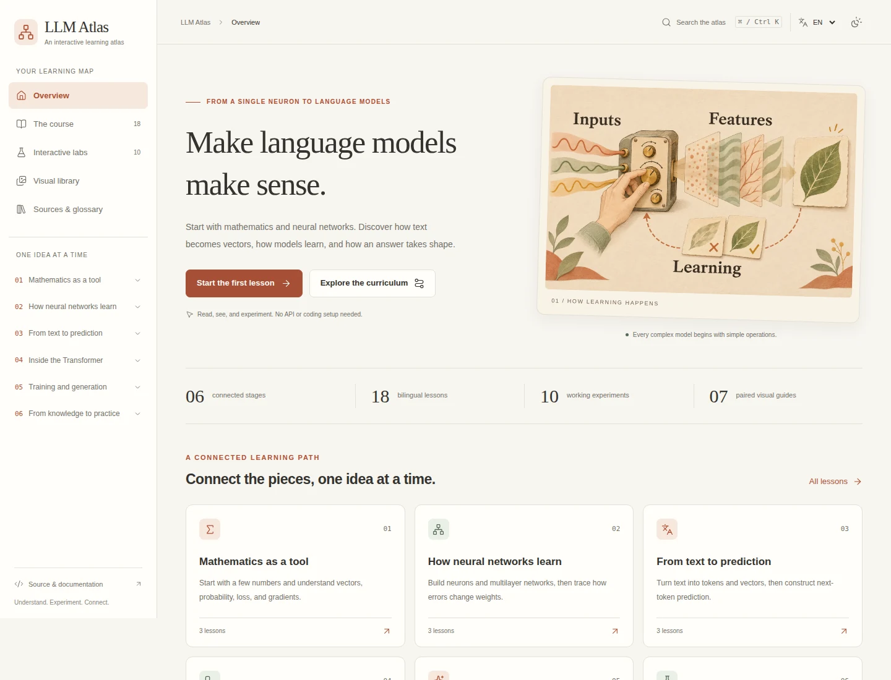

# LLM Atlas · Understand language models from first principles

[中文 README](README.md) · [Course design](docs/design.md) · [Illustration provenance and prompts](docs/illustrations.md) · [Verification record](docs/verification.md)

Begin with vectors, probability, derivatives and a single neuron. Use small numerical examples, original concept illustrations and live calculations to understand text representations, Transformer, training, autoregressive generation and applications. Chinese and English include complete lessons, figure notes, exercise feedback, glossary definitions and experiment instructions.

**6 stages · 18 bilingual lessons · 10 calculated experiments · 7 paired visual guides (14 images) · 30 glossary terms · 20 primary sources**



## Run locally

Use **Node.js 22.12 or newer** and npm. From the repository root:

```bash
cd src/llm
npm ci
npm run dev
```

Open the URL printed by Vite, normally `http://127.0.0.1:5173/`. If the port is occupied, use the actual printed URL. With [just](https://just.systems/) installed, `just dev` prepares locked dependencies and starts the site. The Windows recipe uses `cmd.exe` and does not require Bash.

The site needs no API key, model account, GPU, database or backend. Initial dependency installation requires a network connection; production assets, fonts, illustrations, formulas and calculations are served locally by the site. Primary-source links point to external websites.

## Choose a starting point

| Background | Entry | Preparation |
|---|---|---|
| New to mathematics or neural networks | Lesson 01 | Begin with vectors, probability, gradients and a neuron |
| Familiar with neural networks | Lesson 07 | Review matrix multiplication, cross-entropy and backpropagation first |
| Familiar with Transformer and generation | Lesson 16 | Compare LoRA, RAG, evidence constraints and evaluation |

Each lesson follows a problem and objectives, progressive explanations, an adjacent illustration, a worked example, a live experiment, misconceptions and limits, a self-check, and primary reading. Predict a result, change one parameter, then explain the difference.

| Stage | Lessons | Main questions |
|---|---|---|
| Mathematics | 01–03 | How do numbers represent information? How do scores become probabilities? How do weights change? |
| Neural networks | 04–06 | Why nonlinearities? How does error propagate? Why can a well-trained model still fail? |
| Text representations | 07–09 | What are tokens and embeddings? How are training labels constructed? |
| Transformer | 10–12 | How does QKV work? What is a block? How are position and variable length handled? |
| Training and inference | 13–15 | How do pretraining and alignment differ? How is text generated? What does a cache store? |
| Applications | 16–18 | When should LoRA or RAG be used? How can an industrial-document assistant be evaluated? |

Reading times are estimates; working through derivations and experiments takes additional time. The site stores no learning progress, reading history, notes or bookmarks.

## Pages and experiments

| Route | Purpose |
|---|---|
| `#/` | Overview, six-stage map and entry points |
| `#/course` | Searchable expandable curriculum |
| `#/chapter/01` and other IDs | Text, formulas, figures, inline labs, self-checks and lesson navigation |
| `#/labs` | Searchable experiments with category filters |
| `#/lab/attention` and other IDs | A full-page experiment |
| `#/figures` | Thumbnail gallery, filters, search, enlarged view and localized image downloads |
| `#/resources` | Searchable primary sources and glossary |

Open global search using `Ctrl+K` or `⌘K`. It indexes bilingual titles, lesson content, experiments and terms. The sidebar preserves expansion and scroll state, with the current lesson highlighted. Mobile navigation includes a drawer, keyboard focus management and a skip link.

| Experiment | What it computes |
|---|---|
| Vectors and matrices | Two-dimensional vectors, dot products and matrix multiplication |
| A neuron | Weights, bias and ReLU/sigmoid/linear activation |
| Gradient descent | Real updates on a quadratic loss, with step/play/reset and overshoot |
| Softmax | Logits, temperature, probabilities, entropy and cross-entropy |
| Teaching BPE | Fixed merge rules, stepwise tokenization, preserved spaces and reconstruction |
| Causal attention | QK scores, softmax, masks, a heatmap and the weighted V result |
| Token generation | Seeded bigram sampling, temperature, top-p, EOS and playback |
| KV cache | Memory from layers, batch, length, KV heads and element precision |
| LoRA | Exact dense and low-rank adapter parameter counts for one layer |
| Document retrieval | Lexical ranking over fictional local documents and assembly of cited evidence |

Only language, appearance and text size are stored in `llm-atlas-preferences-v1`. Light, dark and system appearance are available. Animations respect reduced-motion preferences.

## Illustrations and accuracy

Seven concepts each have independent Chinese and English images generated with the built-in image-generation tool. The warm paper, terracotta, graphite and muted sage illustrations are stored as `public/images/<figure-id>-<locale>.webp`, each 1536 × 1024.

Images communicate intuition. The text and code define exact formulas, tensor shapes, probabilities, heatmaps and calculation plots. Generated illustrations are not exact network diagrams or measured experimental results. See [illustrations.md](docs/illustrations.md) for all prompts and limitations.

The course explicitly distinguishes sequence length from feature width, variable length from unlimited context, parallel training losses from sequential generation, token IDs from embeddings and contextual states, causal masks before softmax, original encoder–decoder Transformer from the decoder-only teaching model, KV cache from weights or external knowledge, SFT from PPO/RLHF and DPO, LoRA parameter savings from total memory savings, and retrieval relevance from factual correctness.

Sources include D2L, original Transformer/RoPE/LoRA/RAG/DPO papers, and official PyTorch and Hugging Face documentation. Each lesson links to specific sources. The course avoids volatile model pricing and leaderboard claims.

## Check, build and export

```bash
npm test                 # Numerical behavior, content, sources, images and formulas
npm run export:book      # Re-export the complete Chinese and English books
npm run typecheck        # Strict TypeScript checks
npm run build            # Typecheck and produce the static site
npm run preview          # Preview the dist production build
```

`npm run check` exports the books, runs tests and builds. Complete Markdown books are written to `public/downloads/llm-atlas-zh.md` and `llm-atlas-en.md`, including lessons, worked examples, figure explanations, self-check answers, glossary and bibliography. Image references point to the sibling `images` directory. Downloading Markdown alone does not also download the illustrations; preserve the static-site directory structure to display them.

For browser checks, install the test browser once:

```bash
npx playwright install chromium
npm run build
npm run test:e2e
```

The suite checks bilingual routes, images, formulas, interactions and overflow at desktop and mobile sizes. The root `.github/workflows/llm-atlas.yml` workflow retains screenshots and failure traces. The [first real-browser acceptance run](https://github.com/bahayonghang/learning-docs-web/actions/runs/43799536971) passed 21 tests and skipped one mobile-only test in the desktop project; that test passed in the mobile project. See [verification.md](docs/verification.md) for screenshots and numerical/content test results.

## Static hosting

The output is `src/llm/dist/`. Relative assets (`base: './'`) and hash routes support either a domain root or a subpath such as `/llm/`. Configure a static host with project root `src/llm`, install command `npm ci`, build command `npm run export:book && npm run build`, and output directory `dist`.

Serve the result over HTTP(S); opening `index.html` directly is not equivalent to serving the site. Creating this source and verification workflow does not automatically enable GitHub Pages or deploy a public website.

## Maintenance

| Path | Responsibility |
|---|---|
| `src/content/` | Canonical bilingual lessons, modules, sources and terms |
| `src/types.ts` | Stable content, experiment and figure IDs with locale pairs |
| `src/main.ts` / `src/style.css` | Pages, routes, navigation, search, reading, quizzes and responsive themes |
| `src/markdown.ts` | Sanitized Markdown and KaTeX |
| `src/figures.ts` / `public/images/` | Figure metadata and localized original illustrations |
| `src/labs/math.ts` | Pure numerical kernels |
| `src/labs/` | Ten DOM/SVG experiments, state and styling |
| `src/preferences.ts` | Optional language, appearance and text-size preferences |
| `src/export.ts` / `scripts/export-book.ts` | Single-lesson and complete-book exports |
| `tests/` | Numerical, content and browser checks |
| `docs/` | Design, image provenance, verification and limitations |

Keep both languages, captions, self-check feedback and relevant numerical checks in sync. A new locale needs complete content and appropriate in-image labels, not just a selector option.

## Teaching-model limits

This site does not train or call a real LLM. Tokenization applies teaching rules, generation uses a hand-authored bigram model, and retrieval uses lexical overlap rather than semantic embeddings. Each experiment documents its omissions. Equipment-document examples are fictional and contain no real production data; they do not produce instructions to be sent directly to DCS/PID systems.
