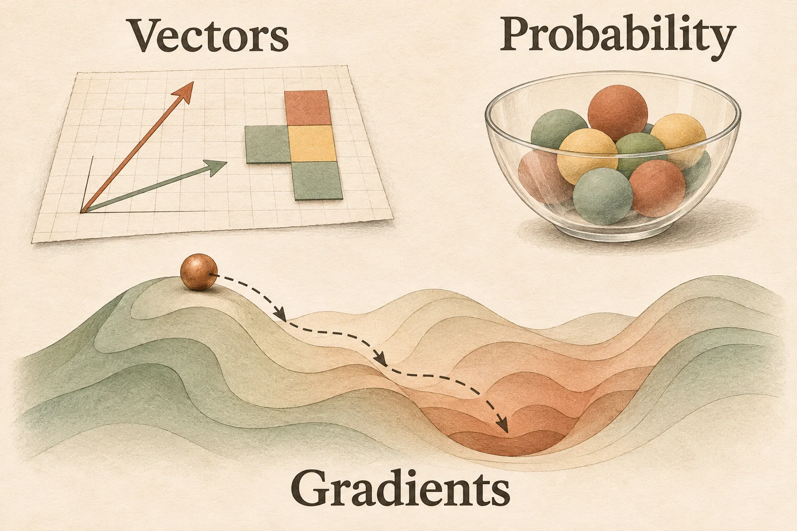
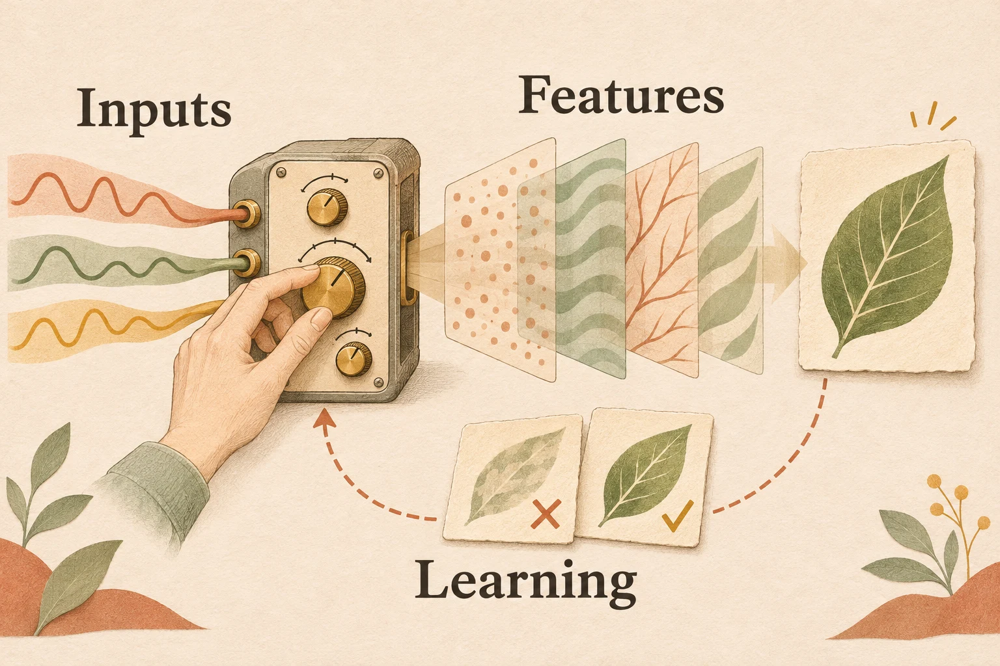
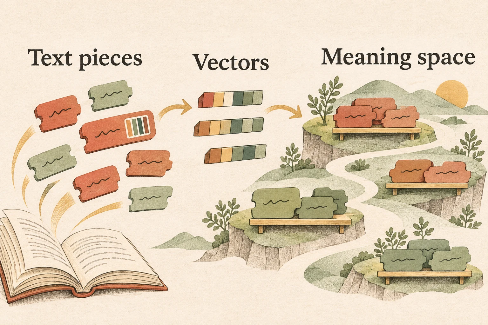
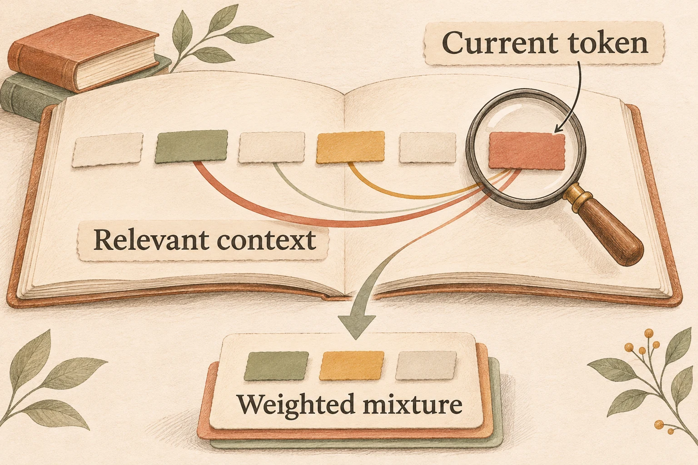
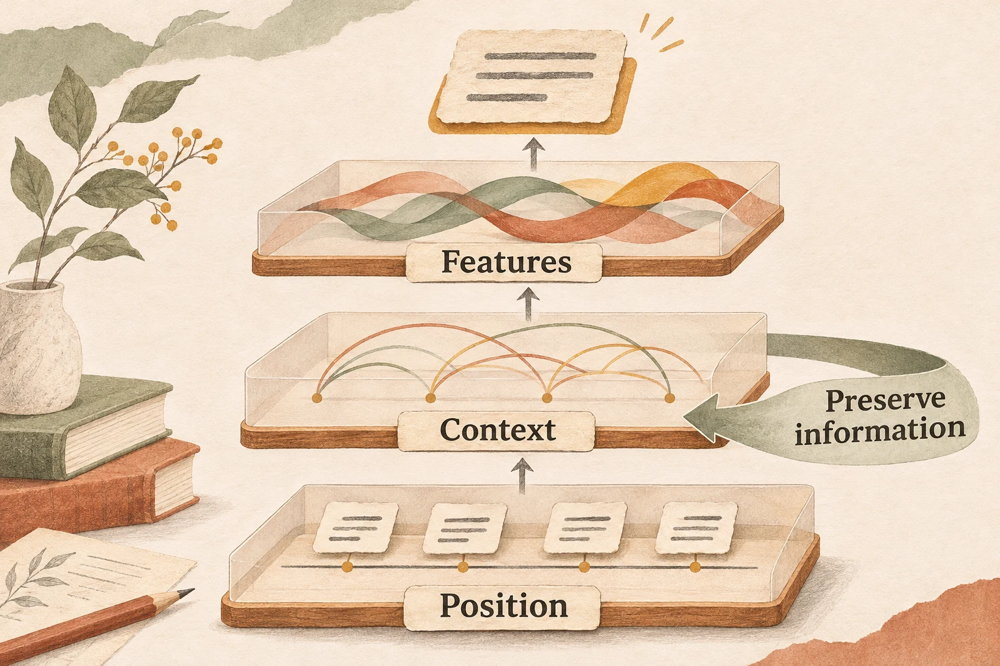
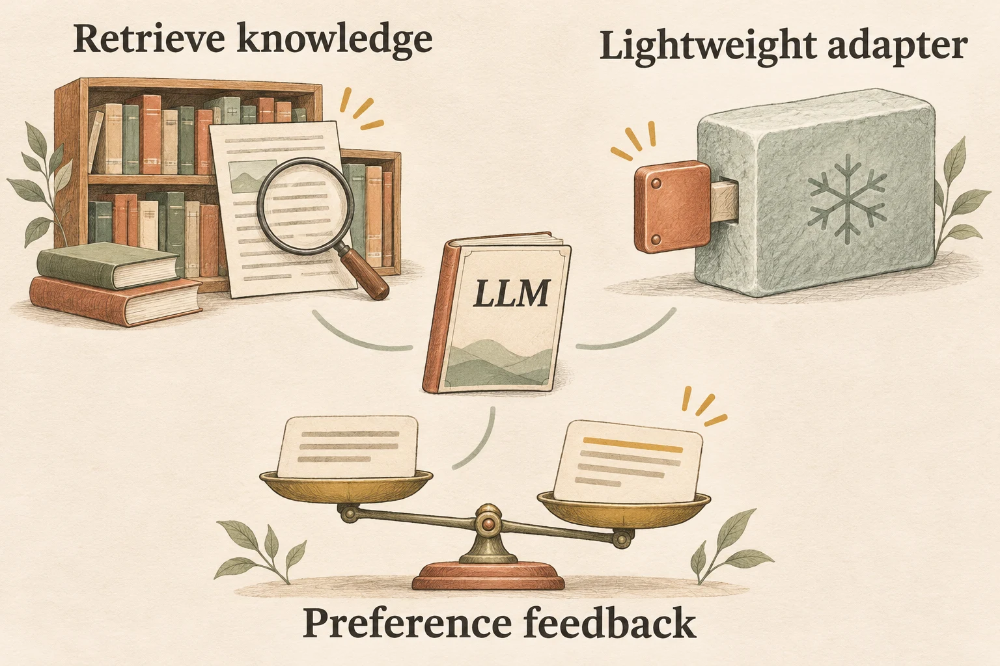
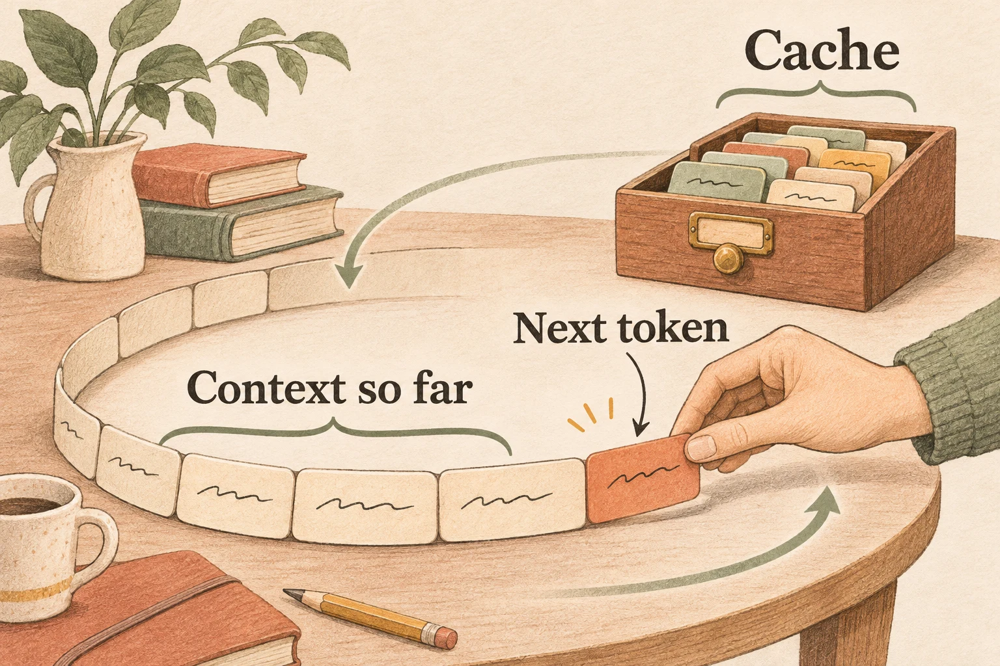

# LLM Atlas · Understand language models from first principles

Start with mathematics and neural networks, then understand Transformer, training, inference, and applications. Exported from the canonical course data, this book includes all text, worked examples, self-check feedback, and primary sources. Run the interactive experiments in the website. Reading times are estimates, not deadlines.

Illustrations communicate concepts. Text and calculated experiments define exact formulas, numbers, and tensor shapes. Images live in the sibling images directory; downloading Markdown alone does not download images, so preserve the site directory structure.

## Contents

### 1. Mathematics as a tool

Start with a few numbers and understand vectors, probability, loss, and gradients.

- 01 Describe information with vectors and matrices
- 02 From scores to probabilities and loss
- 03 Learn one gradient step at a time

### 2. How neural networks learn

Build neurons and multilayer networks, then trace how errors change weights.

- 04 What can one neuron do?
- 05 Multilayer networks and backpropagation
- 06 Fit the data and generalize beyond it

### 3. From text to prediction

Turn text into tokens and vectors, then construct next-token prediction.

- 07 Tokens: the units a model reads
- 08 Embeddings: bring discrete IDs into a network
- 09 Turn language into next-token prediction

### 4. Inside the Transformer

Move from one attention calculation to a complete decoder, following tensors and data flow.

- 10 Attention: match, then aggregate
- 11 The jobs inside a Transformer block
- 12 Positions, variable lengths, and the complete decoder

### 5. Training and generation

Separate pretraining from alignment and observe sampling and KV caching.

- 13 Pretraining, instruction learning, and preferences
- 14 Token-by-token generation: probabilities and randomness
- 15 KV cache: trade memory for repeated computation

### 6. From knowledge to practice

Compare LoRA with RAG and assemble a verifiable industrial-document assistant prototype.

- 16 LoRA: learn a low-rank update
- 17 RAG: find evidence before answering
- 18 Capstone: a verifiable industrial-document assistant

---

# 01 Describe information with vectors and matrices

Shapes before arithmetic: from three sensors to a sentence.

## Objectives

- Distinguish scalars, vectors, matrices, and tensors.
- Calculate a dot product and one matrix product.
- Separate sequence length from feature dimension.

## Give information a shape

A single temperature, $25$, is a scalar. Temperature, pressure, and flow together form a vector, $x=[25,2,8]$. Stacking vectors from different times gives a matrix. Adding axes such as equipment or batch gives a more general tensor. “Dimension” can mean the number of axes or the number of features, so read it in context.

Features often need appropriate scaling before modeling: units and numerical ranges can otherwise dominate a calculation. Our values are chosen for arithmetic, not as a deployable industrial model. In a language model, input vectors usually come from learned embeddings rather than a manually specified list of measurements.

### Arrows, colored balls, and terrain introduce vectors, probability, and gradients; begin with the vector intuition at upper left.

- Upper-left arrows use direction and length to suggest relationships among vector entries.
- The grid and colored cards suggest organized numbers; exact matrix shapes appear in the example below.
- The balls and terrain preview the next two lessons rather than adding new calculations here.

## Multiplication mixes features

A dot product multiplies matching entries and adds them: $x\cdot w=\sum_i x_iw_i$. It can represent a weighted score and contributes to measures of vector similarity. Matrix multiplication performs many dot products together: one row on the left meets one column on the right to produce an output entry.

Using this course’s row-vector convention, $X\in\mathbb{R}^{T\times d}$ and $W\in\mathbb{R}^{d\times h}$ give $XW\in\mathbb{R}^{T\times h}$. The inner dimensions $d$ must match. Elementwise multiplication only multiplies matching cells; it does not perform this sum-and-mix operation and usually has a different operator in code.

## Why the same network can accept different lengths

Represent each of a sentence’s $T$ tokens with a vector of width $d$, giving a $T\times d$ matrix. The same $W$ processes every row’s features; the fifth and twentieth tokens do not require new weights. Thus $T$ can change while parameter shapes stay fixed. Batches of unequal-length sentences can use padding and masks.

This explains why the shapes permit variation, not why length would be unlimited. Position mechanisms, training range, memory, and implementation constrain usable context. Learning task: imagine a paragraph from the later document assistant as $T$ rows. Identify the objects before and after tokenization and which axes grow with text length.

## Calculate a two-dimensional projection

Let $x=[1,2]$ and $W=\begin{bmatrix}2&-1\\1&3\end{bmatrix}$. The first column gives $1\times2+2\times1=4$; the second gives $1\times(-1)+2\times3=5$. Thus $xW=[4,5]$. Changing the second input from 2 to 3 produces $[5,8]$: one input can affect several output features.

## Common misconception

“A longer sentence needs more model parameters.” Parameters are shared across positions; intermediate representations and computation grow.

## Scope and limits

The small numerical examples teach shapes; they neither run an actual embedding model nor estimate all costs of a real model.

## X has shape 7×4 and W has shape 4×3. What is the shape of XW?

1. 7×3
   ✓ The inner dimension 4 is summed over, leaving 7 rows and 3 columns.

2. 4×4
   × The matching inner dimensions are summed over, not retained as the output shape.

3. 7×4×3
   × Matrix multiplication sums over the inner dimension rather than simply concatenating all axes.

## Primary sources

- [Dive into Deep Learning — Linear Algebra](https://d2l.ai/chapter_preliminaries/linear-algebra.html) — Aston Zhang, Zachary C. Lipton, Mu Li, Alexander J. Smola, 2023
- [Attention Is All You Need](https://arxiv.org/abs/1706.03762) — Ashish Vaswani et al., 2017

---

# 02 From scores to probabilities and loss

Understand softmax and cross-entropy with three candidate tokens.

## Objectives

- Explain conditional probability and logits.
- Calculate softmax and negative log-probability for a correct class.
- Distinguish confidence from factual correctness.

## How likely after this prefix?

The conditional probability $p(\text{token}\mid\text{prefix})$ describes a candidate token given a prefix. Change the prefix and the distribution changes: candidates after “the equipment needs” differ from those after “the weather is.” A full distribution must be nonnegative and sum to one.

The network’s final layer first produces logits: unnormalized real-valued scores. They may be negative and need not sum to one. A higher logit means greater relative preference, but a score of 2 is not a probability of 200%.

### The bowl of colored balls suggests several possible outcomes; actual model probabilities are calculated by softmax below.

- The differently colored balls at upper right can stand for candidate categories.
- Ball counts are not model probabilities; do not count the illustration to infer the lab distribution.
- Carry the intuition of selecting a candidate into the example, then separate scores, probabilities, and loss.

## Softmax makes candidates compete

Softmax exponentiates scores and divides by their total:

$$p_i=\frac{\exp(z_i)}{\sum_j\exp(z_j)}.$$

Each probability depends on every candidate. Raising another candidate’s score can lower the current probability even when its own score is unchanged. Implementations subtract the maximum score first, using $\exp(z_i-\max_jz_j)$, to obtain the same answer with less risk of numerical overflow. We use natural logarithms and exponentials.

## Turn prediction error into an optimizable number

For the correct class $y$, cross-entropy is $L=-\ln p_y$. Assigning more probability to that answer reduces loss. A confidently wrong prediction gives the true answer very little probability and a large loss. This provides a finer signal than a binary correct/incorrect label and supports differentiation.

A probability is a model prediction, not a fact-checking verdict. A confidently generated maintenance interval can still lack documentary support. Learning task: define three candidates for “Before inspection, first ___.” Change their scores and observe whether loss changes even when the correct candidate stays in first place.

## A complete three-score calculation

Scores $[2,1,0]$ have exponentials approximately $[7.389,2.718,1]$, summing to $11.107$. Probabilities are approximately $[0.665241,0.244728,0.090031]$. If the first entry is correct, loss is $-\ln(0.665241)\approx0.407606$; if the third is correct, it is $2.407606$. The same predicted distribution produces different training signals for different targets.

## Common misconception

“A maximum softmax value of 0.9 means the answer is 90% factually correct.” It is a conditional token probability, not a calibrated factual-correctness score.

## Scope and limits

The lab uses a few hand-set candidates and one target; real vocabularies are larger and sequence training aggregates valid-position losses. No language model is loaded here.

## What happens to cross-entropy when the true target’s probability rises from 0.2 to 0.8?

1. It increases because confidence rises
   × Confidence assigned to the true target lowers the loss.

2. It falls from about 1.609 to 0.223
   ✓ Compute −ln(0.2) and −ln(0.8), respectively.

3. It stays fixed because only rank matters
   × Cross-entropy uses probability magnitude, not only the argmax.

## Primary sources

- [Dive into Deep Learning — Probability and Statistics](https://d2l.ai/chapter_preliminaries/probability.html) — Aston Zhang, Zachary C. Lipton, Mu Li, Alexander J. Smola, 2023
- [Dive into Deep Learning — Softmax Regression](https://d2l.ai/chapter_linear-classification/softmax-regression.html) — Aston Zhang, Zachary C. Lipton, Mu Li, Alexander J. Smola, 2023

---

# 03 Learn one gradient step at a time

Read derivatives as local slopes and training as repeated adjustment.

## Objectives

- Interpret derivatives and gradients as slopes.
- Calculate one gradient-descent update.
- Observe the effects of learning rates that are too small or too large.

## Start with the slope of one parameter

Suppose a model has one adjustable parameter $w$ and loss $L(w)=(w-3)^2$. When $w<3$, moving right reduces loss; when $w>3$, moving left reduces it. The derivative $L'(w)=2(w-3)$ quantifies this local trend: its sign gives direction and its magnitude describes the local rate of change.

With many parameters, collect their partial derivatives into the gradient $\nabla_\theta L$. It describes how small parameter changes affect loss at the current point. It is not the location of a future optimum and does not automatically determine how far to move.

### The terrain below compares loss to a landscape; the rolling direction suggests local descent, while the lab calculates exact trajectories.

- The valley suggests lower loss, not mastery of every question.
- Arrows beside the ball suggest local adjustment, not a measured or guaranteed-optimal training trajectory.
- The vector and probability panels remind us to define actual parameters and loss before computing a gradient.

## A gradient still needs an update rule

The simplest gradient-descent rule is:

$$\theta_{\text{new}}=\theta_{\text{old}}-\eta\nabla_\theta L.$$

The minus sign moves toward local decrease, and $\eta$ is the learning rate. Backpropagation computes gradients; optimizers such as SGD or Adam use them to update parameters. These tasks cooperate but are distinct. Large models usually estimate gradients from minibatches, adding variation from data sampling to the step direction.

## Why larger steps need not be faster

Steps that are too small can leave you far from the minimum after many updates. Steps that are too large may overshoot, oscillate, or move farther away. For this particular quadratic, the error follows $w_{t+1}-3=(1-2\eta)(w_t-3)$. This explains convergence for $0<\eta<1$ and typical divergence for $\eta>1$.

A real network’s loss landscape is much more complex than one parabola, so this learning-rate range cannot be transferred directly. Learning task: predict trajectories for rates 0.1, 0.8, and 1.1 before using the experiment. Explain the difference between local information and a global guarantee.

## One update starting at w=0

Initially $w=0$, loss is $9$, and the gradient is $2(0-3)=-6$. With $\eta=0.1$, the update gives $w_{\text{new}}=0-0.1\times(-6)=0.6$, and the new loss is $(0.6-3)^2=5.76$. Because the gradient is negative, subtracting it increases the parameter; descent does not mean always decreasing parameter values.

## Common misconception

“Gradient descent makes every weight smaller.” It seeks lower objective loss; individual weights may increase or decrease.

## Scope and limits

The animation uses a deterministic one-dimensional quadratic, omitting stochastic minibatches, momentum, Adam, schedules, and nonconvex guarantees.

## With gradient −4 and learning rate 0.1, how does the parameter change?

1. Decrease by 0.4
   × The update subtracts the gradient; subtracting a negative increases the parameter.

2. Remain unchanged
   × A nonzero gradient and learning rate produce an update.

3. Increase by 0.4
   ✓ The change is −0.1×(−4)=+0.4.

## Primary sources

- [Dive into Deep Learning — Forward Propagation, Backward Propagation, and Computational Graphs](https://d2l.ai/chapter_multilayer-perceptrons/backprop.html) — Aston Zhang, Zachary C. Lipton, Mu Li, Alexander J. Smola, 2023
- [Automatic Differentiation with torch.autograd](https://docs.pytorch.org/tutorials/beginner/basics/autogradqs_tutorial) — PyTorch contributors, 2024

---

# 04 What can one neuron do?

Weighted sums, bias, and nonlinearity: three small building blocks.

## Objectives

- Separate inputs, weights, bias, and outputs.
- Explain why nonlinear activations matter.
- Compare the numerical behavior of ReLU and sigmoid.

## First calculate a score

An artificial neuron can be written as $z=\sum_iw_ix_i+b$, followed by $a=\phi(z)$. Inputs $x_i$ come from data or a previous layer; weights $w_i$ determine their contributions; bias $b$ adds an offset independent of the current input; activation $\phi$ turns the score into an output.

For a teaching example about inspection priority, imagine two standardized features representing vibration and temperature rise. Their weights determine contributions to a score. These values are not maintenance rules. Training adjusts the weights from examples instead of requiring us to hand-code every possible situation.

### The signal workshop turns inputs into features and outputs; adjustable knobs stand for weights and bias, with exact neuron equations below.

- Colored input lines suggest that a computational unit can receive several features.
- The knobs stand for adjustable parameters, not an exact number of positive-only real weights.
- Transparent panels and the leaf suggest feature processing and prediction, not an exact neuron wiring diagram.

## Why stacking linear layers is not enough

If every layer is only an affine transformation, two successive layers can be collapsed: $(xW_1+b_1)W_2+b_2=x(W_1W_2)+(b_1W_2+b_2)$. Adding layers alone does not escape this linear family of relationships.

Nonlinearities between layers enable curved, piecewise, or more complicated relationships. ReLU is $\max(0,z)$: it clips negative values to zero and preserves positive values. Sigmoid, $1/(1+e^{-z})$, maps inputs between zero and one. These are computational functions; biological-neuron analogies are only a starting intuition.

## Interpret an output through its task

A sigmoid output lies between zero and one, but its interpretation as a class probability depends on the binary objective and training setup. Hidden activations are usually intermediate features: a value of 0.8 does not mean “this neuron is 80% confident.” Multiclass outputs also require understanding normalization across classes.

Learning task: hold inputs fixed, vary weights and bias separately, and predict changes in $z$. Then switch the activation. Compare changing the scoring rule with changing the output transformation. When you later meet a Transformer FFN, these ideas remain, although its scale and activation functions may differ.

## Weight first, activate second

With $x=[0.8,0.2]$, $w=[1.5,-1]$, and $b=-0.3$, the score is $z=0.8\times1.5+0.2\times(-1)-0.3=0.7$. ReLU returns $0.7$; sigmoid returns approximately $0.668188$. Both come from the same score, but their task meaning depends on the model’s overall objective.

## Common misconception

“More neurons and deeper linear layers automatically create nonlinearity.” Without intervening nonlinearities, affine layers still collapse into one affine map.

## Scope and limits

The experiment demonstrates one slider-adjusted neuron without data-driven parameter training; its example inputs do not form a validated equipment-risk predictor.

## Why insert ReLU between two linear layers?

1. To guarantee correct probabilities
   × ReLU neither normalizes probabilities nor guarantees correctness.

2. To introduce nonlinearity that a single linear layer cannot replace
   ✓ Without the nonlinearity, two affine transformations can be combined.

3. To make all weights positive
   × ReLU acts on activations; it does not constrain weight signs.

## Primary sources

- [Dive into Deep Learning — Multilayer Perceptrons](https://d2l.ai/chapter_multilayer-perceptrons/mlp.html) — Aston Zhang, Zachary C. Lipton, Mu Li, Alexander J. Smola, 2023
- [Dive into Deep Learning — Linear Algebra](https://d2l.ai/chapter_preliminaries/linear-algebra.html) — Aston Zhang, Zachary C. Lipton, Mu Li, Alexander J. Smola, 2023

---

# 05 Multilayer networks and backpropagation

Break a prediction into a computational graph and send its error signal backward.

## Objectives

- Trace intermediate variables in a forward pass.
- Use the chain rule to compute an early-layer gradient.
- Distinguish backpropagation, gradient accumulation, and optimizer updates.

## Hidden layers compose simple computations

A multilayer network maps inputs to hidden representations and processes them further. Consider a scalar example: $z_1=w_1x+b_1$, $h=\operatorname{ReLU}(z_1)$ and $\hat y=w_2h+b_2$. The hidden value $h$ is intermediate; the final prediction $\hat y$ is compared with target $y$. Forward propagation evaluates these operations in dependency order.

A computational graph makes operations and dependencies explicit. Training retains required intermediate values because derivatives need them: the ReLU derivative depends on whether its forward input was positive or negative. Training memory therefore contains not just weights but also activations and other training state.

### Workshop panels suggest forward feature processing; the learning loop back to the knobs suggests error-based parameter adjustment.

- Follow inputs through transparent panels to the leaf for an intuition of staged processing.
- The upper loop suggests adjusting knobs from outcomes; it does not display computed derivatives.
- Actual backpropagation uses the chain rule; inspect the example below for specific products and values.

## The chain rule relays influence

If loss $L$ depends on prediction $\hat y$, which depends on hidden value $h$, then $\partial L/\partial h=(\partial L/\partial\hat y)(\partial\hat y/\partial h)$. This connects how changing $h$ changes the prediction with how changing the prediction changes the loss.

For a first-layer parameter, continue with local derivatives:

$$\frac{\partial L}{\partial w_1}=\frac{\partial L}{\partial\hat y}\frac{\partial\hat y}{\partial h}\frac{\partial h}{\partial z_1}\frac{\partial z_1}{\partial w_1}.$$

Backpropagation reuses shared intermediate results rather than deriving every parameter’s gradient from scratch. Contributions from branches are added. Matrix networks follow the same logic with matrix products, transposes, and elementwise products.

## What happens in one training iteration?

A basic iteration prepares data, runs a forward pass, computes loss, clears or manages old gradients, backpropagates, and lets the optimizer update parameters. Automatic differentiation handles derivatives, but targets and masks must still be correct. Misaligned labels can make a program run successfully while learning the wrong task.

Gradient accumulation combines contributions from several small batches before an update. Therefore calling backward does not itself mean the weights changed. Learning task: explain the influence path from $w_1$ to loss in the example below, then examine an optimizer step in the gradient lab. Transformers use the same basic training logic on a much larger graph.

## Calculate a first-layer gradient

Take $x=2,w_1=0.5,b_1=0,w_2=3,b_2=0,y=4$, with $L=\frac12(\hat y-y)^2$. Forward: $z_1=1,h=1,\hat y=3,L=0.5$. Backward: $\partial L/\partial\hat y=-1$, so $\partial L/\partial w_2=-1\times h=-1$. The first-layer gradient is $(-1)\times3\times1\times2=-6$. At learning rate 0.01, both weights update simultaneously to $w_1=0.56,w_2=3.01$; trainable biases would receive their own updates too.

## Common misconception

“Backpropagation runs the correct answer backward through the network.” It propagates derivatives of loss, not the target as a reverse input.

## Scope and limits

The scalar network omits batches, matrix Jacobians, regularization, precision issues, and implementation conventions for ReLU at zero.

## After gradients have been computed, what changes the parameters?

1. The optimizer’s update rule
   ✓ Backpropagation produces gradients; the optimizer uses them to update parameters.

2. The labels directly overwrite weights
   × Labels contribute to the loss; they do not become weights directly.

3. Reading the loss automatically changes weights
   × Evaluating a loss is not the same as performing an optimizer update.

## Primary sources

- [Dive into Deep Learning — Forward Propagation, Backward Propagation, and Computational Graphs](https://d2l.ai/chapter_multilayer-perceptrons/backprop.html) — Aston Zhang, Zachary C. Lipton, Mu Li, Alexander J. Smola, 2023
- [Automatic Differentiation with torch.autograd](https://docs.pytorch.org/tutorials/beginner/basics/autogradqs_tutorial) — PyTorch contributors, 2024

---

# 06 Fit the data and generalize beyond it

Training, validation, and test sets answer different questions.

## Objectives

- Distinguish training, validation, and final testing.
- Recognize overfitting and data leakage.
- Design representative held-out questions for an industrial-document assistant.

## Three datasets, three roles

Training data contributes to gradients. Validation data helps select hyperparameters, checkpoints, and designs. Test data provides a final assessment after those choices. Although validation data does not directly update weights, repeated selection adapts the system to it; the test set should not become an unlimited feedback channel.

For operating-procedure QA, randomly splitting near-duplicate paragraphs can share answer wording across training and testing and produce optimistic results. Splits by document, equipment type, time, or question family can help, but the split should match deployment rather than follow a fixed ratio mechanically.

### The workshop adjusts its knobs from examples, but handling new inputs requires independent assessment.

- The book suggests learning examples rather than every possible situation.
- Transparent panels suggest learned features, which may over-adapt to familiar examples.
- The output stands for one prediction; the picture provides no measured generalization result.

## Why validation error can rise as training error falls

Underfitting means the model or training process has not learned the relevant relationships. Overfitting means it increasingly adapts to training-specific details without improving on new data. Falling training loss does not guarantee improving generalization. More parameters can increase fitting capacity, but outcomes also depend on data quality, training, and distribution.

Better data, regularization, suitable capacity, early stopping, and appropriate budgets can help, but none is a guarantee. Ask whether evaluation questions represent future use. Old and new versions of a maintenance procedure may differ: outdated knowledge causes failures that are not simply classical overfitting.

## Prepare the final test now

Create a small question set for the later assistant: direct evidence questions, questions requiring comparison, questions absent from the documents, and questions with version conflicts. Record expected evidence and behavior for each. This turns “the answer sounds fluent” into checkable requirements.

Learning task: write eight questions, including at least two that should receive an insufficient-evidence response. Use only some for development and reserve the rest for the final check. These counts are teaching choices, not a sample size sufficient to prove production reliability.

## Which checkpoint should you choose?

Suppose training losses at epochs 10, 20, and 30 are 0.50, 0.30, and 0.20, while losses on the same validation set are 0.55, 0.40, and 0.48. If the selection rule is lowest validation loss, choose epoch 20, not epoch 30 with its lowest training loss. Then assess the selected checkpoint on the reserved test set. These are illustrative values, not measured learning curves.

## Common misconception

“No backpropagation on the test set means no leakage.” Repeated design changes based on test results, near-duplicates across splits, and test-informed preprocessing can also leak information.

## Scope and limits

This lesson teaches evaluation design; its companion gradient lab illustrates optimization and does not simulate real train/validation generalization.

## Which approach gives a more credible final evaluation?

1. Keep changing the system until all test questions pass
   × This turns the test set into development data and removes its independence.

2. Report only training loss
   × Training loss does not reveal performance on unseen data.

3. Freeze the design, use an independent holdout, and report failure types
   ✓ Independence and interpretable error analysis both help assess actual capability.

## Primary sources

- [Dive into Deep Learning — Generalization in Deep Learning](https://d2l.ai/chapter_multilayer-perceptrons/generalization-deep.html) — Aston Zhang, Zachary C. Lipton, Mu Li, Alexander J. Smola, 2023
- [Transformers — Perplexity of fixed-length models](https://huggingface.co/docs/transformers/perplexity) — Hugging Face contributors, Online

---

# 07 Tokens: the units a model reads

How do spaces, Chinese characters, punctuation, and code become integers?

## Objectives

- Distinguish characters, words, tokens, and token IDs.
- Separate learning BPE merges from applying them.
- Explain why spaces and special tokens cannot be discarded arbitrarily.

## From a raw string to integer IDs

A neural network cannot directly multiply the written word “inspection” by a matrix. A tokenizer first maps text into discrete vocabulary units and then integer IDs. A token can be a word, subword, byte sequence, or special symbol, so token count is neither character count nor simply the number of space-separated words.

Chinese, English, numbers, and code are segmented according to the vocabulary and algorithm. Different tokenizers can segment the same text differently. Byte-level methods begin from bytes and can cover arbitrary characters, but one Unicode character may span multiple tokens. A teaching segmentation must not be presented as a commercial model’s actual output without running that tokenizer.

### Text is split into pieces before entering vector representations; the two stages have different roles.

- Cards emerging from the book suggest tokens, not necessarily whole words or single Chinese characters.
- Central colored bars suggest vectors; IDs and lookup are explained in the text, not shown as real IDs.
- The islands are a metaphor for semantic relationships, not measured model coordinates.

## BPE learns reusable merge rules

Teaching BPE starts with small symbols, counts adjacent pairs in a corpus, merges the most frequent pair into a new symbol, and repeats. Training saves the vocabulary and ordered merge rules. New text is encoded with these fixed rules; the tokenizer is not retrained for every message.

Real pipelines can include normalization, pre-tokenization, byte handling, and special-token rules. Implementations differ in their treatment of spaces and word boundaries. The lab explicitly uses simplified rules to explain merging, not to estimate real API bills or context allowances.

## Whitespace and role markers carry information

“Not able” and “notable” are different strings, and indentation or newlines can matter in code. A tokenizer may attach a space to the following piece, encode it separately, or use another convention. What matters is consistency with training. Deleting whitespace can change content rather than merely reduce token count.

Chat models also commonly use templates for users, assistants, message boundaries, and ending markers. These belong to a training protocol; the model does not inherently understand interface labels. Learning task: preserve document titles, versions, paragraph boundaries, and units for the assistant, then check whether text cleaning retained the same meaning.

## Merge rules do not guess meanings

Suppose a teaching corpus contains “low” three times and “lower” twice, initially split into characters. Both “l,o” and “o,w” occur five times; define a tie-break that selects “l,o” first, forming “lo.” Next merge “lo,w” into “low.” With only these two rules, “lower” encodes as [low, e, r]. The tie-break is explicit; this is not a claim that every BPE implementation produces the same result.

## Common misconception

“A token is always one word or one Chinese character.” The specific tokenizer defines units, and language and surrounding text can affect segmentation.

## Scope and limits

The lab uses an interpretable small vocabulary and teaching merges; it loads no production tokenizer and guarantees no real-model token counts.

## After tokenizer training, what normally happens for a new message?

1. Retrain the entire vocabulary
   × Encoding normally reuses fixed vocabulary and rules to stay aligned with model embeddings.

2. Turn each word’s meaning directly into probabilities
   × A tokenizer produces discrete units or IDs, not the language model’s next-token distribution.

3. Apply the learned encoding rules
   ✓ The model uses the vocabulary and encoding conventions paired with its training.

## Primary sources

- [Hugging Face LLM Course — Byte-Pair Encoding tokenization](https://huggingface.co/learn/llm-course/en/chapter6/5) — Hugging Face course authors, Online

---

# 08 Embeddings: bring discrete IDs into a network

From lookup vectors to contextual representations.

## Objectives

- Explain embedding lookup and its vocabulary matrix.
- Separate initial vectors from contextual hidden representations.
- Understand the limits of vector distances and two-dimensional plots.

## Each vocabulary row is a set of parameters

Let vocabulary size be $V$ and vector width be $d$. The embedding matrix is $E\in\mathbb{R}^{V\times d}$. Token ID $i$ selects row $i$. Neighboring IDs 2 and 3 need not be semantically close: integers address rows, while continuous vectors participate in later computation.

During training, loss gradients adjust these vectors to support prediction. We usually do not prescribe dimension one as “danger” or dimension two as “grammar.” A concept can be distributed across many dimensions and parameters. This is more flexible than a hand-labeled table but harder to interpret dimension by dimension.

### Bars beside cards illustrate a set of values for each token; semantic islands are only a metaphor for relatedness.

- Colored bars beside central cards suggest continuous values returned by lookup.
- Cards grouped on islands are not an exact projection of high-dimensional space.
- Later contextual processing is not drawn; the attention lessons explain how the same initial vector can change.

## The lookup vector is not the final meaning

The same token usually selects the same input row, but subsequent attention reads its surroundings and changes its hidden representation. “Bank” can start with the same vector in river and finance sentences yet evolve differently. Ambiguity and cross-token relationships occur in Chinese too; an isolated lookup vector cannot resolve them all.

Distinguish input token embeddings, multilayer contextual hidden states, and text vectors specifically trained or pooled for retrieval. An arbitrary hidden state is not automatically a high-quality retrieval embedding. The representation must suit its training objective and intended use.

## Similarity is a tool, not semantic truth

Cosine similarity is $\cos(x,y)=x\cdot y/(\|x\|\|y\|)$ for nonzero vectors and compares directions. It is often useful for retrieval ranking, but nearby vectors do not establish that a document applies to the current equipment. Versions, applicability, and units still need checking.

Plots often project high-dimensional vectors into two dimensions, losing information. Nearby points on the plot do not prove equivalent proximity in the original space. Learning task: distinguish semantic similarity from applicable evidence, then list metadata such as equipment model, document version, and paragraph ID to retain in the assistant.

## One lookup and one similarity calculation

Take a teaching table $E=\begin{bmatrix}1&0&0\\0&1&0\\1&1&0\end{bmatrix}$ and input IDs $[2,0]$. Lookup returns $\begin{bmatrix}1&1&0\\1&0&0\end{bmatrix}$ with shape $2\times3$. The rows have dot product 1 and norms $\sqrt2$ and 1, giving cosine similarity approximately $0.707107$. These hand-set vectors do not represent measured word meanings.

## Common misconception

“Every vector dimension corresponds to a named human meaning.” Learned features are usually distributed and cannot be read dimension by dimension that way.

## Scope and limits

The figure and experiment use small hand-set vectors and visual metaphors, not measured semantic spaces; no corpus-trained embedding or retrieval model runs here.

## Must the same token have the same final hidden representation in two different sentences?

1. No; later layers incorporate context
   ✓ The lookup vector may be identical while contextual representations differ.

2. Yes, because the ID is the same
   × The ID determines the lookup, not every later layer’s output.

3. Yes whenever token lengths match
   × Text length does not determine hidden-state content.

## Primary sources

- [Efficient Estimation of Word Representations in Vector Space](https://arxiv.org/abs/1301.3781) — Tomas Mikolov, Kai Chen, Greg Corrado, Jeffrey Dean, 2013
- [Attention Is All You Need](https://arxiv.org/abs/1706.03762) — Ashish Vaswani et al., 2017
- [Dive into Deep Learning — Linear Algebra](https://d2l.ai/chapter_preliminaries/linear-algebra.html) — Aston Zhang, Zachary C. Lipton, Mu Li, Alexander J. Smola, 2023

---

# 09 Turn language into next-token prediction

Training scores many positions together; generation waits for the next unknown token.

## Objectives

- Construct inputs and shifted targets.
- Understand autoregressive factorization and mean loss.
- Precisely distinguish parallel training from sequential generation.

## Factor a sentence into small predictions

An autoregressive language model uses the chain rule:

$$p(x_1,\ldots,x_T)=\prod_{t=1}^{T}p(x_t\mid x_{<t}).$$

Each factor uses only the preceding prefix. Taking the negative logarithm converts the product into additive token losses. Training typically averages over valid target positions, excluding padding and other positions masked by the objective. This is causal language modeling, distinct from BERT-style masked prediction.

### Text pieces and vectors prepare the prediction task; shifted labels are developed separately in the lesson.

- The source book suggests that supervision can come from existing text.
- Arrange cards in their original order to define prefixes and next tokens.
- The bars are not probabilities, and shifted targets are not drawn; use the four-position example below.

## During training, the answers are already in the text

Imagine teaching tokens “equipment / needs / inspection / end.” Inputs can be “start / equipment / needs / inspection,” with targets “equipment / needs / inspection / end.” One forward pass produces vocabulary distributions for all positions, usually shaped $B\times T\times V$. A causal mask prevents positions from reading future targets while allowing those computations together.

This is often called teacher forcing: prefixes use preceding tokens from the real text rather than earlier sampled outputs. Parallelism does not remove order; causal restrictions remain. Some frameworks shift labels internally, so check their convention to avoid shifting twice.

## During generation, the last distribution extends the text

At inference, provide a prefix of length $T$ and use the last position’s distribution to select $x_{T+1}$. Append that token and continue. The architecture is not inherently “$T$ input vectors but only one output vector”; the generation procedure needs the final position’s distribution at that step.

Prediction can encourage learning grammar, factual associations, and patterns, but does not guarantee factual or reasoning reliability. Learning task: write the shifted inputs and targets for a short document sentence, then identify exactly which position generation uses first. Lesson 15 explains how to avoid recomputing the whole prefix at every step.

## Four positions form one training objective

Suppose the probabilities of four true targets are $[0.5,0.25,0.8,0.5]$. Their sequence probability is $0.5\times0.25\times0.8\times0.5=0.05$, and mean negative log-likelihood is $-\ln(0.05)/4\approx0.748933$. Training can obtain all four probabilities in one causally masked pass; free generation still waits for the first new token before knowing the next prefix.

## Common misconception

“Generating one token at a time means training can only score one token at a time.” Known target sequences and causal masks allow parallel loss computation across positions.

## Scope and limits

The lab uses explicitly labeled teaching probabilities and loads no real LLM; this lesson omits multi-token prediction, speculative decoding, and non-autoregressive variants.

## How can training predict several positions together without seeing the future?

1. Let every position read all targets directly
   × This leaks future information and breaks the causal prediction objective.

2. Use shifted targets and a causal mask
   ✓ Each target is the next token, and attention reads only the permitted prefix.

3. Use no loss during training
   × A loss measures prediction–target mismatch so gradients can be computed.

## Primary sources

- [Attention Is All You Need](https://arxiv.org/abs/1706.03762) — Ashish Vaswani et al., 2017
- [Language Models are Few-Shot Learners](https://arxiv.org/abs/2005.14165) — Tom B. Brown et al., 2020
- [Transformers — Perplexity of fixed-length models](https://huggingface.co/docs/transformers/perplexity) — Hugging Face contributors, Online

---

# 10 Attention: match, then aggregate

Calculate Q, K, and V and see why causal masking belongs before softmax.

## Objectives

- Explain the distinct roles of Q, K, and V.
- Calculate scaled dot products, softmax, and weighted aggregation.
- Apply causal masking correctly and distinguish weights from complete explanations.

## Three projections answer different questions

Given token representations $X\in\mathbb{R}^{T\times d}$, one attention head forms $Q=XW_Q$, $K=XW_K$, and $V=XW_V$. Queries suggest “what information is needed,” keys provide matching features, and values contain information to aggregate. These are learned projections, not hand-written database fields; the analogy is only a guide.

Each token supplies a query, key, and value because it both reads others and can be read by others. In self-attention all three come from one sequence; cross-attention can take queries from one representation and keys/values from another. We focus next on causal decoder self-attention.

### A magnifying glass and differently weighted links suggest how the current word uses context; the lab gives exact QKV calculations.

- The magnifying glass focuses on the current word, suggesting its query needs.
- Different link widths and the summary card suggest weighted information mixing.
- The image contains neither a full causal mask nor measured attention values; set accessible positions in the lab.

## From matching scores to weighted content

A query $q_i$ takes a dot product with every key $k_j$ to form matching scores. Dividing by $\sqrt{d_k}$ controls the score scale as dimension grows, followed by softmax over candidate positions:

$$A=\operatorname{softmax}\left(\frac{QK^\top}{\sqrt{d_k}}+M\right),\qquad O=AV.$$

Accessible weights in each row of A sum to one, and the output is a weighted sum of those positions’ values. Attention is not a hard choice of one word: several positions can contribute. A $T\times T$ matrix represents relationships between all query and key positions at once.

## Masking excludes future information

In causal attention, position $i$ may read only positions $j\le i$. Set $M_{ij}=0$ for permitted entries and $-\infty$ for forbidden ones. After softmax, forbidden weights are zero. Simply multiplying future scores by zero is wrong: $e^0=1$ still gives them probability.

A padding mask marks invalid inputs; a causal mask marks positions that cannot be read in time order. Their purposes differ. The teaching lab can compare masked and unmasked behavior, but removing the causal mask is not a legitimate performance improvement on the same causal language-modeling task.

## Weights do not reveal the whole computation

An attention heatmap shows mixing weights in a particular layer and head, but the output also depends on values, residual paths, feed-forward layers, and later processing. A dark connection is not proof of a sole cause of an answer, and hand-set heatmaps are not real-model measurements.

Learning task: fix K and V and change Q to observe new weights. Then hold Q/K fixed and change V to observe a new output. This separates where information is retrieved from what is returned. Document retrieval and attention may both use similarity, but operate on different data, at different places, with different objectives.

## Three positions, one complete attention calculation

Let $q=[1,0]$, $K=[[1,0],[0,1],[1,1]]$, $V=[[1,0],[0,2],[1,1]]$, and $d_k=2$, with all three positions visible. Scores are $[0.707107,0,0.707107]$ and weights approximately $[0.401112,0.197776,0.401112]$. The output is $0.401112[1,0]+0.197776[0,2]+0.401112[1,1]\approx[0.802224,0.796664]$. This fits a final position able to see all three; an earlier query must mask future entries.

## Common misconception

“The highest-weight token is the answer’s source and nothing else contributes.” Outputs mix multiple value vectors and undergo further transformations.

## Scope and limits

The adjustable small matrices are not corpus-trained; this shows one head and does not claim that attention visualization provides reliable causal explanations.

## How should a future position receive zero attention weight after softmax?

1. Multiply its score by zero
   × A zero score still exponentiates to e⁰=1.

2. Set its score to negative infinity before softmax
   ✓ The exponential of negative infinity is zero, excluding that position.

3. Give it the largest token ID
   × An ID is a lookup address, not an attention-probability control.

## Primary sources

- [Attention Is All You Need](https://arxiv.org/abs/1706.03762) — Ashish Vaswani et al., 2017
- [Transformers — How caching works](https://huggingface.co/docs/transformers/main/cache_explanation) — Hugging Face contributors, Online

---

# 11 The jobs inside a Transformer block

Attention mixes positions, feed-forward layers transform features, and residuals preserve a path.

## Objectives

- Explain multihead concatenation and output projection.
- Separate token mixing from per-token feature transformation.
- Read residuals, normalization, and block shapes.

## Multiple heads provide several learned matching spaces

One head matches in one learned projection space. Multihead attention uses several projections in parallel, concatenates their outputs, and mixes them through $W_O$: $\operatorname{MHA}(X)=\operatorname{Concat}(O_1,\ldots,O_h)W_O$. Heads may learn different relationships, but no head is guaranteed to permanently handle grammar or one named concept.

A common design distributes total feature width across heads rather than multiplying the whole model width for every added head. Head count, per-head dimension, and projection choices determine shapes. Variants such as GQA let several query heads share key/value heads, which matters for cache calculations in lesson 15.

### Positions, context, and features on trays form a functional map, not an exact architecture diagram for a particular model.

- Ordered lower cards suggest positions; middle links suggest contextual exchange.
- Upper woven ribbons stand for feature processing, not direct token mixing by the FFN.
- The side preservation path suggests residuals; use the equations for exact addition points.

## Preserve a path and stabilize intermediate values

A residual adds the input to the sublayer output: $X+f(X)$. A layer can learn a correction to an existing representation rather than rebuilding it from scratch. Addition requires compatible shapes, so attention’s output projection usually returns to model width $d$. Residuals help information and gradients cross deep networks without eliminating every optimization difficulty.

Normalization adjusts the numerical scale of each token’s features. We use a Pre-LN example: $U=X+\operatorname{MHA}(\operatorname{LN}(X))$, then $Y=U+\operatorname{FFN}(\operatorname{LN}(U))$. The original Transformer placed normalization differently, and modern models may use RMSNorm. These are architectural choices, not one universal arrangement.

## The FFN transforms features at each position

A standard feed-forward sublayer is $\operatorname{FFN}(x)=\phi(xW_1+b_1)W_2+b_2$: widen features, apply a nonlinearity, and project back. The same parameters are applied separately at each token position; attention performs the direct cross-token mixing. Modern gated FFNs change the formula but retain the useful first intuition of per-position feature processing.

Attention and FFNs complement each other: the former aggregates context, and the latter transforms the resulting features nonlinearly. Saying “a Transformer is just attention” overlooks substantial parameters and computation. Learning task: trace three rows representing a procedure through the block and record every shape change.

## Check a small block using shapes

Take $T=3,d=4,h=2$, with width 2 per head. Each head’s Q/K/V has shape $3\times2$, attention is $3\times3$, and output is $3\times2$. Concatenation gives $3\times4$; a $4\times4$ output projection preserves $3\times4$, allowing residual addition. An FFN expanding to width 8 follows $3\times4\to3\times8\to3\times4$. Sequence length remains 3 throughout.

## Common misconception

“The FFN directly mixes neighboring tokens.” A standard FFN processes rows separately; direct exchange between positions occurs in attention.

## Scope and limits

This uses a teaching Pre-LN block; original Post-LN, RMSNorm, gated FFNs, MoE, and head-sharing designs require architecture-specific reading. The lab computes the attention component only.

## Which part of a standard block directly mixes information across token positions?

1. Self-attention
   ✓ Each query aggregates values from several positions.

2. The positionwise FFN
   × The FFN shares parameters but computes separately for each row.

3. Assigning integer token IDs
   × IDs address vocabulary entries; they do not mix context.

## Primary sources

- [Attention Is All You Need](https://arxiv.org/abs/1706.03762) — Ashish Vaswani et al., 2017
- [Dive into Deep Learning — Multilayer Perceptrons](https://d2l.ai/chapter_multilayer-perceptrons/mlp.html) — Aston Zhang, Zachary C. Lipton, Mu Li, Alexander J. Smola, 2023
- [Transformers — How caching works](https://huggingface.co/docs/transformers/main/cache_explanation) — Hugging Face contributors, Online

---

# 12 Positions, variable lengths, and the complete decoder

Connect the modules: from token IDs to the next-token distribution.

## Objectives

- Explain why position information matters.
- Distinguish additive position encodings from RoPE.
- Trace a complete decoder and explain why variable length is not unlimited length.

## The same words can mean different things in a new order

“Stop before inspection” and “inspect before stopping” contain similar content but different order relations. Attention over vectors without positional information does not adequately encode specific positions or relative distances. A causal mask establishes accessibility; a position mechanism additionally introduces order and distance into representations or scores.

The original Transformer adds sinusoidal position vectors to input representations; other models learn position tables. Both make position matter but differ in usable lengths and extrapolation behavior. Positional encoding does not guarantee understanding of complex temporal relationships.

### Layered trays suggest that a complete model combines positions, contextual exchange, and feature processing before producing an output.

- Position markers remind us that reordering the same tokens can change relationships.
- Links and ribbons represent different functions; one tray is not necessarily one real model layer.
- The top card suggests an output; the text gives exact vocabulary-projection and distribution shapes.

## RoPE turns position into rotation

RoPE applies position-dependent rotations to pairs of query and key dimensions. For this two-dimensional derivation, treat q/k as column vectors; position $m$ uses rotation $R_m$, giving $q'_m=R_mq_m$ and $k'_n=R_nk_n$. Their dot product includes relative position: $(R_mq)^\top(R_nk)=q^\top R_{n-m}k$.

Real models use different frequencies across many dimension pairs, not a single angle for the entire vector. RoPE does not change token IDs and differs from adding a position vector to an embedding. Context extension can require special training or position scaling; the formula does not establish reliable unlimited length.

## Walk through a complete forward pass

A typical decoder-only path is: token IDs → embeddings → multiple causal blocks with position information → final normalization when used → vocabulary projection → logits. Softmax can convert logits into probabilities. Inputs shaped $B\times T$ usually produce hidden states $B\times T\times d$ and logits $B\times T\times V$.

We deliberately use a decoder-only teaching path. The original 2017 Transformer included an encoder and a decoder; text generation does not require copying every module from that paper. Depth, normalization, activation, and position methods vary, so identify the variant before reading an architecture diagram.

## Length varies, but resources remain finite

Changing $T$ from 10 to 20 leaves projection parameter shapes unchanged but increases intermediate vectors. A standard dense attention score matrix grows from $10\times10$ to $20\times20$. Accepting different lengths therefore means neither constant memory/time nor equal reliability beyond the training range.

Learning task: allocate a context budget for the final document assistant across the question, template, retrieved passages, and reserved answer space. Retrieval can select relevant pieces from long documents. Including everything increases cost and may make crucial information harder to use effectively. Lesson 15 examines the cache component of length-dependent memory.

## See relative position through rotation

For a two-dimensional illustration, let $q=k=[1,0]$. Rotating both by $90^\circ$ gives $[0,1]$ for both and keeps their dot product at 1. Rotating only k by $90^\circ$ changes the dot product to 0. The difference comes from relative rotation. This checks rotation geometry, not a claim that real models use a fixed 90° step per token.

## Common misconception

“RoPE permits flexible lengths, so there is no context limit.” Implementation, training distribution, positional extrapolation, and resources still constrain usable length.

## Scope and limits

The complete path is an explicitly labeled decoder-only teaching architecture; it does not cover every variant or promise any product’s context capacity.

## When input token count doubles, what does not need a newly created set solely for that reason?

1. The projection weights shared within each layer
   ✓ Weights act on features and are shared across positions; longer sequences do not need new position-specific projections.

2. Storage for all intermediate tensors
   × More positions generally require more intermediate representations and cache.

3. The number of valid causal-attention positions
   × Longer sequences change accessible positions and attention shapes.

## Primary sources

- [Attention Is All You Need](https://arxiv.org/abs/1706.03762) — Ashish Vaswani et al., 2017
- [RoFormer: Enhanced Transformer with Rotary Position Embedding](https://arxiv.org/abs/2104.09864) — Jianlin Su et al., 2021
- [Transformers — How caching works](https://huggingface.co/docs/transformers/main/cache_explanation) — Hugging Face contributors, Online

---

# 13 Pretraining, instruction learning, and preferences

Continuing text, following tasks, and matching preferences are related but distinct goals.

## Objectives

- Distinguish data used for pretraining, SFT, and preference optimization.
- Explain the basic difference between RLHF and DPO.
- Choose an appropriate improvement for a document assistant.

## Learn prediction from large text collections

Pretraining often learns next-token prediction from large text collections. Labels come from the text itself, making it self-supervised rather than objective-free. Prediction pressure encourages learning language patterns and knowledge associations, but errors, biases, and outdated content in the corpus can also influence parameters.

Model size, data quantity, data quality, and compute must be considered together. Work such as Chinchilla shows that increasing parameters without matching data is not necessarily effective under a fixed budget. Its findings are empirical under particular conditions, not universal constants for every architecture and objective.

### Bookshelves, a frozen module, and a balance suggest retrieval, lightweight adaptation, and preferences, not obligatory sequential stages.

- The bookshelf and magnifying glass suggest finding external evidence.
- The ice block and small attachment suggest frozen base parameters plus learned adaptation.
- The balance suggests response preferences, which are not identical to factual correctness.

## Demonstrations teach response behavior

SFT uses demonstrations such as questions, context, and desired answers to adapt task formats and response behavior. Demonstrations for a document assistant should show answers, evidence, and insufficient-evidence handling, not merely add more industry articles. Token-level cross-entropy is often retained while the data and supervised portions change.

Chat templates and loss masks must agree. Some setups compute loss only on assistant responses while prompts provide conditioning; the choice depends on the task. SFT can improve format and behavior, but a few examples cannot guarantee a complete, continuously updated equipment knowledge base.

## Preference feedback compares two responses

A typical RLHF route trains a reward model from comparisons, then optimizes response policies with reinforcement learning while constraining drift from a reference policy. Reward approximates human preference; it is not a truth function. Flawed scoring can encourage satisfying the score instead of the real goal.

Original DPO trains directly from preferred/rejected responses and their probabilities relative to a reference model. It does not separately fit a reward model or require the same reinforcement-learning sampling loop during training. DPO is an alternative preference method, not an obligatory stage after PPO. Both depend on preference-data quality.

## Choose a method after naming the problem

If response format is inconsistent, demonstrations and SFT may help. If knowledge changes often and citations matter, consider retrieval first. If reasonable responses have a consistent preference ordering, preference data may be useful. LoRA is a parameter-efficient adaptation mechanism that can support SFT and other objectives, not an objective at the same level as SFT.

Learning task: write an evidence-based concise answer to a maintenance question and another that sounds professional but lacks evidence. Specify why one is preferred and whether those reasons can be evaluated. Avoid a vague “better,” and do not substitute fluency for evidential correctness.

## A simplified numerical DPO example

For one prompt, suppose the policy assigns sequence probabilities 0.4 to a preferred response and 0.1 to a rejected response, while the reference gives each 0.2. The log-ratio difference is $\ln(0.4/0.2)-\ln(0.1/0.2)=\ln4$. With teaching value $\beta=1$, the classification-like loss is $-\ln\sigma(\ln4)=-\ln0.8\approx0.223144$. Real implementations use sequence log-probabilities to avoid underflow from multiplying many small numbers.

## Common misconception

“Every model must pass through pretraining, SFT, PPO, DPO, and RAG in that order.” These methods have different objectives and mechanisms; combinations depend on task and resources.

## Scope and limits

This lesson explains training signals; the browser runs no actual pretraining, SFT, or preference optimization. The LoRA lab calculates adaptation parameter counts only.

## Which statement correctly relates LoRA and SFT?

1. They are mutually exclusive training tasks
   × LoRA describes parameterizing updates, while SFT describes the supervision objective.

2. LoRA only retrieves documents during inference
   × That is a retrieval-system role; LoRA uses trainable low-rank updates.

3. SFT can train LoRA’s low-rank parameters
   ✓ An adaptation mechanism can be combined with a supervised task: SFT can update only the low-rank parameters introduced by LoRA.

## Primary sources

- [Language Models are Few-Shot Learners](https://arxiv.org/abs/2005.14165) — Tom B. Brown et al., 2020
- [Training Compute-Optimal Large Language Models](https://arxiv.org/abs/2203.15556) — Jordan Hoffmann et al., 2022
- [Training language models to follow instructions with human feedback](https://arxiv.org/abs/2203.02155) — Long Ouyang et al., 2022
- [Direct Preference Optimization: Your Language Model is Secretly a Reward Model](https://arxiv.org/abs/2305.18290) — Rafael Rafailov et al., 2023
- [LoRA: Low-Rank Adaptation of Large Language Models](https://arxiv.org/abs/2106.09685) — Edward J. Hu et al., 2021

---

# 14 Token-by-token generation: probabilities and randomness

Step manually or play the sequence and observe how temperature and top-p change candidates.

## Objectives

- Separate logits, candidate filtering, and sampling.
- Explain the different roles of temperature and top-p.
- Identify stopping conditions, random seeds, and factual limits.

## Generation is a stateful loop

Basic generation processes a prompt, reads the last position’s logits, selects a token, and appends it to the input. The next distribution depends on the new prefix, so an early choice can alter the whole path. Streaming usually displays tokens as they become available; it does not imply that the full answer was already written.

The loop needs stopping conditions such as an end token, a maximum new-token count, or a stop string. Prompt length and newly generated length are distinct. The teaching experiment uses small predefined transition distributions; it calls no real model and has no real model’s semantic capabilities.

### The loop of paper cards stands for the existing prefix; the new card represents one generated token.

- Read the existing cards as the context already known for this generation.
- Appending the new card changes the prefix used at the next step.
- The dashed path suggests repetition; temperature and filtering are calculated in the lab, not drawn here.

## Temperature changes distribution sharpness

For $T>0$, temperature sampling uses $p_i(T)=\operatorname{softmax}(z_i/T)$. Lower temperatures amplify score differences and concentrate mass on high-scoring candidates; higher temperatures flatten the distribution. Temperature does not change score ordering or add knowledge. Zero temperature must be handled as a separate greedy rule, not division by zero.

Greedy decoding chooses the largest-probability token at each step. It specifies a selection rule, not globally optimal sequences or factual correctness. Reducing randomness can make an error repeat more consistently. Examine probability bars and outputs together rather than inferring the mechanism from how creative a sentence sounds.

## Top-p controls retained probability mass

Top-p sorts candidates by decreasing probability, keeps the smallest set whose cumulative mass reaches the threshold, then renormalizes and samples within that set. Keep the token that first crosses the threshold. Unlike top-k, which fixes the number of candidates, top-p’s candidate count depends on the distribution.

A random seed supports reproducible teaching samples under the same algorithm, state, and environment. Real services can still vary with parallelism, hardware, or implementation changes. Learning task: fix the seed and change only temperature or only top-p, observing candidate sets and outputs. Explain why randomness and factual correctness are different.

## Renormalize after filtering

With logits $[2,1,0]$ and temperature 1, probabilities are approximately $[0.665241,0.244728,0.090031]$. At top-p=0.8, the first entry’s 0.665241 is insufficient; including the second reaches 0.909969, so keep both. Renormalization gives approximately $[0.731059,0.268941,0]$. At temperature 0.5, the original distribution becomes $[0.866813,0.117310,0.015876]$, so the same threshold retains only the first candidate.

## Common misconception

“Lower temperature guarantees accuracy.” Temperature controls sampling concentration and cannot repair incorrect knowledge or evidence.

## Scope and limits

All generated text comes from a teaching probability model, not an LLM. Seeds support this experiment’s reproducibility, not absolute determinism in external services.

## At top-p=0.8 with sorted probabilities [0.6,0.3,0.1], which candidates remain?

1. Only the first
   × Its cumulative probability is only 0.6, below 0.8.

2. The first two, followed by renormalization
   ✓ Cumulative mass reaches 0.9, so the threshold-crossing second token is retained.

3. Exactly 80% of the token count
   × Top-p constrains probability mass, not a fraction of vocabulary size.

## Primary sources

- [Transformers — Generation](https://huggingface.co/docs/transformers/main_classes/text_generation) — Hugging Face contributors, Online
- [Transformers — How caching works](https://huggingface.co/docs/transformers/main/cache_explanation) — Hugging Face contributors, Online

---

# 15 KV cache: trade memory for repeated computation

Understand prefill and decoding, then estimate context-dependent cache memory.

## Objectives

- Explain why past K/V can be reused.
- Distinguish prompt prefill from single-token decoding.
- Calculate theoretical cache bytes from KV head count and precision.

## Why earlier representations need not be recomputed

In inference for a standard causal decoder, earlier positions cannot see future tokens. Appending a new token therefore does not require changing their previously computed K/V. These tensors can be stored and reused per layer. The new position computes its query, key, and value and attends to cached keys and values.

The cache stores intermediate computations, not training data, a complete fact database, or updated parameters. It depends on the model, prefix, positions, and related conditions; changing the prefix does not permit blind reuse. Ordinary autoregressive decoding reuses K/V without needing all previous queries to recompute historical outputs.

### The drawer suggests reusable intermediate results, while the card loop suggests expanding generation context.

- Drawer cards are a cache metaphor; storing raw documents alone is not KV caching.
- The new card is first a token ID; its K/V are appended after the next forward computation.
- Real caches store numerical tensors per layer; equations and the lab provide shapes and memory sizes.

## Process the prompt, then decode one token at a time

Prefill processes the known prompt, builds per-layer caches, and produces the final-position distribution for selecting the first new token. At selection time that token is only an ID. Feeding it into the next pass computes and appends its K/V and yields the following distribution. This ordering avoids imagining that a sampled ID instantly becomes cached tensors.

Without caching, each pass can recompute the entire prefix. With caching, it mainly processes the new position. Standard dense-attention prefill has quadratic score work in sequence length; each decode query still reads history-length-dependent K/V. Actual speed also depends on bandwidth, batching, kernels, and scheduling, not just asymptotic notation.

## What determines cache size?

An uncompressed standard KV tensor estimate is:

$$\text{bytes}=2LBTH_{\mathrm{KV}}D_hs.$$

The 2 counts K and V; L is layers, B batch size, T cached tokens, $H_{\mathrm{KV}}$ KV heads per layer, $D_h$ head dimension, and s bytes per element. GQA may have more query heads than KV heads: use the latter. Sum over layers when their configurations differ.

Learning task: hold other settings fixed and separately double context length and batch concurrency. Model weights, runtime buffers, paging overhead, and possible quantization metadata are absent from this formula. Strategies such as sliding-window attention also change the effective cached length.

## A theoretical 0.5 GiB cache

Set L=32, B=1, T=4096, $H_{\mathrm{KV}}=8$, $D_h=128$, and 2 bytes per element. The cache is $2\times32\times1\times4096\times8\times128\times2=536870912$ bytes, or $0.5\,\mathrm{GiB}$ using $2^{30}$ bytes per GiB. A batch of 4 gives 2 GiB. This is not the total memory required to run the model.

## Common misconception

“With a KV cache, each new token’s attention cost is independent of history length.” Caching avoids recomputing old K/V, but the current query still accesses retained history.

## Scope and limits

The estimate covers standard dense KV tensors with uniform layers, excluding weights, overhead, cache quantization, shared prefixes, paging, and sliding-window effects.

## Which head count should be used for a GQA model’s KV cache?

1. The KV head count
   ✓ The cache stores keys and values, so use their actual head count.

2. Always the query head count
   × GQA lets query heads share KV; using query heads can overestimate storage.

3. Vocabulary size
   × Vocabulary size affects output distributions and related weights, not this standard KV tensor formula.

## Primary sources

- [Transformers — How caching works](https://huggingface.co/docs/transformers/main/cache_explanation) — Hugging Face contributors, Online
- [Attention Is All You Need](https://arxiv.org/abs/1706.03762) — Ashish Vaswani et al., 2017

---

# 16 LoRA: learn a low-rank update

Freeze a large matrix and adapt it with two smaller ones.

## Objectives

- Explain frozen versus trainable parameters.
- Write a low-rank update with consistent shapes.
- Calculate parameter savings without equating them to total memory savings.

## Learn the change rather than every parameter

Full fine-tuning can change many base-model weights. LoRA freezes selected base matrices $W_0$ and restricts each update to a product of two smaller matrices. With row-vector convention, let $W_0\in\mathbb{R}^{d_{in}\times d_{out}}$, $A\in\mathbb{R}^{d_{in}\times r}$, and $B\in\mathbb{R}^{r\times d_{out}}$. Then $\Delta W=AB$ has rank at most r.

The forward pass can be written $y=xW_0+(\alpha/r)xAB$. The base branch retains original weights while the low-rank branch learns a task correction. Papers using column vectors often write BA instead. Follow shapes rather than memorizing letter order; both conventions can express the same idea.

### The frozen large module and small attachment suggest LoRA: retain the base and learn updates to selected weights.

- The ice block suggests frozen parameters, not a base model that consumes no memory.
- The small orange attachment suggests trainable updates; the text gives exact low-rank matrix shapes.
- Documents and the balance remind us that retrieval, adaptation, and preference methods differ and can be combined.

## Fewer parameters, but which costs remain?

The original matrix has $d_{in}d_{out}$ parameters; the low-rank pair has $r(d_{in}+d_{out})$ trainable parameters. This is much smaller when r is well below input and output widths. Adapting multiple layers and projections requires summing their counts rather than treating one matrix as the whole model.

Freezing base weights removes their gradients and corresponding optimizer states, but the weights still participate in forward computation. Activations and adapter training states also consume memory. Savings depend on precision, batch size, optimizer, checkpointing, and quantization. A 99% reduction in trainable parameters is not a 99% reduction in total memory.

## Choose rank and target modules through validation

A larger rank permits richer updates and increases parameters and training cost, but does not guarantee monotonically better validation performance. Target modules, data quality, learning rate, and training duration matter too. Some low-rank updates can be merged into base matrices for inference, subject to precision and quantization details.

Learning task: distinguish “every answer follows a citation format” from “tomorrow’s new procedure must be available.” Demonstration training may help the first; updating retrieval material is usually more relevant to the second. Establish an evaluation baseline before deciding whether adapter training is worthwhile.

## A 4096×4096 matrix with rank 8

The full matrix contains $4096^2=16777216$ parameters. Two rank-8 matrices contain $8(4096+4096)=65536$, or $0.390625\%$ of the original matrix’s count. Doubling r to 16 doubles trainable parameters to 131072. This counts only that matrix’s adapter parameters, excluding biases, other modules, and optimizer memory.

## Common misconception

“LoRA shrinks the whole large model into two small matrices.” The base model remains; small matrices describe updates to selected weights.

## Scope and limits

The lab is an exact parameter-count calculator; it performs no training, predicts no quality, and treats no parameter ratio as measured memory or speed.

## How many parameters does a rank-4 pair add for a 100×200 matrix?

1. 20,000
   × That is the full matrix count, 100×200.

2. 1,200
   ✓ 4×(100+200)=1200, excluding other parameters.

3. 4
   × Rank is not the parameter count; both matrices have rows and columns.

## Primary sources

- [LoRA: Low-Rank Adaptation of Large Language Models](https://arxiv.org/abs/2106.09685) — Edward J. Hu et al., 2021
- [Dive into Deep Learning — Linear Algebra](https://d2l.ai/chapter_preliminaries/linear-algebra.html) — Aston Zhang, Zachary C. Lipton, Mu Li, Alexander J. Smola, 2023

---

# 17 RAG: find evidence before answering

Use local teaching documents to understand retrieval, context, and source checks.

## Objectives

- Separate retrieval, evidence assembly, and generation.
- Distinguish lexical matching scores from answer accuracy.
- Handle missing evidence, version conflicts, and inapplicable sources.

## Split the system into inspectable steps

A basic RAG system prepares documents and provenance, turns a question into a query, retrieves passages, and supplies those passages with the question to a generator. Retrieval can use keywords, vectors, or combinations. Retrievers, rerankers, and generators can each fail independently.

Chunking is not merely cutting at a fixed character count. Separating headings, table units, definitions, or exceptions can remove essential context. Equipment documents should retain IDs, applicable models, versions, sections, and update information. Access restrictions belong in retrieval and context assembly rather than relying only on a generator to ignore content it should not see.

### The bookshelf and magnifying glass suggest finding external evidence, whose support for an answer still needs checking.

- The highlighted document is candidate evidence, not automatically a correct answer.
- Retain document identity and version so claims can be traced to specific passages.
- The adaptation module and preference balance represent other methods; RAG does not require training them first.

## Start with interpretable lexical retrieval

The lab supplies five fictional documents covering pressure calibration, temperature data, manual versions, work orders, and historical data. It ranks lexical query coverage: the number of distinct matched query features divided by all query features. English uses lowercase words; Chinese uses individual characters and adjacent pairs. This is neither semantic vector search nor BM25.

Changing top-k changes how many candidates enter the context, but more is not necessarily better. Weakly related, stale, or contradictory passages can introduce confusion. The lab exposes scores, matched features, source IDs, and assembled evidence so each step can be checked. It does not call a model to generate answers.

## A citation link does not support every claim automatically

Check whether the passage concerns the correct equipment and version, and whether each number, condition, and exception in an answer is present in the evidence. A high-coverage passage may mention calibration without specifying how often calibration is required. The appropriate response is insufficient evidence, not an invented interval based on lexical relevance.

Retrieved text is material to assess, not arbitrary authority over the assistant. A document saying “ignore previous rules” should not automatically control it. Learning task: search for pressure calibration, then ask for a specific interval absent from the corpus. Even if both queries return results, verify whether the needed facts are actually available.

## A retrieval score answers only its defined question

Suppose the simplified query-feature set is {pressure, calibration}. Document A matches both, scoring 2/2=1; document B matches only pressure, scoring 1/2=0.5. A ranks higher but still requires reading. The lab’s D1 lists date, reference instrument, calibration error, and technician and asks for an equipment-ID check. It supplies no interval. “What fields belong in the record?” is supported; “How many days between calibrations?” remains unsupported.

## Common misconception

“RAG prevents hallucination once a source is retrieved.” Retrieval and generation can both fail, and a citation may not support its associated claim.

## Scope and limits

The corpus is fictional teaching material, not operating guidance. The lab performs local lexical retrieval and evidence assembly, with no embedding model, reranker, or real generator.

## A retrieved calibration document gives no interval. How should “How often?” be handled?

1. Guess a common interval and cite the document
   × The source does not support the number; a citation cannot replace evidence.

2. Treat high lexical coverage as sufficient
   × Coverage measures matching, not the presence of the required fact.

3. State the gap and request the applicable procedure
   ✓ Separating known evidence from missing facts keeps the answer verifiable.

## Primary sources

- [Retrieval-Augmented Generation for Knowledge-Intensive NLP Tasks](https://arxiv.org/abs/2005.11401) — Patrick Lewis et al., 2020
- [Hugging Face LLM Course — Byte-Pair Encoding tokenization](https://huggingface.co/learn/llm-course/en/chapter6/5) — Hugging Face course authors, Online

---

# 18 Capstone: a verifiable industrial-document assistant

Connect the learning path and judge the prototype through tests and evidence.

## Objectives

- Complete a retrieval and evidence-context prototype without an API.
- Evaluate retrieval, evidence support, and insufficient-evidence handling separately.
- Explain the limits of perplexity, accuracy, latency, and other metrics.

## Step 1: make the prototype inspectable

The capstone prototype is a completely local document retriever and evidence assembler. Open the retrieval lab, inspect all five fictional documents, ask a question, review matched features and ranking, then read the context prepared for a generator. It calls no API, requires no account or key, and never disguises preset text as a real model response.

Connect the lessons: documents become retrievable units; if a real model is later added, text is tokenized and embedded, a decoder processes context, and decoding generates a response. Prompt templates, RAG, or adaptation training can then be chosen for the goal. The browser prototype implements retrieval and evidence assembly; the other mechanisms are explained in the course.

### Documents, adaptation, and preferences serve an application goal; the capstone first builds an inspectable evidence chain.

- Start with the documents and check what the prototype actually retrieved.
- The balance suggests comparing outputs, but evaluation needs explicit criteria and per-question results.
- The frozen module and attachment represent an optional improvement, not a requirement to fine-tune after every failure.

## Step 2: define expected answers and missing information

Choose four test types from the held-out questions prepared in lesson 6. “Which fields belong in a calibration record?” should retrieve D1. D2 rejects replacing missing temperatures with zero. D3 provides version and equipment-applicability checks for citing old manuals. The current corpus does not answer “How many days between this device’s calibrations?”

Even without a generator, write a human reference answer: “Teaching document D1 lists date, reference instrument, calibration error, and technician; check the equipment ID before use. It gives no calibration interval.” This reference supports future evaluation; it is not a demonstration of model performance. Map each claim to evidence and record questions requiring more material.

## Step 3: give each metric a specific job

Retrieval can measure whether correct evidence appears in top-k. Answers can be checked for factual correctness, support for each claim, and appropriate insufficient-evidence responses. Also inspect latency, context length, and resource use. Do not merge lexical coverage, token probabilities, and answer accuracy into one score. With a small test set, show per-question outcomes and failure reasons rather than only percentages.

Language-model perplexity is $\operatorname{PPL}=\exp(\text{mean negative log-likelihood})$, measuring prediction on specified data and tokenization. It does not directly measure citation quality or actionable maintenance advice. Comparisons must also control tokenizer, context, and sliding-window evaluation. Low perplexity can coexist with failure on a particular QA task.

## Step 4: improve the component that failed

If correct evidence was not retrieved, inspect queries, chunks, metadata, and ranking. If evidence was found but the answer omitted a condition, inspect context assembly, templates, and generation behavior. If the documents are stale, update the corpus and version rules. Consider SFT or LoRA only when learned task behavior is the actual need; more training does not fix document management.

Completion means explaining the question-to-evidence path, showing both a supported case and an insufficient-evidence case, recording per-question evaluation, and explicitly noting that no real LLM runs here. A future model integration should add independent tests, permissions, and human review. This assistant supports document reading; generated suggestions must not automatically become equipment actions or process setpoints.

## Count retrieval success separately from answer correctness

Suppose correct evidence appears in top-2 for three of four answerable test questions. Retrieval hit rate on this set is $3/4=75\%$. If one of those three answers omits a crucial condition, answer correctness cannot simply be reported as the same 75%. Separately test two unanswerable questions for appropriate abstention. As an independent math example, assigning probability 0.5 to every true token gives mean loss $-\ln0.5$ and PPL=2; it does not imply 50% answer accuracy.

## Common misconception

“Fluent answers, citations, and a few successful tests justify automatic control.” None establishes industrial reliability.

## Scope and limits

The capstone is an offline teaching retrieval prototype and evaluation exercise. Documents are fictional, tests are small, no real generator is used, and this is not production-system validation.

## The correct document is in context, but the answer omits its equipment applicability. What should be checked first?

1. Reorder every vocabulary ID
   × This does not address omitted evidence conditions and would break encoding conventions.

2. Context assembly, answer templates, and evidence consistency
   ✓ Retrieval succeeded, so inspect how evidence and its required qualifications are used.

3. Maximize top-k and declare the issue fixed
   × More passages do not guarantee preserved conditions and can add conflicts.

## Primary sources

- [Retrieval-Augmented Generation for Knowledge-Intensive NLP Tasks](https://arxiv.org/abs/2005.11401) — Patrick Lewis et al., 2020
- [Transformers — Perplexity of fixed-length models](https://huggingface.co/docs/transformers/perplexity) — Hugging Face contributors, Online
- [Dive into Deep Learning — Generalization in Deep Learning](https://d2l.ai/chapter_multilayer-perceptrons/generalization-deep.html) — Aston Zhang, Zachary C. Lipton, Mu Li, Alexander J. Smola, 2023

---

# Glossary

## Tensor

A numerical array organized along axes; first inspect its shape, then its values.

See lesson 01 .

## Matrix multiplication

An operation combining features through row–column dot products, distinct from elementwise multiplication.

See lesson 01 .

## Logit

A real-valued score before softmax; it may be negative and need not sum to one.

See lesson 02 .

## Softmax

Transforms scores into positive probabilities summing to one; each result depends on all candidates.

See lesson 02 .

## Cross-entropy

Measures mismatch with a target distribution; for one correct class, it is the negative log of its predicted probability.

See lesson 02 .

## Gradient

The vector of loss derivatives with respect to parameters, describing local directions and rates of change.

See lesson 03 .

## Learning rate

A hyperparameter controlling the scale of each optimizer update.

See lesson 03 .

## Activation function

A nonlinear transformation of intermediate values that lets multilayer networks express richer relationships.

See lesson 04 .

## Backpropagation

Applies the chain rule backward through a graph to compute gradients; an optimizer performs the update.

See lesson 05 .

## Generalization

A model’s performance on unseen examples, assessed with independent data representing the intended setting.

See lesson 06 .

## Token

A discrete unit defined by a tokenizer, possibly a word, subword, byte, or special symbol.

See lesson 07 .

## Byte-pair encoding

A tokenization method learning adjacent-symbol merges from smaller symbols; byte-level BPE is one variant.

See lesson 07 .

## Embedding

Maps a discrete ID to a learned continuous vector whose dimensions usually have no manually assigned meanings.

See lesson 08 .

## Autoregressive

Predicts the next element from a prefix and appends the generated element before continuing.

See lesson 09 .

## Causal mask

An attention constraint preventing access to future positions, usually by adding negative infinity before softmax.

See lesson 10 .

## Query, key, and value

Three projected vectors: queries and keys determine weights, which aggregate values.

See lesson 10 .

## Attention

Mixes information across positions using input-dependent weights rather than merely selecting one word.

See lesson 10 .

## Residual connection

Adds a sublayer’s input to its output, preserving a path for information and aiding deep-network optimization.

See lesson 11 .

## Feed-forward sublayer

Uses shared parameters to process each token’s features separately; it does not directly mix positions in a standard block.

See lesson 11 .

## Rotary position embedding

Rotates pairs of query and key dimensions by position so attention scores can depend on relative positions.

See lesson 12 .

## Context window

The range of tokens used in a processing context; it is finite and is not long-term memory.

See lesson 12 .

## Pretraining

Learning broadly useful parameters from large datasets and prediction objectives.

See lesson 13 .

## Supervised fine-tuning

Training on inputs paired with demonstration responses to adapt tasks and response behavior.

See lesson 13 .

## Direct preference optimization

A preference method that trains from preferred/rejected response pairs and a reference policy.

See lesson 13 .

## Sampling temperature

Scales logits to adjust distribution sharpness; it is not a factual-accuracy control.

See lesson 14 .

## Top-p sampling

Keeps the smallest high-probability set reaching a cumulative threshold, renormalizes, and samples.

See lesson 14 .

## KV cache

Stores previous tokens’ keys and values per layer during inference, usually growing with context length.

See lesson 15 .

## Low-rank adaptation

Freezes base weights and represents trainable updates as a product of two smaller matrices.

See lesson 16 .

## Retrieval-augmented generation

A system approach that retrieves external evidence before generating an answer conditioned on it.

See lesson 17 .

## Perplexity

The exponential of mean token negative log-likelihood; comparisons require consistent data, tokenization, and context evaluation.

See lesson 18 .

# Primary bibliography

- [Dive into Deep Learning — Linear Algebra](https://d2l.ai/chapter_preliminaries/linear-algebra.html) — Aston Zhang, Zachary C. Lipton, Mu Li, Alexander J. Smola, 2023. Foundations of vectors, matrix multiplication, shapes, and norms.
- [Dive into Deep Learning — Probability and Statistics](https://d2l.ai/chapter_preliminaries/probability.html) — Aston Zhang, Zachary C. Lipton, Mu Li, Alexander J. Smola, 2023. An introduction to conditional probability, random variables, and expectation.
- [Dive into Deep Learning — Softmax Regression](https://d2l.ai/chapter_linear-classification/softmax-regression.html) — Aston Zhang, Zachary C. Lipton, Mu Li, Alexander J. Smola, 2023. From logits to probabilities and cross-entropy.
- [Dive into Deep Learning — Multilayer Perceptrons](https://d2l.ai/chapter_multilayer-perceptrons/mlp.html) — Aston Zhang, Zachary C. Lipton, Mu Li, Alexander J. Smola, 2023. Nonlinear activations, hidden layers, and multilayer networks.
- [Dive into Deep Learning — Forward Propagation, Backward Propagation, and Computational Graphs](https://d2l.ai/chapter_multilayer-perceptrons/backprop.html) — Aston Zhang, Zachary C. Lipton, Mu Li, Alexander J. Smola, 2023. Apply the chain rule on a computational graph and distinguish gradients from weight updates.
- [Automatic Differentiation with torch.autograd](https://docs.pytorch.org/tutorials/beginner/basics/autogradqs_tutorial) — PyTorch contributors, 2024. Computational graphs and gradient accumulation in automatic differentiation.
- [Dive into Deep Learning — Generalization in Deep Learning](https://d2l.ai/chapter_multilayer-perceptrons/generalization-deep.html) — Aston Zhang, Zachary C. Lipton, Mu Li, Alexander J. Smola, 2023. The relationship between training error, generalization, and model capacity.
- [Hugging Face LLM Course — Byte-Pair Encoding tokenization](https://huggingface.co/learn/llm-course/en/chapter6/5) — Hugging Face course authors, Online. BPE training, encoding, and byte-level variants.
- [Efficient Estimation of Word Representations in Vector Space](https://arxiv.org/abs/1301.3781) — Tomas Mikolov, Kai Chen, Greg Corrado, Jeffrey Dean, 2013. A historical starting point for learned word vectors, not a complete modern LLM architecture.
- [Attention Is All You Need](https://arxiv.org/abs/1706.03762) — Ashish Vaswani et al., 2017. Scaled dot products, multihead attention, positions, and the original encoder–decoder Transformer.
- [RoFormer: Enhanced Transformer with Rotary Position Embedding](https://arxiv.org/abs/2104.09864) — Jianlin Su et al., 2021. Introducing relative-position information into attention through rotations.
- [Language Models are Few-Shot Learners](https://arxiv.org/abs/2005.14165) — Tom B. Brown et al., 2020. Autoregressive language models and in-context learning; historical results are not current model guarantees.
- [Training Compute-Optimal Large Language Models](https://arxiv.org/abs/2203.15556) — Jordan Hoffmann et al., 2022. Research on balancing model size and training data under a fixed training budget.
- [Training language models to follow instructions with human feedback](https://arxiv.org/abs/2203.02155) — Long Ouyang et al., 2022. Demonstration supervision, reward models, and reinforcement learning from human feedback.
- [Direct Preference Optimization: Your Language Model is Secretly a Reward Model](https://arxiv.org/abs/2305.18290) — Rafael Rafailov et al., 2023. A training method that optimizes the policy directly from preference pairs.
- [Transformers — Generation](https://huggingface.co/docs/transformers/main_classes/text_generation) — Hugging Face contributors, Online. Definitions of temperature, top-k, top-p, sampling, and stopping conditions.
- [Transformers — How caching works](https://huggingface.co/docs/transformers/main/cache_explanation) — Hugging Face contributors, Online. Caching previous tokens’ keys and values per layer during inference.
- [LoRA: Low-Rank Adaptation of Large Language Models](https://arxiv.org/abs/2106.09685) — Edward J. Hu et al., 2021. Freeze base weights and train low-rank updates.
- [Retrieval-Augmented Generation for Knowledge-Intensive NLP Tasks](https://arxiv.org/abs/2005.11401) — Patrick Lewis et al., 2020. Original research combining parametric knowledge with external retrieval.
- [Transformers — Perplexity of fixed-length models](https://huggingface.co/docs/transformers/perplexity) — Hugging Face contributors, Online. Perplexity and how tokenization and context segmentation affect evaluation.
