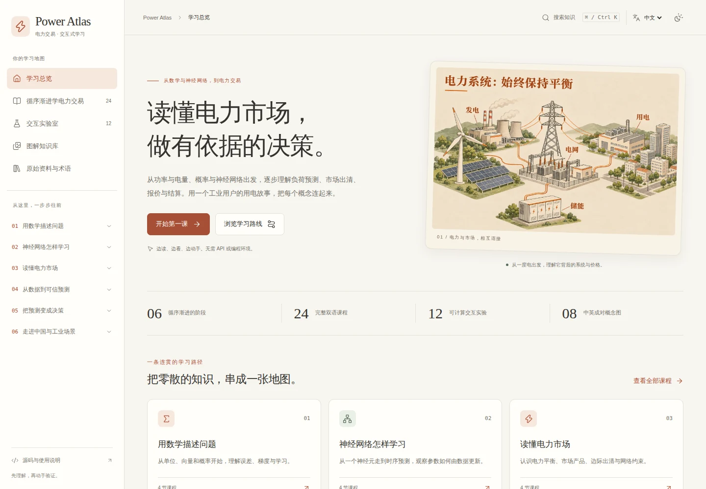

# Reviewed browser screenshots / 实际界面截图

These eight screenshots were produced by real Chromium in [successful workflow run 43803811174](https://github.com/bahayonghang/learning-docs-web/actions/runs/43803811174), for application/test commit `1cb7dcc3fb52f189f4d6904571a3ae23f6c49eff`. All were visually reviewed. PNG captures were converted to WebP at their original dimensions; they are not generated mockups.

以下8张来自同一次通过验收的真实浏览器运行，已检查阅读布局、语言对应、配图、实验数字及手机宽度。课程截图保留正文读图位置，实验截图为完整页面。桌面视口为1440×1000，手机视口为390×844。

| View / 场景 | Screenshot / 截图 |
|---|---|
| Chinese home / 中文首页 | [home-zh-desktop.webp](home-zh-desktop.webp) |
| English home / 英文首页 | [home-en-desktop.webp](home-en-desktop.webp) |
| Mobile home / 手机首页 | [home-zh-mobile.webp](home-zh-mobile.webp) |
| Mobile Chinese lesson / 手机中文正文 | [lesson-01-zh-mobile.webp](lesson-01-zh-mobile.webp) |
| Mobile English lesson / 手机英文正文 | [lesson-01-en-mobile.webp](lesson-01-en-mobile.webp) |
| Clearing lab / 报价出清实验 | [lab-clearing-zh-desktop.webp](lab-clearing-zh-desktop.webp) |
| Mobile storage lab / 手机储能实验 | [lab-storage-zh-mobile.webp](lab-storage-zh-mobile.webp) |
| Dark English reading / 英文深色阅读 | [lesson-dark-en-desktop.webp](lesson-dark-en-desktop.webp) |

[Full verification record / 完整验证记录](../verification.md)
