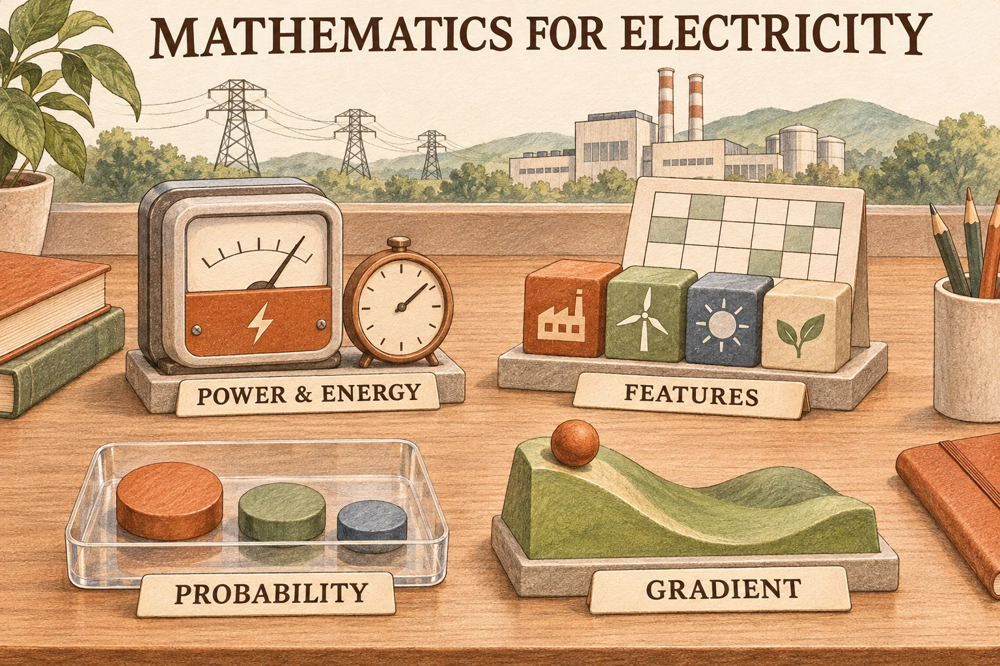
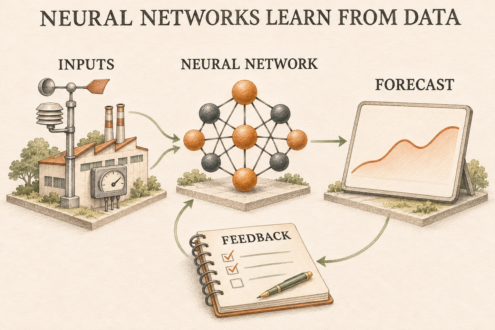
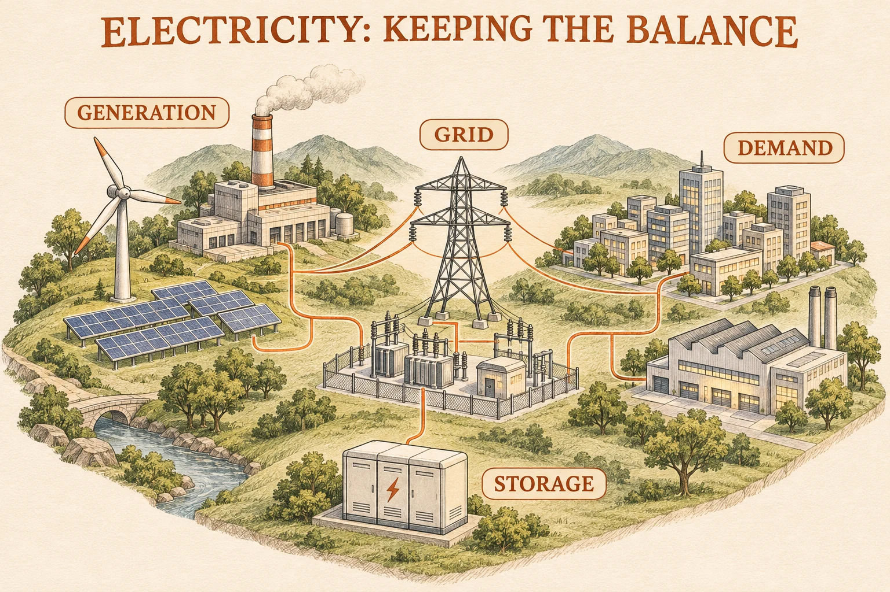
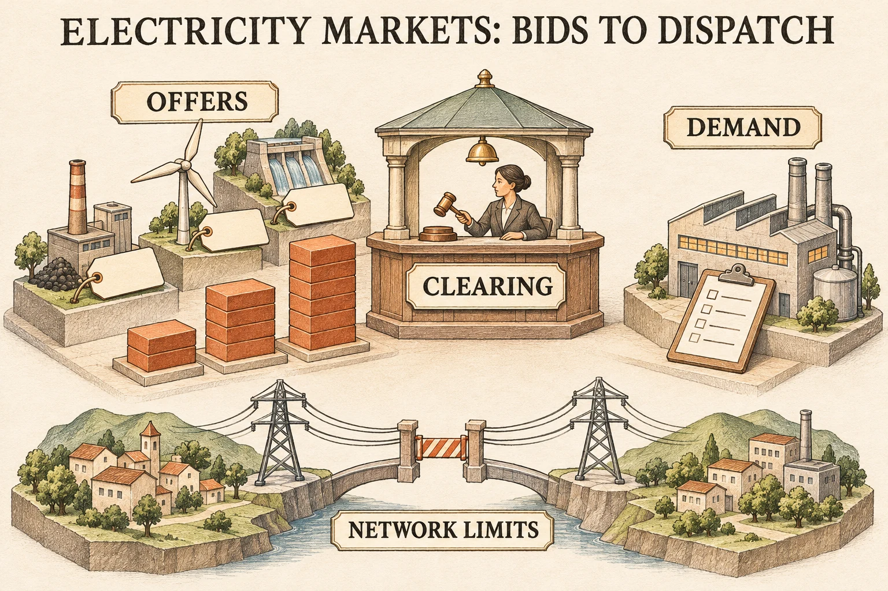
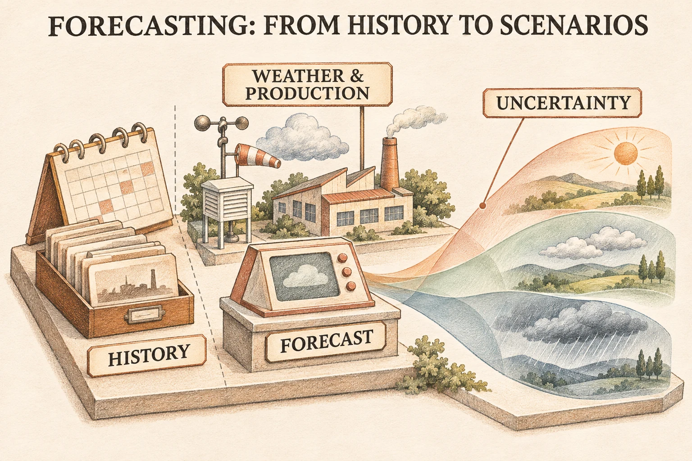
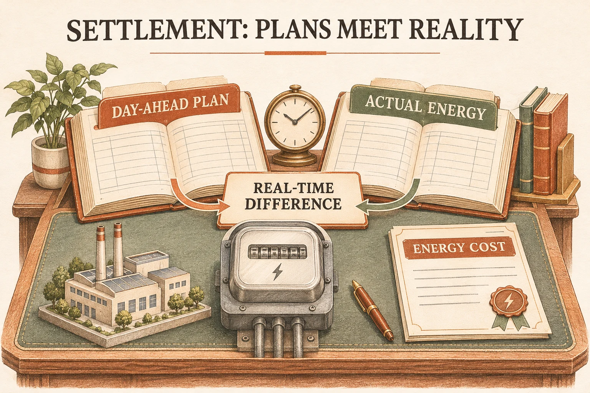
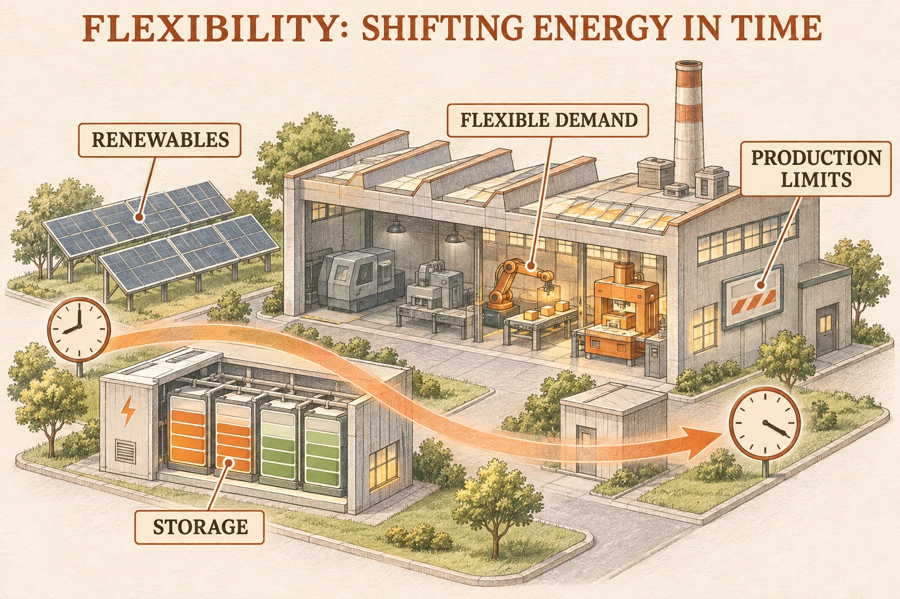
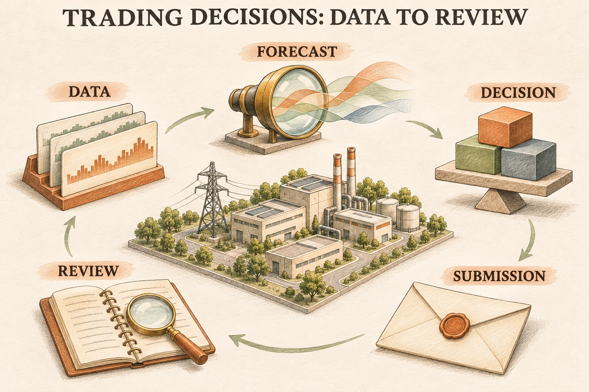

# Power Trading Atlas · Understand power trading from first principles

Start with mathematics and neural networks, then explore electricity systems, market clearing, forecasting, procurement, settlement, storage, and industrial applications. Rules were checked on 2026-11-15; consult each source for its status. Teaching examples are not actual Anhui bills. Exported from the canonical course data, this book includes all text, worked examples, self-check feedback, and primary sources. Run the interactive experiments in the website. Reading times are estimates, not deadlines.

Illustrations communicate concepts. Text and calculated experiments define exact formulas, numbers, units, and model boundaries. Images live in the sibling images directory; downloading Markdown alone does not download images, so preserve the site directory structure.

## Contents

### 1. Describe problems with mathematics

Start with units, vectors, and probability, then understand errors, gradients, and learning.

- 01 From power and energy to an electricity bill
- 02 Represent load information with vectors and matrices
- 03 Probability, expectation, and the tail that matters
- 04 Derivatives, gradients, and one hand-calculated learning step

### 2. How neural networks learn

Move from one neuron to time-series forecasting and observe how data updates parameters.

- 05 Build a linear baseline worth improving
- 06 From one neuron to a nonlinear load model
- 07 Backpropagation: send the error signal to the parameters
- 08 Time windows, sequence networks, and forecast intervals

### 3. Understand electricity markets

Explore power balance, market products, marginal clearing, and network constraints.

- 09 Power balance, participants, and products
- 10 Contracts, spot markets, ancillary services, and green attributes
- 11 From offers to marginal clearing
- 12 Transmission constraints and locational prices

### 4. From data to trustworthy forecasts

Forecast demand, renewables, and prices, then evaluate timing and uncertainty.

- 13 Forecasting demand, wind, and solar
- 14 Price forecasting: spikes, negative prices, and regimes
- 15 Backtesting in time and detecting leakage
- 16 Quantiles, scenarios, and uncertainty

### 5. Turn forecasts into decisions

Compare coverage, settlement, storage, and risk objectives and observe their cost effects.

- 17 Retail procurement: fixed-price coverage and exposure
- 18 Day-ahead and real-time: reconcile one energy position
- 19 Storage, demand response, and virtual power plants
- 20 Roles of stochastic optimization, CVaR, and reinforcement learning

### 6. Connect to Chinese markets and industry

Check Chinese and Anhui sources and reproduce one industrial customer’s decision day.

- 21 China’s rule map and the Anhui entry point
- 22 The industrial customer and retailer workflow
- 23 Capstone: one day of trading decisions
- 24 Validation, deployment boundaries, and the next steps

---

# 01 From power and energy to an electricity bill

Separate MW from MWh, then turn an interval load profile into a calculable cost.

## Objectives

- Distinguish instantaneous power, average power, energy, and price units.
- Convert interval loads into energy and energy procurement costs.
- Explain why a realized average price must be energy-weighted.

## A flow rate and the amount collected

Imagine electricity use as water flowing into a bucket. Power describes the rate of flow; energy describes the amount collected over an interval. Common units are kW or MW for power and kWh or MWh for energy. $1\,\mathrm{MW}=1000\,\mathrm{kW}$ and $1\,\mathrm{MWh}=1000\,\mathrm{kWh}$. A household “unit” of electricity is a kWh, not a kW.

If an interval’s **average power** is $P_t$ MW and its duration is $\Delta t$ hours, its energy is $E_t=P_t\Delta t$ MWh. Operating at 8 MW for 15 minutes consumes $8\times0.25=2$ MWh. A single instantaneous reading of 8 MW does not prove that the entire interval averaged 8 MW; check the measurement convention.

### Start from a factory’s rate of electricity use and pair each interval’s energy with its price.

- Read load as the rate of electricity use and energy as the accumulated use over time.
- The mathematical building blocks suggest attaching units before weighting or summing numbers.
- The illustration organizes concepts; use the calculations below for exact areas, energy, and cost.

## Let units check your formula

With an energy price $\pi_t$ in yuan/MWh, interval procurement cost is $C_t=E_t\pi_t$ in yuan. A day’s simplified energy procurement cost is:

$$C=\sum_t P_t\Delta t\,\pi_t.$$

For 2 MWh at 480 yuan/MWh, the cost is 960 yuan. A price of 480 yuan/MWh equals 0.48 yuan/kWh. Multiplying MW directly by yuan/MWh gives yuan/hour, not a bill amount: duration is missing. Keep interval boundaries, average power, energy, price, and money in separate dataset columns so factors of 1000 or four are easier to catch.

## Why equal energy can produce different costs

When prices vary with time, when electricity is used matters alongside how much is used. Moving 1 MWh from a 700-yuan/MWh interval to a 300-yuan/MWh interval reduces energy cost by 400 yuan. The arithmetic isolates the price difference; production, equipment, and contract constraints determine whether a shift is feasible.

A realized procurement average is $\bar\pi=\sum_tE_t\pi_t/\sum_tE_t$. This weights each price by the associated energy rather than averaging prices directly. The two averages coincide when interval energy is equal. With zero total energy, the weighted average is undefined and should not be displayed as zero.

## Build the energy ledger before the full bill

Begin with a factory buying electricity. A load forecast estimates future energy needs; a price forecast describes possible procurement prices; a decision then selects contract coverage, day-ahead schedules, or flexible load. All three depend on an aligned interval index. Mismatched dates, time zones, missing records, or durations can pair the wrong values even when multiplication is correct.

Here $C$ covers only a teaching energy-procurement component. A real customer bill may also contain network charges, system-operation costs, government funds and surcharges, or demand and capacity charges, according to the applicable rules and contract. Fifteen minutes is an example interval, not a universal settlement requirement.

## Four intervals: calculate one hour of procurement

Four consecutive 15-minute intervals have average powers $[8,12,10,6]$ MW and prices $[300,500,700,400]$ yuan/MWh.

| Interval | Average power MW | Energy MWh | Price yuan/MWh | Cost yuan |
|---|---:|---:|---:|---:|
| 1 | 8 | 2 | 300 | 600 |
| 2 | 12 | 3 | 500 | 1500 |
| 3 | 10 | 2.5 | 700 | 1750 |
| 4 | 6 | 1.5 | 400 | 600 |

Total energy is 9 MWh and total cost is 4450 yuan. The energy-weighted average is $4450/9\approx494.44$ yuan/MWh. The unweighted price average, 475 yuan/MWh, understates the procurement average for this particular profile.

## Common misconception

“A 10 MW device always consumes 10 MWh per interval.” MW is power. Energy depends on actual average power and duration; rated power is not necessarily actual operating power.

## Scope and limits

All loads, prices, and amounts are teaching assumptions. We calculate an energy-procurement component, not a jurisdiction’s full tariff, settlement, or tax rules, and do not establish the feasibility of shifting production.

## At 12 MW average for 15 minutes and 500 yuan/MWh, what is the energy cost?

1. 6000 yuan
   × This treats 15 minutes as one hour. First calculate 12×0.25=3 MWh.

2. 1500 yuan
   ✓ Energy is 3 MWh and cost is 3×500=1500 yuan.

3. 1.5 yuan
   × The price is already in yuan/MWh; do not divide by 1000 again.

## Primary sources

- [Measuring electricity](https://www.eia.gov/energyexplained/electricity/measuring-electricity.php) — U.S. Energy Information Administration, Online
- [Mathematics for Machine Learning](https://mml-book.github.io/) — Marc Peter Deisenroth, A. Aldo Faisal, Cheng Soon Ong, 2020

---

# 02 Represent load information with vectors and matrices

How do temperature, past load, and a production plan become one model input?

## Objectives

- Distinguish samples, features, vectors, and matrix shapes.
- Calculate a dot product and one linear load forecast.
- Explain feature scaling and information availability.

## Name each axis before calculating

Let $x=[T,L,d]$ contain temperature, past load, and a working-day indicator for one interval. It is a vector of three features. Collecting 96 intervals gives $X\in\mathbb{R}^{96\times3}$: every row is a sample and every column has a consistent meaning. Ninety-six is an example dataset size, not a required model length.

Neural networks may add batch and time axes. In $B\times T\times d$, these represent the number of samples in a batch, window length, and feature count. “Dimension” can mean the number of axes or an axis length. Write shapes alongside variables before interpreting multiplication signs.

### Organize information into consistently defined numeric entries before connecting forecasts to costs.

- An ordered list can hold several features for one interval.
- A collection of numeric cells can represent multiple intervals.
- The illustration does not specify dimensions; this lesson uses samples as rows and features as columns.

## A dot product is a learnable weighted summary

The dot product $x\cdot w=\sum_jx_jw_j$ multiplies each feature by its weight and sums the contributions. Adding a bias gives $\hat P=x\cdot w+b$. A hat marks a prediction; $b$ is a baseline and $w$ describes how the model uses its features.

For $X\in\mathbb{R}^{n\times d}$ and a column vector $w\in\mathbb{R}^{d\times1}$, $Xw+b$ has shape $n\times1$, with the bias added to each sample. Matrix multiplication sums over the inner dimension; elementwise multiplication only multiplies matching cells. Learned weights describe a model relationship, not automatically a causal effect.

## Put different features on workable scales

Temperature may be measured in tens, power in hundreds, and calendar month from 1 to 12. A larger numerical range does not imply greater importance, but it affects optimization scales. A common transformation is $\tilde x_j=(x_j-\mu_j)/\sigma_j$. Estimate $\mu_j$ and $\sigma_j$ only from data available for training, then reuse them for validation, testing, and future inputs. Handle constant columns separately to avoid division by zero.

Standardized inputs are usually dimensionless. If the output is in MW, weights and bias must be interpreted consistently. A binary working-day indicator can remain 0/1; not every feature needs identical processing. Prices that can be zero or negative also require care before applying ordinary logarithms.

## Correct inputs must also have been available

Suppose you forecast tomorrow’s load this morning. Tomorrow’s calendar is known and an already-issued weather forecast is available, but tomorrow’s measured temperature is not. Using that future observation in a historical backtest gives the model information unavailable in deployment: data leakage. Keep weather forecast issue times so later revisions are not substituted accidentally.

Document each feature’s definition and unit, target interval, and earliest availability time. Aligning these three properties before training can matter more than adding network depth. Lesson 15 extends the check into a complete backtesting process.

## From raw features to an 11 MW teaching prediction

Let temperature be 25°C, past load 9 MW, and the working-day indicator 1. For arithmetic, assume training statistics of 20°C mean and 5°C standard deviation for temperature, and 10 MW mean and 2 MW standard deviation for load. Then $x=[(25-20)/5,(9-10)/2,1]=[1,-0.5,1]$.

With teaching weights $w=[2,4,1]$ MW and bias $b=10$ MW, $\hat P=1\times2+(-0.5)\times4+1\times1+10=11$ MW. For a 15-minute interval, forecast energy is $11\times0.25=2.75$ MWh. These hand-set weights are not a trained model.

## Common misconception

“Standardizing all data before splitting makes evaluation fairer.” It leaks future distribution information into training; preprocessing parameters must respect the time boundary too.

## Scope and limits

The linear map teaches shapes and feature availability. The neuron lab illustrates weighted sums and activation without fitting real load data or establishing feature causality.

## If X is 96×3 and w is 3×1, what is the shape of Xw?

1. 96×1
   ✓ The three features are summed over, producing one prediction per interval.

2. 3×3
   × The matching inner dimensions are summed over rather than becoming output axes.

3. 96×3×1
   × The shared dimension of 3 is summed over; the axes are not concatenated. The result remains 96×1.

## Primary sources

- [Mathematics for Machine Learning](https://mml-book.github.io/) — Marc Peter Deisenroth, A. Aldo Faisal, Cheng Soon Ong, 2020
- [Dive into Deep Learning](https://d2l.ai/) — Aston Zhang, Zachary C. Lipton, Mu Li, Alexander J. Smola, 2023
- [Forecasting: Principles and Practice, 3rd edition](https://otexts.com/fpp3/) — Rob J Hyndman, George Athanasopoulos, 2021 / Online

---

# 03 Probability, expectation, and the tail that matters

Why can a lower average-cost plan still produce a large loss?

## Objectives

- Represent uncertain load and price with probabilistic scenarios.
- Calculate expectations, variance, and costs under joint scenarios.
- Separate average outcomes, dispersion, and tail losses.

## Define the uncertain quantity before its probabilities

Let tomorrow’s interval procurement cost be a random variable $C$. In a discrete teaching model, it takes three possible values $C_s$ with probabilities $p_s$, where $p_s\ge0$ and $\sum_sp_s=1$. Probabilities express a modeling judgment about the future, not an objective guarantee obtained by arbitrarily giving a few historical observations equal weight.

Scenarios should preserve joint relationships. Hot weather may raise both demand and spot prices, suggesting a joint high-load, high-price scenario. Independently shuffling load and price can create implausible combinations and understate procurement risk.

### A single decision can meet several futures; probability assigns each future a weight.

- Read scenarios as possible joint changes in weather, load, and price.
- Each scenario needs a probability weight; illustration counts do not estimate real probabilities.
- An average summarizes outcomes but does not replace inspection of extreme scenarios.

## Expectation is a weighted average, not the most likely value

Expectation is $\mathbb E[C]=\sum_sp_sC_s$. It compares long-run average outcomes on a consistent basis, but tomorrow need not equal that value; the expectation may not be any individual scenario. Two plans with the same expectation can have very different risk distributions.

For uncertain energy $E$ and price $\pi$, expected cost is $\mathbb E[E\pi]$, generally not $\mathbb E[E]\mathbb E[\pi]$. Their difference is covariance: $\mathbb E[E\pi]=\mathbb E[E]\mathbb E[\pi]+\operatorname{Cov}(E,\pi)$. When greater demand coincides with higher prices, ignoring dependence can understate cost.

## Variance measures spread; tail measures examine bad outcomes

Variance, $\operatorname{Var}(C)=\sum_sp_s(C_s-\mu)^2$, measures squared deviations from mean $\mu$. Its square root is the standard deviation, which uses the same yuan units as cost. Variance penalizes deviations both above and below the mean, so it is not exclusively a measure of losses.

For procurement, the high-cost tail often deserves special attention. Quantiles locate positions in a distribution; CVaR focuses on average losses in a specified upper tail. Discrete distributions require care when probability mass straddles a threshold: averaging only samples strictly above a quantile is not always correct. Lessons 16 and 20 specify the calculation conventions.

## Carry uncertainty into the decision

A complete workflow defines available information, constructs joint load-price scenarios, calculates each candidate decision’s cost in every scenario, and compares averages, tails, and constraint compliance. Comparing candidates on the same scenarios prevents random resampling from obscuring the effect of the decision itself.

Risk tolerance is not a fact that a model discovers automatically. A business may require a cash buffer or disallow certain production interruptions; such conditions come from the operation. Three scenarios are useful for hand calculation, while actual research must examine scenario coverage, probability calibration, and omitted extremes.

## An expectation that is not an individual scenario

Suppose low, typical, and high costs are 3000, 5000, and 12000 yuan with probabilities 0.5, 0.4, and 0.1. Expected cost is $0.5\times3000+0.4\times5000+0.1\times12000=4700$ yuan.

Variance is $0.5(3000-4700)^2+0.4(5000-4700)^2+0.1(12000-4700)^2=6{,}810{,}000$ yuan², with standard deviation approximately 2610 yuan. The 10% high-cost scenario still deserves separate attention.

Now consider two equally likely joint scenarios $(E,\pi)=(8,300)$ and $(12,700)$ in MWh and yuan/MWh. Expected cost is $0.5\times8\times300+0.5\times12\times700=5400$ yuan. Multiplying the means gives only $10\times500=5000$ yuan, a 400-yuan difference.

## Common misconception

“Reducing expected cost necessarily reduces every risk.” A better mean can coexist with a worse tail; inspect the distribution and operating constraints together.

## Scope and limits

Scenarios and probabilities are assumptions, not estimated market distributions. Variance, quantiles, and CVaR do not cover every liquidity, rule-change, credit, or model-failure risk.

## When high load often coincides with high prices, what can happen if cost is estimated as mean energy × mean price?

1. It must be exact because expectations always multiply
   × Expectations of products do not generally factor; dependence matters.

2. It can understate cost by omitting positive covariance
   ✓ Under this condition E[Eπ]=E[E]E[π]+Cov(E,π), with positive covariance.

3. It must overstate cost because two averages are used
   × The number of averages does not determine the direction; dependence is the issue.

## Primary sources

- [Mathematics for Machine Learning](https://mml-book.github.io/) — Marc Peter Deisenroth, A. Aldo Faisal, Cheng Soon Ong, 2020
- [Forecasting: Principles and Practice, 3rd edition](https://otexts.com/fpp3/) — Rob J Hyndman, George Athanasopoulos, 2021 / Online

---

# 04 Derivatives, gradients, and one hand-calculated learning step

Turn a prediction error into a direction for adjusting parameters.

## Objectives

- Interpret derivatives, partial derivatives, and gradients as local slopes.
- Calculate a parameter update for an explicitly defined loss.
- Separate predictive-model training from constrained trading optimization.

## A derivative asks what a small change would do

A loss compresses prediction error into a scalar. Begin with $L(w)=\tfrac12(w-3)^2$. Below 3, increasing $w$ slightly decreases loss; above 3, the opposite holds. The derivative $L'(w)=w-3$ gives this local tendency a signed numerical value.

With several parameters, differentiate with respect to one while holding the others fixed to obtain a partial derivative. Collect these derivatives into the gradient $\nabla_\theta L$. It describes how nearby parameter changes affect loss; it is not a list of optimal parameter values. Changing the definition or scale of loss changes the gradient scale too.

### Read error as a landscape: a gradient describes the local direction of change.

- A lower position suggests smaller training loss, not necessarily higher trading profit.
- One move uses a local slope, while the learning rate still determines step size.
- The conceptual terrain contains no actual market constraints; formulas and the lab calculate exact updates.

## The negative gradient gives direction; the rate gives step size

Gradient descent uses $\theta_{k+1}=\theta_k-\eta\nabla_\theta L(\theta_k)$ with learning rate $\eta>0$. Subtracting a negative gradient increases a parameter. “Descent” refers to the objective, not to every weight becoming smaller.

For $L(w)=\tfrac12(w-3)^2$, error evolves as $w_{k+1}-3=(1-\eta)(w_k-3)$. This example converges for $0<\eta<2$, oscillates without shrinking at $\eta=2$, and usually diverges above 2. That range follows from this quadratic’s curvature and is not a learning-rate recommendation for real networks.

## Obtain a gradient from a load prediction

Let $\hat y=wx+b$, target $y$, and loss $L=\tfrac12(\hat y-y)^2$. The chain rule connects two stages of change: $\partial L/\partial w=(\hat y-y)x$ and $\partial L/\partial b=\hat y-y$. A larger input produces a larger weight gradient for the same output error, helping explain why feature scaling matters.

Here $x,y,w,b$ use a teaching scale. Real implementations may standardize inputs and targets separately, then transform predictions back into MW. A batch loss averages sample losses; its gradient must use the same normalization. Lesson 7 extends this chain through a hidden layer.

## Learning parameters and choosing trades are distinct problems

When training a load model, variables are weights and the objective is prediction error. In procurement, variables may be contract quantities, offers, or battery schedules; the objective may combine cost and risk under energy-balance, capacity, and production constraints. Lower forecast error does not automatically imply better trading outcomes because objectives, constraints, and error costs differ.

Gradient methods suit some continuous differentiable problems. Integer commitment, piecewise bids, and discrete trading blocks may require other optimization methods. “Follow the gradient” is not a universal power-trading solution. Define variables, units, objectives, and constraints before choosing an algorithm.

## Update a slope and bias simultaneously

Use dimensionless teaching data $x=2,y=5$ with initial $w=1,b=0$. Prediction is $\hat y=2$, error is $-3$, and loss is $L=\tfrac12(-3)^2=4.5$. Gradients are $\partial L/\partial w=-3\times2=-6$ and $\partial L/\partial b=-3$.

At $\eta=0.1$, use the **same pre-update gradients** to obtain $w'=1.6,b'=0.3$. A new forward pass gives $\hat y'=1.6\times2+0.3=3.5$ and loss $\tfrac12(3.5-5)^2=1.125$. This is one update on one sample, not evidence of generalization to future load.

## Common misconception

“A lower training loss guarantees a profitable trade.” Training loss measures prediction error; trading outcomes also depend on decision rules, realized prices, constraints, and charges.

## Scope and limits

The derivation uses smooth deterministic teaching losses, and the lab reveals update directions. It is not a market optimization solver and gives no global-convergence guarantee for nonconvex networks.

## A parameter is 1, its gradient is −6, and the rate is 0.1. What is its next value?

1. 0.4
   × The update subtracts the gradient; subtracting a negative increases the parameter.

2. 1.6
   ✓ 1−0.1×(−6)=1.6; the gradient sign determines the direction.

3. 6
   × A gradient is a local rate of change, not the new parameter value.

## Primary sources

- [Mathematics for Machine Learning](https://mml-book.github.io/) — Marc Peter Deisenroth, A. Aldo Faisal, Cheng Soon Ong, 2020
- [Deep Learning](https://www.deeplearningbook.org/) — Ian Goodfellow, Yoshua Bengio, Aaron Courville, 2016
- [Dive into Deep Learning](https://d2l.ai/) — Aston Zhang, Zachary C. Lipton, Mu Li, Alexander J. Smola, 2023

---

# 05 Build a linear baseline worth improving

From the same time yesterday to regression: give complex models a fair reference.

## Objectives

- Separate targets, input features, and trainable parameters.
- Explain how least squares fits a predictive relationship.
- Compare simple and complex models using chronological holdouts.

## Why start with “similar to yesterday”?

A complex model should first answer a simple question: is it more useful than an uncomplicated alternative? A seasonal load baseline can use the previous comparable interval, such as the same time yesterday or last week. A persistence baseline uses the latest available observation. Neither requires a deep network, and both reveal how much predictable repetition the data contains.

Baselines must respect forecast time. When predicting all of tomorrow, tomorrow’s immediately preceding realized load is not yet available. Shutdowns, holidays, and extreme weather can defeat simple repetition; those failures identify problems that additional features or more complex models should solve.

### Pass available information through a simple predictor, then check its errors against observations.

- Weather, calendars, and past load can provide predictive information if available at forecast time.
- Begin with linear weighting inside the model before moving to deeper networks.
- Comparing predictions with observations creates a learning signal; the illustration is not a measured accuracy result.

## Let data choose weights rather than tuning by appearance

A linear model predicts $\hat y_i=x_i\cdot w+b$. Given $n$ training examples, one objective is half the mean squared error:

$$L(w,b)=\frac{1}{2n}\sum_{i=1}^n(\hat y_i-y_i)^2.$$

Squaring prevents positive and negative errors from canceling and penalizes larger errors more strongly. The factor $1/2$ is a differentiation convention and must match the gradient and learning-rate interpretation. The fitted relationship depends on the features, data, and loss; it is not an eternal physical law. Suitable linear regression problems can be solved by analytical or gradient-based methods.

## A linear model can use deliberately designed features

“Linear” usually means linear in the estimated parameters, not necessarily a straight-line relationship with raw temperature. You can construct cooling-degree features, squared temperature, hour indicators, or production-plan features before regression. For example, $\max(T-26,0)$ can represent additional cooling demand above a threshold; 26°C is a teaching choice, not a universal engineering limit.

More features bring concerns about collinearity and overfitting. Ridge regression adds $\lambda\lVert w\rVert_2^2$ to control coefficient size; the intercept is usually exempt. Scaling, feature combinations, and $\lambda$ must be selected using training and validation data. Regularization cannot repair future-information leakage.

## Examine when errors occur

Define residual $e_t=y_t-\hat y_t$, so a positive residual means underprediction. Beyond MAE or RMSE, inspect errors by hour, working-day status, temperature band, and forecast horizon. A model can work well during the day yet systematically underestimate the evening peak. Near-zero mean error can hide canceling positive and negative errors.

Compare models at the same forecast origins, with the same available information and evaluation periods. Assess forecast quality first, then feed forecasts into the same decision logic to examine business consequences. If only the complex model receives extra weather information, its advantage cannot be attributed entirely to network architecture.

## Three teaching observations define a linear relation

Let the scaled temperature feature be $x=(T-20)/5$. Three teaching samples are $(x,y)=(0,8),(1,10),(2,12)$, with $y$ in MW. The relation $\hat y=2x+8$ fits all three exactly and has zero training half-MSE.

At a forecast temperature of 27.5°C, $x=1.5$ and $\hat y=11$ MW. If actual load later equals 11.5 MW, absolute error is 0.5 MW. A hypothetical seasonal baseline of 10.5 MW has error 1 MW on the same observation. One synthetic example establishes neither universal superiority nor zero future error from a zero training error.

## Common misconception

“Zero training error solves forecasting.” It can reflect simple examples or overfitting; future performance still requires independent evaluation.

## Scope and limits

The line and temperature threshold are teaching constructions, not calibrated factory-load relationships. The gradient lab explains fitting rather than performing real multifeature regression or ranking deployed models.

## How can you judge whether a new network improves on a linear baseline?

1. Compare the same chronological holdout and available information
   ✓ Consistent tasks and information make the comparison meaningful; inspect business consequences as well.

2. Compare training errors alone
   × Greater fitting capacity may simply memorize training examples.

3. The model with more parameters must be better
   × Model capacity does not guarantee future predictive performance.

## Primary sources

- [Mathematics for Machine Learning](https://mml-book.github.io/) — Marc Peter Deisenroth, A. Aldo Faisal, Cheng Soon Ong, 2020
- [Dive into Deep Learning](https://d2l.ai/) — Aston Zhang, Zachary C. Lipton, Mu Li, Alexander J. Smola, 2023
- [Forecasting: Principles and Practice, 3rd edition](https://otexts.com/fpp3/) — Rob J Hyndman, George Athanasopoulos, 2021 / Online

---

# 06 From one neuron to a nonlinear load model

Weight, offset, activate, and compose simple calculations into a network.

## Objectives

- Separate inputs, parameters, hidden features, and final outputs.
- Calculate a ReLU neuron and its load output.
- Interpret outputs through the task rather than calling every number a probability.

## Four roles inside a neuron

An artificial neuron computes $z=\sum_jw_jx_j+b$ and then $h=\phi(z)$. Inputs $x_j$ belong to the current example; weights $w_j$ and bias $b$ are learned parameters; $\phi$ is an activation function; $h$ is a hidden feature. Inputs change on every prediction, while parameters usually remain fixed during inference and change during training.

Combining temperature and production intensity can create a feature related to their joint behavior. This is an intuition, not a promise that every hidden unit has a stable business label. A learned statistical relationship also does not establish the causal effect of changing operating conditions.

### A network transforms available features through layers into a prediction with task-specific units.

- Inputs can represent weather, production plans, and past load.
- Intermediate nodes suggest learnable features; their count is not the exact model size.
- Load or price outputs are predictions; observations and evaluation remain necessary.

## Why an activation is needed

Two affine layers can still be combined: $(xW_1+b_1)W_2+b_2=x(W_1W_2)+b_1W_2+b_2$. Depth alone has not escaped an affine relationship. Intervening nonlinearities allow compositions of more complicated piecewise or curved relationships.

ReLU is $\phi(z)=\max(0,z)$: positive inputs pass through and negative inputs become zero. Sigmoid instead maps values between zero and one. ReLU does not force weights to be positive or guarantee that every unit remains useful; units persistently in the negative region may receive zero gradients.

## Combine neurons into matrices

Using row vectors, a network with $d$ inputs, $h$ hidden units, and one output is $H=\operatorname{ReLU}(XW_1+b_1)$ followed by $\hat y=HW_2+b_2$. If $X$ is $n\times d$, then $W_1$ is $d\times h$, $H$ is $n\times h$, and $W_2$ is $h\times1$.

The input layer specifies how numbers enter a computation; it does not turn measurements into biological neurons. Hidden layers learn representations, and the output layer maps them to the target. Greater capacity may fit complex relationships, but brings data, regularization, and validation requirements. It cannot substitute for correct time alignment and forecast origins.

## The output layer must match the target

For load forecasting, one design uses a linear output with physical plausibility checks; another uses a suitable nonnegative transformation. Some spot markets and intervals admit negative prices, so a price predictor should not universally clip them with ReLU. If the target was standardized, invert the transformation to recover MW or yuan/MWh.

A sigmoid can represent an event probability under an appropriate binary target, training objective, and evaluation setup. A hidden activation of 0.8 is not “80% confidence,” and probabilistic outputs still require calibration checks. Different quantiles or forecast horizons can occupy separate output positions, whose dimensions and meanings should be specified before training.

## One hidden feature produces 8.6 MW

Use dimensionless inputs $x=[0.5,1]$, weights $w=[1.2,0.8]$, and bias $b=-0.5$. The weighted sum is $z=0.5\times1.2+1\times0.8-0.5=0.9$, so the ReLU hidden value is $h=0.9$.

Let the output layer be $\hat P=5+4h$ MW, giving $\hat P=8.6$ MW. Changing the first input to $-1$ gives $z=-0.9$, $h=0$, and a 5 MW prediction. That 5 is a hand-set model baseline, not proof of a physical minimum load.

## Common misconception

“A sigmoid value of 0.8 means the load forecast is 80% accurate.” An activation’s range does not determine statistical meaning; inspect the target, loss, calibration, and evaluation.

## Scope and limits

The lab uses a small slider-controlled computation rather than training a deep network. Hidden-feature interpretations are illustrative, not validated industrial load relationships or trading results.

## What should you consider when predicting spot prices that may be negative?

1. Every prediction must use ReLU to stay nonnegative
   × That would exclude valid negative targets and misspecify the model.

2. Design the output for the allowed target range rather than clipping arbitrarily
   ✓ The output transformation should match the target; check the applicable rules for negative prices.

3. Convert every output into a probability from 0 to 1
   × Price regression and event-probability prediction are different tasks.

## Primary sources

- [Deep Learning](https://www.deeplearningbook.org/) — Ian Goodfellow, Yoshua Bengio, Aaron Courville, 2016
- [Dive into Deep Learning](https://d2l.ai/) — Aston Zhang, Zachary C. Lipton, Mu Li, Alexander J. Smola, 2023

---

# 07 Backpropagation: send the error signal to the parameters

The forward pass produces predictions, the backward pass gradients, and the optimizer updates.

## Objectives

- Trace a forward and backward pass through a computational graph.
- Calculate parameter gradients in a two-layer network.
- Distinguish training improvement, validation selection, and final testing.

## Keep track of each intermediate computation

Consider a scalar two-layer network: $z_1=w_1x+b_1$, $h=\operatorname{ReLU}(z_1)$, $\hat y=w_2h+b_2$, and $L=\tfrac12(\hat y-y)^2$. Evaluating these variables in order is forward propagation. A computational graph records dependencies and therefore supplies paths for differentiation.

The backward pass uses intermediate forward values. For example, $\partial\hat y/\partial w_2=h$, while ReLU’s local derivative depends on the sign of $z_1$. Training memory thus includes intermediate states as well as weights. Inference without gradients can omit some training-specific state.

### Prediction errors define a loss, and training propagates gradients through computational dependencies.

- Follow the inputs to the output for the forward computation, then compare with an observation.
- Learning feedback represents derivatives used to adjust parameters, not the target being run backward.
- Feedback paths provide intuition; the worked example supplies the exact derivatives and updates.

## Multiply local influences along a path

The first weight affects a hidden feature, which affects the prediction, which affects loss. The chain rule joins the path:

$$\frac{\partial L}{\partial w_1}=\frac{\partial L}{\partial\hat y}\frac{\partial\hat y}{\partial h}\frac{\partial h}{\partial z_1}\frac{\partial z_1}{\partial w_1}.$$

When $z_1>0$, these factors are $(\hat y-y)$, $w_2$, 1, and $x$. If a variable influences loss through several paths, add their contributions. Backpropagation reuses shared intermediate derivatives rather than independently perturbing every parameter and rerunning the entire model.

## Responsibilities within a training iteration

A basic iteration reads training examples, predicts forward, computes loss, clears or manages old gradients, differentiates backward, and updates through an optimizer. Backpropagation computes gradients; SGD, Adam, or another optimizer determines parameter changes. If gradients intentionally accumulate across minibatches, specify when they are cleared, when updates occur, and how losses are normalized.

Large gradients may reflect anomalous data, poor scaling, or instability. Check input-target alignment before reaching for a more complicated optimizer. Automatic differentiation can correctly differentiate the graph you wrote; it cannot detect a task error such as using tomorrow’s realized price as today’s feature.

## Train parameters, validate choices, test future performance

Training data contributes to gradients. Validation data selects model design, rate, regularization, and checkpoints. Test data evaluates the frozen design. Repeated validation-based selection can over-adapt to validation data even without direct gradient updates. Time series require chronological boundaries, including checks that rolling-window targets do not cross split boundaries.

Suppose training losses at epochs 10, 20, and 30 are 0.50, 0.30, and 0.20, while validation losses are 0.55, 0.40, and 0.48. A predeclared minimum-validation-loss rule selects epoch 20. Early stopping is a selection procedure, not proof that the model understands the market; unseen periods and extreme conditions still require evaluation.

## Update four parameters together and recompute loss

Use dimensionless teaching values $x=2,y=4,w_1=0.5,b_1=0,w_2=3,b_2=0$. Forward: $z_1=1,h=1,\hat y=3,L=0.5$.

Backward: output error is $-1$, giving $\partial L/\partial w_2=-1$ and $\partial L/\partial b_2=-1$. For the first layer, $\partial L/\partial w_1=(-1)\times3\times1\times2=-6$ and $\partial L/\partial b_1=-3$.

At rate 0.01, update all parameters using gradients from the same old point: $w_1'=0.56,b_1'=0.03,w_2'=3.01,b_2'=0.01$. The new hidden value is $h'=0.56\times2+0.03=1.15$, prediction is $3.01\times1.15+0.01=3.4715$, and loss is approximately 0.139656. Do not update the second layer and then use its new weight to calculate the first layer’s old-step gradient.

## Common misconception

“Calling backpropagation already changes the weights.” Derivative computation and parameter updates are separate operations, especially with gradient accumulation.

## Scope and limits

The example omits batch matrix operations, regularization, optimizer state, and the convention for ReLU at zero. The companion lab explains gradient steps rather than simulating real generalization curves.

## Training loss falls throughout, while validation loss first falls and then rises. How should a predeclared validation rule select the model?

1. Choose the final epoch with the lowest training loss
   × Better training fit does not guarantee better unseen-data performance.

2. Repeatedly inspect the test set to find the best epoch
   × That turns the test set into development data used for selection.

3. Select by validation loss, then assess on an independent test set
   ✓ Validation performs selection while an independent test retains its assessment role.

## Primary sources

- [Deep Learning](https://www.deeplearningbook.org/) — Ian Goodfellow, Yoshua Bengio, Aaron Courville, 2016
- [Dive into Deep Learning](https://d2l.ai/) — Aston Zhang, Zachary C. Lipton, Mu Li, Alexander J. Smola, 2023
- [Forecasting: Principles and Practice, 3rd edition](https://otexts.com/fpp3/) — Rob J Hyndman, George Athanasopoulos, 2021 / Online

---

# 08 Time windows, sequence networks, and forecast intervals

Organize the observed past into inputs and the unobserved future into targets.

## Objectives

- Define a forecast origin, history window, and horizon.
- Explain how MLPs, convolutions, recurrent networks, and attention handle sequences.
- Separate point forecasts, quantile intervals, and joint scenarios.

## Every example has its own “now”

At forecast origin $t$, a model sees a history window $x_{t-L+1:t}$ of length $L$ and predicts $H$ future intervals $y_{t+1:t+H}$. With $d$ features per interval, a batch can have shape $B\times L\times d$ and outputs $B\times H$. Input and output time axes have different meanings and cannot be aligned merely because both represent time.

Future calendar information is usually known, future weather must use forecasts issued no later than $t$, and future actual load remains a target. Training can draw from many past origins, but must reconstruct each origin’s available information. Imputation, smoothing, and scaling must respect that boundary too.

### Historical observations and known future conditions enter a model that predicts an unobserved future.

- Separate historical records from the forecast origin; later actual outcomes cannot enter the input.
- Weather forecasts and calendars can supply future conditions with different availability and error properties.
- A forecast band illustrates uncertainty; actual coverage must be checked independently.

## How different networks use history

An MLP can flatten a fixed window into features: simple, but usually tied to a chosen length. Temporal convolutions share local filters; causal convolutions only read the current and earlier positions. RNNs update a hidden state over time, with LSTM or GRU gates controlling information retention. Attention combines information from several historical positions using learned weights.

Each architecture has modeling and computational tradeoffs; its name guarantees no universal forecasting advantage. Bidirectional encoding inside a fully observed historical window is not automatically leakage. The real question is whether it reads information unavailable after the forecast origin. Supporting variable window lengths still requires length management, masks where needed, and adequate training coverage.

## Direct and recursive forecasts accumulate error differently

A recursive strategy forecasts one step, feeds that prediction into the next input, and continues. It reuses a predictor, but may face a difference between observed histories during training and self-generated histories during inference, allowing errors to accumulate. Direct multistep prediction outputs $H$ targets together or uses horizon-specific models, avoiding mandatory feedback of the preceding prediction while learning horizon-specific relationships.

Report errors by horizon rather than only one pooled average. Accurate forecasts for the next hour do not establish accuracy for all of tomorrow. Rolling reforecasting can use new information, but a backtest must release observations only when they would actually have become available.

## When one number is insufficient, describe the distribution

A point forecast gives one central value, such as a conditional mean or median. Quantile forecasts can supply $q_{0.1},q_{0.5},q_{0.9}$; the 10th and 90th quantiles define a nominal 80% interval. Accurate quantiles of a continuous conditional distribution cover 80%; a discrete distribution can have greater coverage. That is model-implied coverage: evaluate realized coverage, width, and performance under different operating conditions.

Separate interval quantile bands are not joint scenario paths. An 80% interval at every time does not imply an 80% chance that the whole day lies inside every band simultaneously. Storage, cumulative energy, and portfolio risk depend on temporal dependence and often require joint scenarios. Lessons 13–16 connect these ideas to load, prices, and backtesting.

## Four inputs, two outputs: check power and energy

At origin $t$, suppose four observed 15-minute average loads are $[8,9,10,11]$ MW. A model predicts the next two intervals as $[12,10]$ MW, giving half-hour energy $(12+10)\times0.25=5.5$ MWh.

Actual loads later become $[13,9]$ MW. Both absolute errors are 1 MW, so MAE is 1 MW, while actual total energy is also 5.5 MWh. **Accurate total energy does not imply accurate interval forecasts**: different interval prices can make those errors affect procurement cost.

A first-step 10%–90% quantile interval of $[10,14]$ MW describes that step’s marginal prediction interval. It does not establish an 80% simultaneous coverage probability for the whole two-step path.

## Common misconception

“Connecting hourly 10th and 90th quantiles gives an 80% whole-day path interval.” Marginal and simultaneous coverage differ; temporal dependence matters.

## Scope and limits

This lesson compares architectures and data organization. The local forecasting lab does not train or benchmark large LSTM or Transformer networks and provides no real-market probability guarantee.

## When forecasting tomorrow’s load this morning, which input leaks future information?

1. Tomorrow’s already-published holiday calendar
   × It is known at forecast time and can be used with correct date alignment.

2. Tomorrow’s weather forecast issued this morning
   × The already-issued forecast is available; retain its version rather than substituting later updates.

3. Tomorrow’s actual mean temperature calculated after the day ends
   ✓ It is unavailable at the forecast origin and makes a backtest overstate deployable performance.

## Primary sources

- [Deep Learning](https://www.deeplearningbook.org/) — Ian Goodfellow, Yoshua Bengio, Aaron Courville, 2016
- [Dive into Deep Learning](https://d2l.ai/) — Aston Zhang, Zachary C. Lipton, Mu Li, Alexander J. Smola, 2023
- [Forecasting: Principles and Practice, 3rd edition](https://otexts.com/fpp3/) — Rob J Hyndman, George Athanasopoulos, 2021 / Online

---

# 09 Power balance, participants, and products

Follow electricity through the system, then follow a contract through the market.

## Objectives

- Distinguish power, energy, capacity, and flexibility.
- Explain the roles of generation, consumption, trading, dispatch, and the grid.
- Write a balance equation with consistent units for each interval.

## From power to energy to cost

“The factory used 10 MW” does not yet specify an energy quantity: MW is a rate and requires a duration. For interval-average power $P$ and duration $\Delta t$ hours, energy is $E=P\Delta t$ MWh. Summing areas under a load curve gives daily energy; powers from unequal intervals cannot simply be added as energy.

Capacity can describe available power or stored energy. A “10 MW / 20 MWh” battery has separate power and energy limits. Flexibility concerns how quickly output can change, for how long, and at what cost. Buying energy, procuring reserve capability, and scheduling a battery address different needs.

### Generators, the grid, consumers, and storage share a physical system on which commercial relationships are built.

- Locate generation and consumption and ask who supplies or consumes power at each instant.
- Storage changes roles: charging adds demand and discharging supplies power.
- Connections show relationships; physical flows and contracts require separate models, so individual contracted electrons cannot be traced through this illustration.

## Commercial schedules must respect physical balance

For a simplified regional boundary, each interval must satisfy:

$$P_{\mathrm{generation}}+P_{\mathrm{import}}+P_{\mathrm{discharge}}=P_{\mathrm{load}}+P_{\mathrm{export}}+P_{\mathrm{charge}}+P_{\mathrm{loss}}.$$

This does not mean a trader personally balances the grid every second. Markets establish schedules and prices; dispatch coordinates execution under operating conditions and arranges balancing resources such as reserves. Weather, outages, and consumer behavior make actual outcomes differ from forecasts, so a day-ahead schedule is not a guarantee of tomorrow’s physical state.

Begin with zero losses and check supply against demand. Add network and storage terms when those features enter the model. Never silently remove unmet demand to force balance: explicitly report a shortfall.

## Five roles within one connected system

Generators supply energy and eligible services; consumers require electricity; retailers aggregate customer demand, procure supply, and manage contracts and price exposure. Whether a virtual power plant, aggregator, or storage operator may offer a product depends on its resources and applicable entry rules.

Trading institutions organize transactions and related services, dispatch institutions coordinate system operations, and grid companies provide transmission and distribution plus regulated metering and billing functions. These roles cooperate, but arranging a transaction and determining a secure real-time operating state are different tasks.

Check applicable rules for participation and bidding rights. Do not transfer another country’s institutional responsibilities directly into China, or present one province’s bidding arrangements as a nationwide constant.

## Separate physical, contractual, and financial flows

A factory’s purchase contract with a wind farm establishes commercial rights and obligations; it generally does not create a dedicated path for identifiable electrons. Physical flows depend on network structure and operating conditions. Contracts record intervals, quantities, prices, and responsibilities; settlement translates metered outcomes and rules into money.

For each data column, ask which flow it describes: MW may represent a power schedule, MWh an energy quantity, currency/MWh a price, and currency a payment. The same number, 100, means very different things in these columns. Forecast targets, optimization variables, and settlement formulas must preserve these units and boundaries.

## Balance generation, storage, and consumption over 15 minutes

A teaching region generates 90 MW and imports 20 MW while a factory consumes 100 MW and a battery charges at 10 MW. Ignoring losses, $90+20=100+10$. Over 0.25 h, the factory uses 25 MWh and the battery draws 2.5 MWh from the grid. At 400 yuan/MWh, the factory’s energy component is $25\times400=10000$ yuan. Do not also include the battery’s separately defined charging energy in that factory bill.

## Common misconception

“A contract with a plant identifies its particular electricity along the wires.” Contracts, physical flows, and financial records are related but distinct objects.

## Scope and limits

The balance is an interval-average regional teaching model. It omits frequency, voltage, reactive power, losses, and contingencies and does not replace operational security checks.

## A load remains at 80 MW for 15 minutes. How much energy does it use?

1. 80 MWh
   × 80 MWh would correspond to one hour; this interval is 0.25 h.

2. 20 MWh
   ✓ Energy = 80 MW × 0.25 h = 20 MWh.

3. 320 MWh
   × Multiply by duration rather than dividing by 0.25 h.

## Primary sources

- [Measuring electricity](https://www.eia.gov/energyexplained/electricity/measuring-electricity.php) — U.S. Energy Information Administration, Online
- [《电力市场运行基本规则》— 2024 年第 20 号令](https://zfxxgk.ndrc.gov.cn/wap/iteminfo.jsp?id=20379) — 国家发展和改革委员会, 2024
- [《电力市场计量结算基本规则》— 发改能源规〔2025〕976 号](https://zfxxgk.ndrc.gov.cn/web/iteminfo.jsp?id=20533) — 国家发展和改革委员会、国家能源局, 2025

---

# 10 Contracts, spot markets, ancillary services, and green attributes

Why does one power system need several types of transactions?

## Objectives

- Distinguish markets by timing and product.
- Explain how contracts and spot settlement shape price exposure.
- Separate energy, balancing services, and green environmental attributes.

## Manage longer-horizon exposure and near-delivery changes

Longer-term transactions specify quantities, prices, delivery profiles, and responsibilities for future delivery, potentially across multiple years, a year, a month, or within a month. They help manage uncertainty earlier. An annual contract does not imply constant hourly power throughout the year or remove the need for forecasting and deviation management.

Spot arrangements operate nearer delivery. Day-ahead scheduling uses information available at that time, while intraday and real-time arrangements can reflect subsequent changes. The available stages, their financial settlement, and their links to contracts depend on market rules. First understand progressive information updates, then examine the applicable implementation.

### The same generators, grid, and consumers can trade different products over different time horizons.

- Start with physical resources, then ask whether they provide energy, reserve capability, or balancing services.
- The value of storage and flexible demand depends on executable flexibility, not their labels.
- Separate renewable energy from its environmental attributes; illustration colors are not certified environmental claims.

## A contract does not automatically fix every interval’s total price

Suppose demand is fixed at $Q$, with $q_c$ purchased at contract price $K$ and the remainder at spot price $p$. The teaching cost is $C=q_cK+(Q-q_c)p$. It distinguishes covered and uncovered energy: more coverage usually reduces remaining spot-price exposure, but the contract can be more expensive than the eventual spot market.

When actual demand is uncertain, excess and insufficient coverage require settlement under applicable rules. Delivery intervals and reference locations matter too. Matching total volume while mismatching hourly profiles still leaves risk. Chapters 17 and 18 develop procurement scenarios and day-ahead/real-time settlement; this one-line model is not a national billing formula.

## Ancillary services procure needed system flexibility

Energy trading answers how much electricity is delivered or consumed during an interval. Ancillary services also ask who can respond when conditions change: frequency regulation supports frequency control, while reserve holds capability for possible supply-demand changes. Eligibility, response requirements, pricing, and performance assessment differ by product.

A battery cannot simultaneously promise all its power to incompatible obligations. Joint scheduling must account for opportunity cost, energy state, and delivery constraints. China’s 2025 ancillary-service rules also address the transition of peak-shaving functions to continuous spot markets; historical compensation mechanisms should not simply be stacked into a current revenue estimate.

## Green electricity and certificates: separate energy and attributes

Green-power transactions involve eligible renewable energy and corresponding environmental attributes; certificates document those attributes. In China, one green electricity certificate corresponds to 1,000 kWh, or 1 MWh. Certificates support renewable-consumption claims; they are not generic carbon credits worth one tonne of carbon each.

Identify energy prices, certificate quantities and prices, delivery, and retirement separately in a contract. The same claimed attribute cannot repeatedly become a new contribution for different parties. Under the 2025 certificate-management provisions, independent-storage discharge receives no newly issued certificates; from 2026, retirement for green-consumption claims includes production-year and consumption-year matching requirements. Unit conversion does not establish a project’s eligibility.

## Coverage of 100 MWh is not a complete 100 MWh bill

A delivery block requires 100 MWh: 60 MWh at a contract price of 380 yuan/MWh and 40 MWh at a spot price of 500. The teaching energy cost is $60\times380+40\times500=42800$ yuan, averaging 428 yuan/MWh. If 30 MWh meets the relevant green-power and certificate conditions, that quantity corresponds to 30 certificates. A separately specified illustrative certificate price of 5 yuan each implies 150 yuan. This does not mean every contract charges certificates separately, and transmission and other charges remain excluded.

## Common misconception

“Contracts, spot energy, ancillary services, and certificates all charge for the same thing.” They describe different timing arrangements or products whose settlement depends on rules and contracts.

## Scope and limits

This chapter explains products and simplified coverage rather than recommending a contract portfolio. The 2023 trial spot rules are a mechanism reference; Chapter 21 records version status and Anhui entry points.

## Subject to applicable issuance conditions, how many Chinese certificates correspond to 25 MWh of renewable energy?

1. 25
   ✓ One represents 1 MWh; this conversion remains distinct from eligibility and actual issuance.

2. 25,000
   × 25,000 is the quantity in kWh, not the certificate count.

3. 25 tonnes of carbon credits
   × These certificates document energy attributes, not a fixed tonnage of carbon credits.

## Primary sources

- [《电力中长期市场基本规则》— 发改能源规〔2025〕1656 号](https://www.ndrc.gov.cn/xxgk/zcfb/ghxwj/202512/t20251226_1402666.html) — 国家发展和改革委员会、国家能源局, 2025
- [《电力辅助服务市场基本规则》— 发改能源规〔2025〕411 号](https://www.ndrc.gov.cn/xxgk/zcfb/ghxwj/202504/t20250429_1397483.html) — 国家发展和改革委员会、国家能源局, 2025
- [《可再生能源绿色电力证书管理实施细则（试行）》— 国能发资质规〔2025〕107 号](https://henb.nea.gov.cn/xxgk/zcfg/202602/t20260203_295284.html) — 国家能源局；河南能源监管办公室官方全文转载, 2025
- [《关于深化新能源上网电价市场化改革 促进新能源高质量发展的通知》— 发改价格〔2025〕136 号](https://zfxxgk.ndrc.gov.cn/web/iteminfo.jsp?id=20482) — 国家发展和改革委员会、国家能源局, 2025

---

# 11 From offers to marginal clearing

Build a supply staircase and see how demand changes dispatch and price.

## Objectives

- Build a supply staircase from offers and capacities.
- Calculate simplified dispatch, marginal price, and energy revenue.
- Explain shortages, staircase boundaries, and omitted market constraints.

## An offer needs quantity, price, and an interval

Consider one hour, one region, fixed demand, and no network limits. Each generator offers available capacity $\bar g_i$ in MW and price $c_i$ in yuan/MWh. A lower offer means willingness to provide that block at a lower price; it does not automatically imply lower total accounting cost. Start-up, fixed costs, and obligations may not appear in this single price.

Sort offers from low to high. Cumulative MW form the horizontal axis and yuan/MWh the vertical axis. Each step’s width is available power and its height is its offer. Demand is the power requirement to cover, not another generator. Changing capacity alters width; changing an offer alters height and potentially ordering.

### A supply staircase suggests marginal supply; the lab below calculates exact axes, dispatch, and prices.

- Read offers from low to high and ask whether cumulative capacity covers demand.
- The final dispatched resource only needs to meet remaining demand and need not run at full capacity.
- Interregional links point to the next chapter: congestion makes one aggregate staircase insufficient.

## Clearing first finds a feasible supply combination

In this model, minimizing offer-based supply expenditure is:

$$\min_{g_i}\sum_i c_i g_i\Delta t\quad\text{subject to}\quad\sum_i g_i=D,\quad0\le g_i\le\bar g_i.$$

With fixed demand, linear offers, and no intertemporal constraints, dispatching from cheapest to most expensive solves the problem. If remaining demand is below the next capacity, dispatch only the required amount. Demand exceeding total available capacity makes the original problem infeasible. Report unserved demand; a value of lost load is an additional assumption, not a disguised generator offer.

Negative offers can still be sorted in the teaching model. They do not create unlimited generation because capacity and demand constraints remain. Whether negative offers are permitted, and their allowed range, requires applicable rules.

## Marginal price asks what one more unit of demand costs

If the marginal generator has spare capacity, a small demand increase uses more of it, so the change in the optimum reflects its offer. The lab displays the offer of the final block with positive dispatch. This is an explicit teaching convention: exact step boundaries, zero demand, and shortages require separate handling rather than mechanically applying “the last generator.”

Under uniform marginal payment, a dispatched generator receives $R_i=\lambda g_i\Delta t$ for energy. Revenue is not profit: actual variable costs and possibly start-up, fixed, and other settlement items remain. The offer-weighted optimization objective also differs from the total revenue paid at a uniform price.

## Transfer the intuition with its limits intact

Real units may have minimum stable output, start-up times, ramp limits, and minimum up/down times. Networks have line constraints and systems need reserves. These conditions can make simple low-price-first sorting insufficient for an executable schedule, while it remains a useful introduction to scarcity and marginal value.

In the clearing lab, vary demand first, then hold demand fixed and change cheap capacity. Predict the dispatched block before checking the results. Reduce supply below demand and inspect the reported shortfall. Finally record whether each change affected dispatch, the uniform payment price, or both.

## Three offers meet 85 MW of demand

For one hour, A offers 40 MW at 100 yuan/MWh, B offers 50 MW at 300, and C offers 30 MW at 600. Demand of 85 MW dispatches A=40, B=45, and C=0 MW, with displayed marginal price 300 yuan/MWh. The offer-weighted objective is $40\times100+45\times300=17500$ yuan, while uniform-price energy payments total $85\times300=25500$ yuan. Their 8,000-yuan difference is not automatically system net profit. At demand of 95 MW, C supplies 5 MW and the displayed price rises to 600 yuan/MWh.

## Common misconception

“The marginal price equals average cost and cheaper units always receive their own offers.” Averages, marginal values, and payment rules are different concepts requiring explicit definitions.

## Scope and limits

A single-interval, single-region model with fixed demand, linear offers, and uniform marginal payment. It omits networks, commitment, ramping, reserves, and market-power analysis and is not a full regional clearing engine.

## In the example, how much power should B provide for demand of 85 MW?

1. 50 MW
   × After A supplies 40 MW, only 45 MW remain; B need not run at capacity.

2. 45 MW
   ✓ Dispatch A’s 40 MW first, then B supplies 85−40=45 MW.

3. 0 MW
   × A’s 40 MW alone cannot meet 85 MW of demand.

## Primary sources

- [《电力市场运行基本规则》— 2024 年第 20 号令](https://zfxxgk.ndrc.gov.cn/wap/iteminfo.jsp?id=20379) — 国家发展和改革委员会, 2024
- [《电力中长期市场基本规则》— 发改能源规〔2025〕1656 号](https://www.ndrc.gov.cn/xxgk/zcfb/ghxwj/202512/t20251226_1402666.html) — 国家发展和改革委员会、国家能源局, 2025
- [《电力现货市场基本规则（试行）》— 发改能源规〔2023〕1217 号](https://zfxxgk.ndrc.gov.cn/web/iteminfo.jsp?id=20272) — 国家发展和改革委员会、国家能源局, 2023
- [Locational Marginal Pricing](https://learn.pjm.com/three-priorities/buying-and-selling-energy/lmp.aspx) — PJM Learning Center, Online

---

# 12 Transmission constraints and locational prices

Why can one additional megawatt cost different amounts in different places?

## Objectives

- Explain line capacity through two regional balances.
- Calculate dispatch and local marginal costs with constrained transfer.
- Distinguish a transport model, DC optimal power flow, and an AC network.

## Split one balance into two

Let demands be $D_A,D_B$, generation be $g_A,g_B$, and transfer from A to B be $f$. A lossless two-region model satisfies $g_A-D_A=f$ and $g_B+f=D_B$, with $-F\le f\le F$. Adding the balances still gives system-wide balance, but the separate constraints retain the possibility that electricity cannot be transferred where needed.

If A has cheaper supply but the link is full, additional demand in B may require costlier local generation. Cheap capacity elsewhere therefore does not imply unlimited cheap power at every location. Network constraints make location part of value.

### Transfer capability between two regions changes the resources each needs and their marginal values.

- Check supply and demand on each side rather than only system totals.
- Treat the connection as a constrained transfer path; its drawn width is not a line rating.
- Price differences arise from constrained marginal changes; exact values belong to the adjustable lab below.

## Add a little local demand and inspect the optimum

Write the minimum offer-based expenditure as $C^*(D_A,D_B)$. A’s marginal value can be understood through a finite difference:

$$\lambda_A\approx\frac{C^*(D_A+\epsilon,D_B)-C^*(D_A,D_B)}{\epsilon\Delta t}.$$

The duration converts additional MW to MWh, leaving yuan/MWh. The same applies to B. Without a binding link or other restricting constraint, one cheap resource may serve an increment in either region. Once transmission binds, different resources can respond and marginal values can diverge.

A finite difference crossing a breakpoint yields an average change across that range rather than a one-sided instantaneous derivative. Infeasibility must not produce an apparently normal price. The lab’s regional marginal values illustrate a concept rather than calculate full nodal prices.

## A transport model is not DC optimal power flow

The lab constrains net transfer and capacity between two regions: it is a transport model. It contains no line reactances, phase angles, or meshed-network flow allocation. Under its linearizing assumptions, DC optimal power flow additionally links active line flows to angle differences and reactances and enforces network equations; it typically neglects resistive losses, reactive power, and voltage-magnitude effects.

An AC model adds active and reactive power, voltages, and nonlinear network relationships. Actual locational marginal prices can contain energy, congestion, and marginal-loss components, depending on market design. A two-node example shows constraint value but does not reproduce provincial SCUC/SCED or AC security analysis.

## Different pricing locations leave basis risk

If a contract settles at a reference point while a factory settles at another node or a common settlement point, location-price differences can remain even when energy quantities match. This illustrates basis risk: the contract does not perfectly cover the relevant exposure. Timing and product differences can create related mismatches.

Increase transfer capacity in the lab and record dispatch, total expenditure, and marginal values. Predict whether another increment of capacity is useful before calculating savings. Operational savings are not the net return of a transmission investment: capital cost, maintenance, reliability, and intertemporal conditions are absent.

## When cheap electricity cannot reach the load

For one hour, A has 150 MW at 200 yuan/MWh and demand of 40 MW; B has 100 MW at 600 and demand of 80 MW. Transfer A→B is limited to 50 MW. Optimal generation is A=90 MW and B=30 MW, with offer-based expenditure $90\times200+30\times600=36000$ yuan. An extra 1 MW of demand in A costs 200 yuan, while one in B costs 600. Raising the link from 50 to 51 MW gives A=91 and B=29 MW, costing 35,600 yuan and saving 400. With sufficient lossless transfer, A could supply all 120 MW for 24,000 yuan.

## Common misconception

“Enough total generation means all locations should have the same price.” Location, transfer capability, and other constraints change the cost of local demand increments.

## Scope and limits

The lab is a lossless two-region transport model without angles, reactances, loop flows, reactive power, contingencies, or marginal losses. It is not presented as DCOPF or a real nodal-pricing system.

## With the example’s link already full, what is the cheapest feasible response to 1 MW more load in B?

1. Generate 1 MW more in A and exceed the link limit
   × That violates the transfer limit and is infeasible.

2. Generate 1 MW more locally in B
   ✓ B has spare capacity; the one-hour increment costs 600 yuan.

3. Raise the price without adding supply
   × Fixed demand still requires physical balance; a price change cannot replace energy.

## Primary sources

- [Locational Marginal Pricing](https://learn.pjm.com/three-priorities/buying-and-selling-energy/lmp.aspx) — PJM Learning Center, Online
- [《电力现货市场基本规则（试行）》— 发改能源规〔2023〕1217 号](https://zfxxgk.ndrc.gov.cn/web/iteminfo.jsp?id=20272) — 国家发展和改革委员会、国家能源局, 2023
- [《电力市场运行基本规则》— 2024 年第 20 号令](https://zfxxgk.ndrc.gov.cn/wap/iteminfo.jsp?id=20379) — 国家发展和改革委员会, 2024

---

# 13 Forecasting demand, wind, and solar

Define what is forecast, and when, before choosing a model.

## Objectives

- Specify the target, resolution, and forecast issue time.
- Distinguish demand, renewable output, and net demand.
- Build a verifiable model starting from a seasonal baseline.

## Write a complete forecasting task

“Predict tomorrow’s electricity” is incomplete. A workable task is: at 10:00 each day, using information available by that time, forecast the average MW demand in every 15-minute interval of the following day. A factory, a retailer’s customer portfolio, and a whole power system require different features and have different error interpretations.

Write the prediction as $\hat y_{t+h|t}$, issued at time $t$ for target $y_{t+h}$. The conditioning time is a reminder that the future is not available. Record target intervals, time zone, horizon, meter publication delays, and missing-data rules. Convert predicted power to energy by multiplying each interval by $\Delta t$; 96 quarter-hour intervals are not 96 hours.

### History and external information offer clues about the future

- Historical records represent measurements known before issuance.
- Separate weather forecasts and production plans from realized outcomes.
- The future ribbons represent scenarios, not measurements already observed.

## Three targets, three sets of drivers

Demand responds to calendars, temperature, shifts, maintenance, and production plans. Wind output depends on wind conditions, air density, turbine availability, and curtailment. Solar output depends on irradiance, cloud, temperature, solar position, and equipment availability. A neural network can accept these features, but their physical meaning and availability still matter.

A teaching definition of net load is $N_t=D_t-W_t-S_t$: demand less wind and solar. This approximates what other resources must supply, before accounting for exchanges, losses, other generation, and storage actions. A retailer’s customer demand is not automatically the same target as system net load.

## Start with an available seasonal baseline

For a forecast issued at 10:00 for the entire following day, use an available seasonal naive baseline, such as $\hat y_t=y_{t-672}$ for quarter-hour data: the same slot last week, 672 intervals earlier. A same-slot-yesterday actual is valid only after it has been published. At 10:00 today, today’s 23:00 demand is not yet known and cannot predict tomorrow’s 23:00 demand. Another option is the latest fully observed available daily profile. Such baselines are cheap, interpretable, and useful for detecting alignment mistakes. Add a calendar-and-weather linear model before testing trees, MLPs, LSTMs, or other sequence networks. An independent evaluation window determines whether complexity pays off.

Keep reason codes when treating outages, missing readings, and anomalies. A genuine shutdown may be a valuable event rather than noise to smooth away. Fit preprocessing on training data only. Compare models using the same issue time, test window, and information availability; otherwise a better score may simply reflect easier information conditions.

## Make forecasts useful for procurement

A point forecast describes a conditional mean, median, or another central estimate. Procurement also needs the likelihood of upward and downward deviations. Report quantiles or intervals and inspect errors during heat, maintenance, shutdowns, and other important events. Aggregating customers may cancel errors, but shared weather and calendars can also make errors move together.

The experiment uses deterministic synthetic daily curves; it does not train an industrial forecasting system. Change temperature, model sensitivity, or bias and observe the baseline and feature model. Convert a predicted MW value into MWh, then carry it into lesson 18’s settlement model to connect forecasting with financial exposure.

## Turn a demand forecast into energy

Consider a teaching model $\hat D=80+1.5(T-20)+10I$ MW, where $T$ is tomorrow’s temperature forecast available at issuance and $I=1$ indicates scheduled production. At $T=28$, demand is $80+12+10=102$ MW. A 15-minute interval contains $102\times0.25=25.5$ MWh.

In a separate system example, demand of 120 MW, wind of 25 MW, and solar of 15 MW give net load of $120-25-15=80$ MW, or 20 MWh over the interval. These examples refer to different system boundaries: subtracting the factory’s 25.5 MWh from the system’s 20 MWh would be meaningless.

## Common misconception

Not every future-dated feature is unavailable. Calendars and already released production plans may be known; realized future temperature is not. Use the weather forecast available at issuance. The distinction is information release time.

## Scope and limits

The lesson and experiment use synthetic data and no Anhui metering, weather, or trading feed. The simplified net-load definition omits losses and full dispatch. Model rankings must be validated for the actual target and time window.

## Which input is valid for a 10:00 forecast of tomorrow’s demand?

1. Tomorrow’s final measured maximum temperature
   × This observation becomes known later; using it at issuance leaks future information.

2. Tomorrow’s weather forecast released at 09:00 today
   ✓ It is available at 10:00. Preserve the original forecast vintage and timestamp.

3. A scaling mean fitted on all training and test data
   × The preprocessing has learned from the test period. Fit it on the available training set only.

## Primary sources

- [Forecasting: Principles and Practice, 3rd edition](https://otexts.com/fpp3/) — Rob J Hyndman, George Athanasopoulos, 2021 / Online
- [Dive into Deep Learning](https://d2l.ai/) — Aston Zhang, Zachary C. Lipton, Mu Li, Alexander J. Smola, 2023
- [Common pitfalls and recommended practices — Data leakage](https://scikit-learn.org/stable/common_pitfalls.html) — scikit-learn contributors, Online

---

# 14 Price forecasting: spikes, negative prices, and regimes

Prices reflect supply, demand, and constraints—not demand in different units.

## Objectives

- Explain why prices can change abruptly.
- Choose a price target consistent with the market and issue time.
- Evaluate forecasts sensibly around negative prices and spikes.

## Why can smooth demand produce a price jump?

In lesson 11’s teaching market, supply consists of offer steps. A small demand increase within the same step may leave the price unchanged. Crossing the threshold for another resource changes the marginal offer. Transmission limits, outages, reserve requirements, and forecast errors can further alter which supply is usable.

Price therefore is not simply demand multiplied by a fixed coefficient. The same demand can yield different prices when renewable output, fuel conditions, or available transfer capacity differs. Before choosing a statistical or neural model, describe the price-formation mechanism and the observable variables that approximate it.

### The same demand change may produce different price outcomes

- History reflects past supply, demand, and market conditions.
- Weather and production affect both consumption and renewable output.
- Different future paths represent ordinary, low-price, and stressed states.

## Identify the price you actually need

Day-ahead, real-time, nodal, zonal, settlement-point, and retail contract prices are different targets. An accurate system-average forecast may not cover the spread at a participant’s settlement location. Record currency, CNY/MWh or CNY/kWh, interval, location, and revision status.

Start with a same-slot historical price already published at issuance, such as the same slot last week, then add calendars, lagged prices, demand and renewable forecasts, and available outage or network information. A published day-ahead price may be available for a later real-time decision. A realized real-time price cannot be used to forecast an earlier day-ahead outcome. The business timeline defines the valid input set.

## Evaluate spikes and negative prices carefully

MAE weights errors by absolute size; RMSE emphasizes large misses and can reveal failures around spikes. Neither proves trading value alone. Break results down into high-price, ordinary, and negative-price intervals, seasons, and relevant regimes; also assess quantiles or intervals.

A percentage error based on $|y-\hat y|/|y|$ becomes undefined at zero and unstable near it. Negative and near-zero prices make denominator choice especially important. Report errors in the original price unit, quantile losses, and procurement costs under a consistent settlement model. Explain the distinct question each metric answers.

## Rules and operating regimes can shift the distribution

Relationships learned from history can shift with renewable penetration, fuel conditions, bidding arrangements, and market boundaries. A training set is not an eternal law of the market. Use rolling evaluation, label relevant rule changes and abnormal events, and record the period and rules under which the model was validated.

Negative prices can arise where market bounds permit them; they are not allowed for every product or region. Negative inputs in the experiment illustrate the mathematics and do not assert current Anhui price limits. Check applicable formal rules for bidding bounds, interventions, and settlement definitions.

## Why can two additional MW change the marginal price?

Use a single-zone, unconstrained teaching offer stack: 40 MW at 100 CNY/MWh, 60 MW at 300, and 30 MW at 900. Demand of 99 MW dispatches 40+59 MW, so the marginal offer is 300 CNY/MWh. Demand of 101 MW dispatches 40+60+1 MW, making the marginal offer 900 CNY/MWh.

This is a mechanism example, not a forecasting model. A 2 MW demand increase changes the price by 600 CNY/MWh. If such thresholds rarely appear in training, a good average fit may still miss spikes. Inspect tail behavior separately.

## Common misconception

Forecasting price is different from forecasting profit. Outcomes also depend on cleared quantities, settlement location, contracts, actual use, risk limits, and fees. Price accuracy alone does not evaluate a trading strategy.

## Scope and limits

The lesson explains mechanisms and evaluation, not a live price forecast. Offers, negative-price ranges, and curves are teaching choices rather than actual price limits for Anhui or another market.

## What requires special care when the actual price is zero?

1. Using that price directly as a MAPE denominator
   ✓ Division by zero makes the percentage error undefined. Use suitable measures such as errors in the original unit.

2. Recording the absolute error in that interval
   × Absolute error remains well-defined; the denominator is the problem.

3. Checking the settlement location
   × Location is essential target metadata and does not create a division-by-zero problem.

## Primary sources

- [Forecasting: Principles and Practice, 3rd edition](https://otexts.com/fpp3/) — Rob J Hyndman, George Athanasopoulos, 2021 / Online
- [Locational Marginal Pricing](https://learn.pjm.com/three-priorities/buying-and-selling-energy/lmp.aspx) — PJM Learning Center, Online
- [《电力现货市场基本规则（试行）》— 发改能源规〔2023〕1217 号](https://zfxxgk.ndrc.gov.cn/web/iteminfo.jsp?id=20272) — 国家发展和改革委员会、国家能源局, 2023

---

# 15 Backtesting in time and detecting leakage

Recreate forecasts that could have been issued at the time.

## Objectives

- Set chronological training, validation, and test boundaries.
- Detect leakage in preprocessing, weather, windows, and tuning.
- Compare errors and business cost at consistent issue times.

## Why is shuffling often inappropriate?

Random splitting can place observations from the test period’s future into training. That does not reproduce deployment for electricity time series with trends, seasonality, and rule changes. Use an earlier period for training, a later one for model selection, and a final untouched test period. Repeatedly inspecting that final period while tuning makes it part of model selection.

An expanding window uses more history; a fixed rolling window emphasizes recent conditions. Validate that choice historically. Also inspect target availability: a sample’s inputs may be in the past while its prediction label reaches into the test interval. Exclude such samples or introduce a suitable gap.

### Each forecast stands at its own information boundary

- Historical information may enter the model; future targets are hidden.
- The information boundary advances with each forecast issue time.
- Reveal actual outcomes after forecasting and use them only in later permitted updates.

## Leakage hides in ordinary preparation

Leakage includes scaling before splitting, centered rolling features, final weather or meter revisions substituted for historical vintages, post-clearing outcomes used before submission, and selecting features using the full dataset. Avoiding an explicit future-target column is not enough.

Track observation time, publication time, and revision version for each field. Use as-of joins during backtesting. Fit imputers, scalers, and feature selectors within each training window, then apply them to its evaluation window. Backtest the entire data pipeline together with the predictor.

## What happens at each backtest origin?

Freeze the available information at the first issue time. Fit or load the model version that could exist then, predict the specified horizon, and store the forecast. Score it when the target becomes available under the business process. Move the issue time forward and repeat using the planned retraining schedule. Do not add retraining opportunistically in windows where it improves the score.

The experiment reveals a synthetic series point by point. It contrasts past-only forecasting with a deliberately leaked model fitted on the entire sequence, including future targets. The latter’s impressive score exposes why an information boundary matters. This example does not imply every form of leakage produces zero error.

## Keep errors, costs, and reproducibility together

For power forecasts, $\mathrm{MAE}=n^{-1}\sum|y_i-\hat y_i|$ and $\mathrm{RMSE}=\sqrt{n^{-1}\sum(y_i-\hat y_i)^2}$ both retain units of MW. If using WAPE, define its denominator as the sum of absolute actual values and handle a zero denominator explicitly. Do not average incompatible price locations, resolutions, or currencies.

Evaluate business cost under identical contracts, prices, permitted actions, and constraints, and report constraint violations separately. Preserve data snapshots, parameters, versions, seeds, windows, and metric definitions. Reproducibility is necessary, but realistic deployment evaluation also needs correct information timing, fees, market rules, and operating limits.

## Three metrics for the same forecasts

Actual power in four equally sized intervals is $[100,110,90,120]$ MW; forecasts are $[105,100,95,110]$ MW. Absolute errors are $[5,10,5,10]$ MW.

$$\mathrm{MAE}=30/4=7.5\ \mathrm{MW},\qquad \mathrm{RMSE}=\sqrt{250/4}\approx7.91\ \mathrm{MW}.$$

With the stated definition, $\mathrm{WAPE}=30/(100+110+90+120)\approx7.14\%$. These describe the same forecasts from different angles. None includes prices, so none directly determines the procurement-cost difference.

## Common misconception

Chronologically splitting a CSV solves only part of the problem. Scaling, feature selection, or weather vintages may already contain future information. Review the whole data pipeline.

## Scope and limits

The experiment uses a small deterministic synthetic series and an intentionally invalid fit using future targets. It is not an industrial model benchmark. Real evaluation must handle delays, overlapping labels, revisions, seasonality, and rule changes.

## Which workflow still leaks information?

1. Fitting a scaler separately inside each training window
   × This is appropriate, provided the window’s features and labels are actually available.

2. Splitting chronologically, then scaling with the full-data mean
   ✓ Preprocessing has learned from the test period. Chronological ordering does not fix full-data fitting.

3. Selecting hyperparameters on validation data and testing once
   × This preserves an independent test set, assuming preprocessing also respects the training boundary.

## Primary sources

- [Forecasting: Principles and Practice, 3rd edition](https://otexts.com/fpp3/) — Rob J Hyndman, George Athanasopoulos, 2021 / Online
- [Common pitfalls and recommended practices — Data leakage](https://scikit-learn.org/stable/common_pitfalls.html) — scikit-learn contributors, Online
- [TimeSeriesSplit](https://scikit-learn.org/stable/modules/generated/sklearn.model_selection.TimeSeriesSplit.html) — scikit-learn contributors, Online

---

# 16 Quantiles, scenarios, and uncertainty

Move from a single estimate to a distribution that supports risk decisions.

## Objectives

- Distinguish means, medians, quantiles, and intervals.
- Calculate pinball loss and explain its asymmetric penalty.
- Preserve temporal and cross-variable dependence in scenarios.

## A mean is not automatically a safe forecast

The mean minimizes expected squared error; a median minimizes expected absolute error. Different losses therefore define different best point predictions. A quantile $q_\tau$ can be defined as the smallest value satisfying $F(q)\ge\tau$. Higher quantiles lie toward the upper side of the distribution. An 80th percentile is not “80% model certainty,” nor a guarantee of coverage every day.

Discrete distributions jump, so exactly 80% of observations need not lie below an 80th-percentile estimate. Distinguish marginal and joint coverage: 80% coverage for each of 96 daily intervals does not imply an 80% probability that all 96 outcomes fall inside their respective intervals.

### The future is a set of possibilities with probabilities

- History informs a distribution without guaranteeing that it repeats.
- One issue time can produce multiple quantiles or complete scenarios.
- A scenario should describe related times and variables coherently.

## Why is quantile loss asymmetric?

Let $u=y-q$. Pinball loss is $\rho_\tau(u)=\max(\tau u,(\tau-1)u)$. If the observation exceeds the prediction, the penalty is $\tau(y-q)$; if it falls below, it is $(1-\tau)(q-y)$. At $\tau=0.8$, an underprediction has four times the penalty of an equally sized overprediction.

This asymmetry targets a conditional quantile rather than simply increasing every forecast. Choosing a quantile for procurement still requires a model of under- and over-purchasing costs; a higher value is not automatically safer. Change $\tau$ and the candidate prediction in the experiment to inspect the resulting loss.

## Assess coverage together with interval width

An extremely wide interval can cover observations while providing little decision value. A narrow interval that often misses gives false confidence. Report coverage, width, and quantile loss together, and inspect calibration under heat, holidays, and price spikes. Average coverage may hide failure in an important operating regime.

If an intended 80% interval covers 81 of 100 held-out periods, that describes empirical coverage in that sample; it does not prove future 80% coverage. Temporal dependence also reduces the effective number of independent observations. Recheck probability outputs after model updates and market changes.

## From individual distributions to complete scenarios

Storage and procurement depend on trajectories, not isolated random values. Independently stitching interval quantiles together can create implausible load jumps or inconsistent weather and solar outcomes. A scenario is a jointly occurring set of demand, renewable, and price trajectories with nonnegative weight $p_s$, summing to one.

Possible methods include historical residual blocks, joint statistical models, and calibrated generative models. The course begins with a few explicit scenarios so calculations remain inspectable. The next stage evaluates each decision in each scenario and compares expected and tail costs. A scenario set describes assumptions and cannot cover every extreme event.

## Compute an 80th percentile and its pinball loss

Use equally weighted teaching price samples $[100,200,300,500,900]$ CNY/MWh. Their mean is 400 and median is 300. With the lower empirical-CDF convention, $q_{0.8}=500$.

At $\tau=0.8$ and candidate $q=500$, losses are $[80,60,40,0,320]$, averaging 100 CNY/MWh. Underpredicting $y=900$ costs $0.8(900-500)=320$; overpredicting $y=100$ costs $0.2(500-100)=80$.

A discrete sample need not have a unique optimum: candidates between 500 and 900 have the same mean loss here. Reporting 500 follows the quantile convention rather than claiming a unique optimizer.

## Common misconception

A prediction interval is not a guarantee, and a quantile is not a subjective confidence percentage. Specify the conditioning information, target, empirical coverage, and validation period. Trading risk also depends on dependence between variables.

## Scope and limits

The experiment explains quantile loss using a small equally weighted discrete sample. It fits no live probability model and estimates no Anhui price distribution. Real scenarios need calibration, dependence modeling, and stress testing.

## At τ=0.8, what are the losses for underpredicting by 10 and overpredicting by 10?

1. 8 and 2
   ✓ Underprediction costs 0.8×10=8; overprediction costs (1−0.8)×10=2.

2. 2 and 8
   × This reverses the penalties. A high-quantile loss penalizes underprediction more.

3. 10 and 10
   × That is absolute error. Pinball loss assigns different weights according to the target quantile.

## Primary sources

- [Regression Quantiles](https://people.eecs.berkeley.edu/~jordan/sail/readings/koenker-bassett.pdf) — Roger Koenker, Gilbert Bassett, Jr., 1978
- [Forecasting: Principles and Practice, 3rd edition](https://otexts.com/fpp3/) — Rob J Hyndman, George Athanasopoulos, 2021 / Online
- [Optimization of Conditional Value-at-Risk](https://sites.math.washington.edu/~rtr/papers/rtr179-CVaR1.pdf) — R. Tyrrell Rockafellar, Stanislav Uryasev, 2000

---

# 17 Retail procurement: fixed-price coverage and exposure

Turn load and price forecasts into a procurement mix and identify who bears the remaining risk.

## Objectives

- Use one energy ledger to separate fixed-price coverage and residual spot procurement.
- Explain how coverage changes price exposure and opportunity cost.
- Identify mismatches in quantity, delivery shape, and settlement reference price.

## Build a position ledger from energy demand

For one delivery interval, or an aggregation with consistently defined delivery terms, let actual demand be $D$ MWh. Fix price $K$ yuan/MWh for $Q$ MWh in advance and price the remainder at spot price $p$. With aligned location, timing, and reference price, teaching energy cost is:

$$C=QK+(D-Q)p.$$

This partitions total demand into two components. Position $Q$ is chosen before price and demand are fully revealed; $D$ is subsequently realized. If actual demand falls below $Q$, the residual is negative. The formula then assumes that excess coverage can be settled at the same spot price; actual eligibility and settlement require the contract and applicable rules.

### Decide how much energy to cover, then reconcile actual demand with the existing position.

- Contract records and metered consumption have different roles; do not purchase the same energy twice in the ledger.
- Fixed-price coverage reduces some price exposure while actual quantity and timing can still change.
- The ledgers are conceptual; the example specifies the exact settlement assumptions.

## Coverage reduces exposure and some low-price upside

Holding $D,Q,K$ fixed, cost sensitivity to spot price is $\partial C/\partial p=D-Q$. Greater coverage leaves less energy exposed to a price rise. If spot prices fall, however, the fixed-price portion does not automatically receive that lower price. Hedging allocates risk; it is not a forecasting trick that wins in every future scenario.

If only $p$ is random, $\operatorname{Var}(C)=(D-Q)^2\operatorname{Var}(p)$. Random demand requires a joint load-price model instead. Select coverage by comparing expected cost, adverse scenarios, cash requirements, and contract conditions, rather than treating a teaching slider position as a universal optimum.

## Two accounting views of fixed-price coverage

The same teaching cost is $C=Dp+Q(K-p)$: price all actual energy at spot and adjust the covered quantity through the contract difference. This is algebraically equivalent to $QK+(D-Q)p$, not an additional amount to add to it. Recording $QK$ and then adding all of $Dp$ would charge covered energy twice.

Equivalence requires matching reference prices, delivery intervals, and quantity conventions. A contract referencing another location, a monthly index, or different intervals needs its actual reference price in the adjustment; basis risk remains. Medium- and long-term trading is not always a financial contract for difference. These accounting views explain a model rather than replacing contractual or legal arrangements.

## Connect procurement cost to retail outcomes

A teaching retailer margin is retail revenue minus procurement cost, but revenue itself depends on the retail contract: fixed-price, market-linked, and other terms distribute risks differently between retailer and customer. Relevant charges, credit costs, and defaults also affect results. Forecast error is one contributor, and procurement savings are not automatically net profit.

An accurate monthly industrial-energy forecast can still conceal evening shortages and off-peak surpluses. Track interval demand forecasts, existing contract profiles, uncovered quantities, and flexibility before evaluating a common scenario set. Available credit, customer concentration, and cash can constrain an apparently cheap procurement plan.

## Cover 60 MWh and compare three spot prices

Independent teaching example: actual demand $D=100$ MWh, fixed-price quantity $Q=60$ MWh, and contract price $K=400$ yuan/MWh. The fixed portion costs $60\times400=24{,}000$ yuan; the remaining 40 MWh is bought at spot.

| Spot price yuan/MWh | Cost with 60% coverage, yuan | All-spot cost, yuan |
|---|---:|---:|
| 200 | 32,000 | 20,000 |
| 400 | 40,000 | 40,000 |
| 800 | 56,000 | 80,000 |

At 800 yuan/MWh, $C=24{,}000+40\times800=56{,}000$ yuan. The difference-payment form gives the same result: $100\times800+60(400-800)=56{,}000$. At 200 yuan/MWh, coverage costs 12,000 yuan more than all-spot procurement. Only the same energy component is compared; other charges are excluded.

## Common misconception

“Pay the fixed-price contract and then pay spot for all consumption again.” Use one consistent ledger: fixed plus residual spot, or all spot plus the contract difference, without double counting.

## Scope and limits

The example assumes aligned delivery terms and reference prices, not an actual Anhui retail settlement. Network and system charges, surcharges, credit arrangements, and taxes are omitted; map real contracts to their applicable rules.

## With D=100 MWh, Q=60 MWh, K=400 and p=800 yuan/MWh, which calculation avoids double counting?

1. 60×400 + 100×800
   × The covered 60 MWh is charged again at spot.

2. 60×400 + 40×800 = 56,000 yuan
   ✓ The covered and uncovered portions sum to the 100 MWh actual demand.

3. 100×400 = 40,000 yuan
   × Only 60 MWh is fixed; the remaining 40 MWh cannot simply be priced at the contract rate.

## Primary sources

- [《电力中长期市场基本规则》— 发改能源规〔2025〕1656 号](https://www.ndrc.gov.cn/xxgk/zcfb/ghxwj/202512/t20251226_1402666.html) — 国家发展和改革委员会、国家能源局, 2025
- [《电力市场运行基本规则》— 2024 年第 20 号令](https://zfxxgk.ndrc.gov.cn/wap/iteminfo.jsp?id=20379) — 国家发展和改革委员会, 2024
- [Optimization of Conditional Value-at-Risk](https://sites.math.washington.edu/~rtr/papers/rtr179-CVaR1.pdf) — R. Tyrrell Rockafellar, Stanislav Uryasev, 2000

---

# 18 Day-ahead and real-time: reconcile one energy position

Convert MW to MWh, then separate cleared energy, actual energy, and deviations.

## Objectives

- Calculate a teaching day-ahead plus real-time deviation settlement.
- Separate deviation cash flow, spread effects, and additional rule-based charges.
- Preserve interval, metering, and price versions for reconciliation.

## Different transaction times, the same delivery interval

The day-ahead stage forms schedules and positions using information then available. During operation, actual load, generation, and network conditions emerge, and real-time mechanisms handle differences. Day-ahead energy is not an additional physical consumption event: the two stages concern planned and actual quantities for the same delivery interval.

Take the buyer’s perspective, with positive amounts representing expenditure and every $Q$ measured in MWh. Assume aligned location and interval, a day-ahead price $p_{\mathrm{DA}}$, a real-time price $p_{\mathrm{RT}}$, and no other charges. These conventions make arithmetic checkable, not a complete provincial settlement procedure for every participant type.

### The day-ahead ledger records the scheduled quantity; the real-time ledger adjusts its difference from actual energy.

- Both ledgers refer to the same delivery interval, not two purchases of all consumption.
- The deviation sign is known only after actual energy is observed.
- The illustration explains reconciliation; interval granularity and charges depend on the market rules.

## Day-ahead energy plus the real-time deviation

Under those teaching assumptions:

$$C=Q_{\mathrm{DA}}p_{\mathrm{DA}}+(Q_{\mathrm{actual}}-Q_{\mathrm{DA}})p_{\mathrm{RT}}.$$

If actual consumption exceeds the day-ahead position, the positive difference is bought at real-time price. A negative difference produces a credit in this symmetric model. Equivalently, $C=Q_{\mathrm{actual}}p_{\mathrm{RT}}+Q_{\mathrm{DA}}(p_{\mathrm{DA}}-p_{\mathrm{RT}})$.

Generator revenue can have an analogous form under the same symmetric assumptions, while actual arrangements may include participant-specific compensation and assessments. Additional medium- or long-term contracts require their actual reference prices and settlement methods; do not add another duplicate full-energy cost.

## Deviation cash flow is not automatically a penalty

Using all actual energy valued at the day-ahead price as a comparison baseline, the teaching difference is:

$$C-Q_{\mathrm{actual}}p_{\mathrm{DA}}=(Q_{\mathrm{actual}}-Q_{\mathrm{DA}})(p_{\mathrm{RT}}-p_{\mathrm{DA}}).$$

Both the deviation sign and price-spread sign matter. Underforecast demand with a higher real-time price raises cost; the same underforecast with a lower real-time price lowers relative cost in this model. Deviation settlement is therefore not inherently a fixed-percentage fine. Additional assessments, imbalance charges, or compensation should appear as separately identified rule-based items.

## Trace each amount back to its inputs

A reproducible ledger records delivery date and interval, duration, day-ahead cleared power or energy, finalized metered energy, price location and version, deviation, and each cash-flow component. Convert MW by multiplying by hours; do not multiply MWh by duration again. Align data at different granularities according to the applicable convention rather than arbitrarily pairing monthly averages with 15-minute energy.

As of the course check date, 2026-11-15, the listed 2023 trial spot rules are historical institutional material: their stated validity ended on 2026-10-15. A 2026 consultation draft is not an enacted rule. Actual use requires the applicable local rules, contract, and metering-settlement requirements; lesson 21 explains the version-checking process.

## 100 MW day-ahead and 110 MW actual: why does cost equal 12,000 yuan?

Independent teaching example: the interval lasts 15 minutes, or 0.25 hours. Cleared day-ahead average power is 100 MW, actual average consumption is 110 MW, and prices are 400 yuan/MWh day-ahead and 800 yuan/MWh real-time.

1. Day-ahead energy: $100\times0.25=25$ MWh.
2. Actual energy: $110\times0.25=27.5$ MWh; deviation is 2.5 MWh.
3. Day-ahead amount: $25\times400=10{,}000$ yuan.
4. Real-time deviation amount: $2.5\times800=2000$ yuan.
5. Total $C=12{,}000$ yuan.

Valuing all actual energy at day-ahead price gives a baseline of $27.5\times400=11{,}000$ yuan. The spread adds $2.5(800-400)=1000$ yuan. The entire 2000-yuan real-time amount should not be labeled a “fine.”

The settlement lab takes quantities in MWh. Convert MW × duration first, then enter 25 MWh day-ahead and 27.5 MWh actual; do not enter the original 100 and 110 MW values.

## Common misconception

“After paying day-ahead, pay real-time price for the full actual quantity again.” The real-time component here settles only the deviation; an all-real-time accounting view also needs the day-ahead spread adjustment.

## Scope and limits

This is a two-settlement teaching identity with positive buyer expenditure, not an Anhui billing engine. Location differences, contract-reference adjustments, assessments, compensation, allocations, and taxes are omitted; 15 minutes is an example granularity.

## In the example, what is the extra cost relative to all actual energy valued at the day-ahead price?

1. 2000 yuan, because that is the deviation cash flow
   × That includes 1000 yuan which the extra energy would also cost at day-ahead price.

2. 1000 yuan, equal to 2.5×(800−400)
   ✓ Deviation energy times the spread equals 12,000−11,000.

3. 8000 yuan, because 10 MW×800
   × This omits the 0.25-hour duration and uses the price instead of the relevant spread.

## Primary sources

- [《电力现货市场基本规则（试行）》— 发改能源规〔2023〕1217 号](https://zfxxgk.ndrc.gov.cn/web/iteminfo.jsp?id=20272) — 国家发展和改革委员会、国家能源局, 2023
- [《电力现货市场基本规则（公开征求意见稿）》征求意见公告](https://yyglxxbsgw.ndrc.gov.cn/htmls/article/article.html?articleId=2c97d16c-9ff00a63-01a1-524711ba-002f) — 国家发展和改革委员会, 2026
- [《电力市场计量结算基本规则》— 发改能源规〔2025〕976 号](https://zfxxgk.ndrc.gov.cn/web/iteminfo.jsp?id=20533) — 国家发展和改革委员会、国家能源局, 2025
- [《电力中长期市场基本规则》— 发改能源规〔2025〕1656 号](https://www.ndrc.gov.cn/xxgk/zcfb/ghxwj/202512/t20251226_1402666.html) — 国家发展和改革委员会、国家能源局, 2025

---

# 19 Storage, demand response, and virtual power plants

Flexibility can change timing, but every adjustment has energy and equipment limits.

## Objectives

- Update stored energy using grid-side power, efficiency, and duration.
- Calculate a complete cycle’s energy margin including a degradation charge.
- Distinguish shifting, curtailment, and aggregation while checking double commitments.

## Start with a correct stored-energy state

Let $E_t$ be usable internal battery energy in MWh; $P_t^c,P_t^d\ge0$ are grid-side charging and discharging power in MW. Let charging and discharging efficiencies be $\eta_c,\eta_d$, with duration $\Delta t$ in hours. Then:

$$E_{t+1}=E_t+\eta_cP_t^c\Delta t-\frac{P_t^d\Delta t}{\eta_d}.$$

Only part of the grid-side charging energy enters storage. Delivering 1 MWh to the grid consumes more internal energy. Do not multiply by efficiency on both sides. Enforce energy and power bounds and, in this teaching model, mutually exclusive charging and discharging so simultaneous operation cannot create artificial accounting gains.

### Coordinate batteries, flexible load, and distributed resources while respecting each physical constraint.

- A battery transfers energy between intervals, but conversion losses reduce the energy returned.
- Some industrial demand may be flexible; production constraints determine what can move.
- Aggregation provides coordination and participation interfaces without removing network or equipment limits.

## A price spread must cover losses and degradation

Charging 1 MWh at the grid returns $\eta_c\eta_d$ MWh over a complete cycle. Before other charges, the margin is sale revenue minus purchase cost, then a degradation charge under a clearly stated convention. Buying at 200 and selling at 210 yuan/MWh is not automatically attractive: conversion losses can outweigh the spread.

Compare strategies using consistent initial and terminal energy. A strategy liquidating the initial inventory should not be compared directly with one retaining it using cash flow alone. Require the same terminal energy or explicitly value terminal inventory; stored energy is not a free asset.

## Shifting and curtailment have different production costs

Load shifting moves a task between intervals, often preserving production or energy within an allowed window. Curtailment may reduce production or comfort, or use a process buffer. Neither should automatically assume lower electricity use with no business consequences. Minimum run times, ramps, temperatures, inventories, and rebound demand can constrain flexibility.

Verifiable demand response also depends on baseline, metering, and delivery rules. A baseline estimates counterfactual consumption without response; it is not an arbitrarily inflated number. Record price response, instructed response, and actual delivery separately to distinguish model recommendations, committed capacity, and delivered service.

## Aggregation combines capability and obligations

A virtual power plant coordinates distributed generation, storage, or flexible demand as a resource portfolio. Its aggregation layer needs each asset’s location, available power, sustainable duration, energy state, and communication conditions, then decomposes portfolio commitments into executable schedules. More resources do not mean every capacity figure can be added without conditions.

The same capability cannot be promised twice. A battery already using its full discharge power for energy cannot also promise that entire power as additional upward reserve unless physical headroom and rules actually permit it. Combined energy, ancillary-service, and demand-response revenues must share a consistent constraint and settlement model.

## What energy margin comes from charging 1 MWh for a complete cycle?

Start and finish an independent teaching cycle with an empty battery, assuming sufficient power and capacity. Buy 1 MWh from the grid at 200 yuan/MWh; let $\eta_c=\eta_d=0.95$ and the sale price be 600 yuan/MWh.

Stored energy is 0.95 MWh, and grid-side energy sold is $0.95\times0.95=0.9025$ MWh. Round-trip efficiency is 90.25%. Revenue is $0.9025\times600=541.5$ yuan; subtracting the 200-yuan purchase gives an energy margin of 341.5 yuan.

With a teaching degradation charge of 30 yuan per MWh discharged, degradation costs $0.9025\times30=27.075$ yuan, leaving **314.425 yuan**. This is not project net profit: capital cost, fixed operation costs, taxes, and other charges are omitted, and no initial inventory is treated as free energy.

## Common misconception

“Buying 1 MWh guarantees that 1 MWh can later be sold.” Charging and discharging losses reduce returned energy, while capacity, power, terminal inventory, and degradation also matter.

## Scope and limits

The battery uses constant efficiencies and a linear degradation charge, not a validated lifetime or profitability model. Participation, metering, baselines, and revenues depend on local rules; full distribution-network and process dynamics are omitted.

## With 1 MWh charged at the grid and 95% efficiency in each direction, how much grid-side energy returns over a full cycle?

1. 1 MWh
   × That ignores both charging and discharging losses. Multiply 1 MWh by the product of the two efficiencies.

2. 0.95 MWh
   × That is internal energy after charging; discharging introduces another loss.

3. 0.9025 MWh
   ✓ 1×0.95×0.95=0.9025 MWh, corresponding to 90.25% round-trip efficiency.

## Primary sources

- [System Advisor Model — Battery Storage: Front of Meter](https://samrepo.nlr.gov/help/battery_storage_fom.html) — System Advisor Model development team, Online
- [《电力市场运行基本规则》— 2024 年第 20 号令](https://zfxxgk.ndrc.gov.cn/wap/iteminfo.jsp?id=20379) — 国家发展和改革委员会, 2024
- [《电力辅助服务市场基本规则》— 发改能源规〔2025〕411 号](https://www.ndrc.gov.cn/xxgk/zcfb/ghxwj/202504/t20250429_1397483.html) — 国家发展和改革委员会、国家能源局, 2025
- [《电力市场计量结算基本规则》— 发改能源规〔2025〕976 号](https://zfxxgk.ndrc.gov.cn/web/iteminfo.jsp?id=20533) — 国家发展和改革委员会、国家能源局, 2025

---

# 20 Roles of stochastic optimization, CVaR, and reinforcement learning

Define information, objectives, and constraints before choosing a solver or learned policy.

## Objectives

- Form a stochastic optimization problem from scenarios, decision times, and constraints.
- Compute upper-tail CVaR correctly for a discrete loss distribution.
- Explain RL states, actions, rewards, and credible evaluation requirements.

## One advance decision faces several possible futures

Let $x$ be an advance contract quantity or schedule. Scenario $s$ has probability $p_s$ and cost $C_s(x)$. A risk-neutral model minimizes $\sum_sp_sC_s(x)$ subject to a feasible set covering energy, power, cash, and contract conditions. Recourse can adjust decisions after new information arrives, but only using information revealed by that time.

The key is **nonanticipativity**: identical information cannot justify different past actions merely because future scenarios differ. Choosing each scenario’s cheapest action with advance knowledge gives an idealized perfect-foresight result, not deployable policy performance. Common scenario sets and consistent inventory boundaries are also necessary for fair comparisons.

### Forecasts provide future scenarios, decisions select feasible actions, and outcomes return to evaluation.

- Information entering the model retains its availability time; the realized future cannot be known in advance.
- The decision layer handles costs, risk, and physical limits; an algorithm is a tool for that job.
- Feedback evaluates models and policies, not permission for unvalidated live exploration.

## CVaR examines the upper loss tail with exactly the required probability mass

Fix the sign convention: $L$ is loss or procurement cost, so larger values are worse. Use the lower quantile $\operatorname{VaR}_\alpha=\inf\{z:P(L\le z)\ge\alpha\}$. CVaR averages the worst $1-\alpha$ probability mass. In a discrete distribution, only part of the probability mass at a threshold may be needed.

A scenario-compatible form is:

$$\operatorname{CVaR}_\alpha(L)=\min_z\left[z+\frac{1}{1-\alpha}\sum_sp_s\max(L_s-z,0)\right].$$

Thus averaging all samples satisfying $L\ge\operatorname{VaR}$ is not generally correct. Unequal probabilities require weighting. Higher confidence levels leave fewer tail observations and make results more dependent on adequate extreme-scenario coverage.

## Risk preference is an objective choice, not another cash charge

One objective is $(1-\lambda)\mathbb E[C]+\lambda\operatorname{CVaR}_\alpha(C)$ with $0\le\lambda\le1$. It is an **evaluation objective** trading average outcomes against adverse ones, not an additional CVaR cash charge on the bill. Another design minimizes expected cost subject to a CVaR cap. The choice should reflect business risk requirements.

Hard constraints remain necessary. With linear costs and constraints, auxiliary variables can express scenario CVaR in a linear program. Charging/discharging exclusivity or commitment decisions may introduce integer variables. Establish interpretable rules, linear or mixed-integer optimization, or a rolling-optimization baseline before judging what a more complex method adds.

## RL can study sequential decisions, but the environment must be credible

An MDP state might contain current stored energy, unfinished production tasks, existing contracts, available market information, and already-issued forecasts. Actions might be feasible charging/discharging or procurement changes. Rewards can be negative net cost with degradation and terminal inventory properly accounted for. Transitions combine physical updates with uncertain external processes. Treating prices as exogenous requires an explicit price-taker assumption.

RL learns a state-to-action policy from interaction data without removing the need for validation. Check the simulator, historical replay, and offline evaluation, then compare against optimization baselines under common conditions. Effects outside the training-data support are particularly uncertain. Hard power, capacity, and production limits require feasible action sets or an independent constraint-enforcement mechanism; a finite penalty alone does not guarantee compliance. Unvalidated policies should not explore directly in live trading or equipment operation.

## Splitting discrete tail mass: VaR differs from CVaR

Independent teaching loss distribution: $L=[10,20,100]$ thousand yuan with probabilities $[0.80,0.15,0.05]$. Expected loss is $0.80\times10+0.15\times20+0.05\times100=16$ thousand yuan.

Under the lower-quantile definition, $P(L\le20)=0.95$, giving $\operatorname{VaR}_{0.95}=20$ thousand yuan. The worst 5% consists entirely of the 100-thousand-yuan outcome, so $\operatorname{CVaR}_{0.95}=100$ thousand yuan.

At 90% confidence, take the worst 10% of probability mass: all 5% at 100 plus 5% from the 15% mass at 20. Thus $\operatorname{CVaR}_{0.90}=(0.05\times100+0.05\times20)/0.10=60$ thousand yuan. The probability-weighted average of all outcomes at or above VaR is 40 thousand yuan; it fails to select exactly the worst 10%.

## Common misconception

“Training an RL agent removes the need for settlement equations and equipment constraints.” A flawed environment rewards exploiting simulation errors; settlement, transitions, and feasible actions must still be defined correctly.

## Scope and limits

The CVaR example is exact for a finite teaching distribution, not a market-risk estimate. The procurement lab compares scenario costs and exposure without training or deploying RL. Miscalibrated probabilities, market impact, credit risk, and unmodeled conditions require separate study.

## For losses [10,20,100] thousand yuan with probabilities [0.80,0.15,0.05], what is 95% CVaR?

1. 16 thousand yuan
   × Sixteen is the expectation over the entire distribution, not the average of its worst 5%.

2. 20 thousand yuan
   × Twenty is 95% VaR under the lower-quantile definition, not the tail average.

3. 100 thousand yuan
   ✓ Exactly the worst 5% lies in the 100-thousand-yuan outcome.

## Primary sources

- [Optimization of Conditional Value-at-Risk](https://sites.math.washington.edu/~rtr/papers/rtr179-CVaR1.pdf) — R. Tyrrell Rockafellar, Stanislav Uryasev, 2000
- [Conditional Value-at-Risk for General Loss Distributions](https://sites.math.washington.edu/~rtr/papers/rtr187-CVaR2.pdf) — R. Tyrrell Rockafellar, Stanislav Uryasev, 2002
- [Reinforcement Learning: An Introduction, 2nd edition](https://mitpress.mit.edu/9780262039246/reinforcement-learning/) — Richard S. Sutton, Andrew G. Barto, 2018
- [《电力市场运行基本规则》— 2024 年第 20 号令](https://zfxxgk.ndrc.gov.cn/wap/iteminfo.jsp?id=20379) — 国家发展和改革委员会, 2024
- [Forecasting: Principles and Practice, 3rd edition](https://otexts.com/fpp3/) — Rob J Hyndman, George Athanasopoulos, 2021 / Online

---

# 21 China’s rule map and the Anhui entry point

Check versions, regions, and effective dates before applying a rule.

## Objectives

- Distinguish national foundations, local implementation, and contracts.
- Identify effective rules, historical references, and consultation drafts.
- Use official sources to check versions relevant to Anhui.

## Connect four kinds of documents

Start with document layers: national foundations describe the market framework; national product rules cover arrangements such as longer-term or ancillary-service markets; provincial or regional provisions specify local implementation; annual schemes, transaction notices, and contracts define execution. Read these together rather than deriving an actual bill from an introductory article.

This course separates rule sources from teaching formulas. Sources establish where a claim applies; formulas reveal relationships among variables. A mathematically correct two-settlement expression may still be incomplete for a participant in a particular province. Record the full title, document number, publication and effective dates, scope, and replacement relationships.

### Rule versions and scope accompany the entire process from information intake to decisions and settlement review.

- Before modeling, record the market, participant type, and rule date.
- A forecast becomes a decision only after applicable entry, bidding, and operating conditions are included.
- Review numerical outcomes together with the rule and contract versions used for that delivery day.

## Version distinctions checked on 2026-11-15

The 2024 No. 20 Electricity Market Operating Rules supply the course’s general framework. Longer-term trading uses document 1656 of 2025, effective 2026-03-01, which explicitly replaces the 2020 basic rules and the 2024 green-power chapter. Replacing that chapter does not abolish green trading; it changes the governing document set.

Spot references particularly need version labels. The 2023 trial document states an end date of 2026-10-15. An official revised consultation opened on 2026-10-19 and closes on 2026-11-18. This check does not establish the old document as unconditionally current or the draft as effective. The course uses the 2023 text to explain mechanisms; business use requires subsequent formal documents and applicable local provisions. Unverified extensions or replacements are not inferred.

## Anhui: verify operating status, then applicable implementation

The East China energy regulator’s notice of 2026-09-09 confirms that Anhui’s spot market entered formal operation. It describes participation by coal generation, users, storage, and other resources. Anhui should therefore not be described as still awaiting formal operation. The notice establishes status and context, not a complete machine-readable settlement specification.

For longer-term trading, start with Anhui’s implementation provisions issued on 2026-03-20, then check the relevant annual scheme, trading arrangements, and settlement provisions. The announced “1+5” rule structure does not mean this course reproduces every document. Complete current Anhui spot-settlement parameters have not been established here, so lab intervals, limits, price differences, and deviation treatment are not presented as live Anhui settings.

## Read rules around a concrete question

Consider: “How is this factory settled if it consumes 2 MWh more tomorrow?” First identify whether it participates in wholesale trading or buys through a retailer. Check the contract’s delivery profile, deviation provisions, and reference price, then applicable local spot and settlement rules. Finally identify the metering point, interval, actual energy, and settlement items. Missing essential fields remain unresolved inputs.

Store applicability dates separately from retrieval dates. A file downloaded today may already be superseded; an older file may still govern a historical bill. The reference page records status and checking dates to support traceability, not to turn one search date into a permanent validity guarantee.

## An extra 2 MWh: identify the rule before the amount

Under the explicitly defined teaching two-settlement model, with a real-time price of 700 yuan/MWh and other quantities fixed, 2 MWh of additional consumption adds $2\times700=1400$ yuan to the real-time component. This answers only that model. A retail customer also requires its tariff and deviation terms; a complete bill requires other applicable items. The three fields “Anhui, 2 MWh, 700 yuan/MWh” do not establish an actual payable bill.

## Common misconception

“An official source stays valid forever and the newest publication is the newest effective rule.” Effective dates, expiry, replacement, scope, and document type still matter.

## Scope and limits

Rules were checked on 2026-11-15. This chapter offers traceable learning sources rather than an exhaustive inventory of effective Anhui requirements or a replacement for transaction and settlement documents.

## On 2026-11-15, how should a newly found spot-rule consultation draft be used?

1. Immediately replace all effective production rules
   × Consultation is not implementation; a final document and effective date are needed.

2. Label it as a draft, track proposed changes, and verify effective sources
   ✓ Retaining document type and status prevents a proposal from becoming an assumed obligation.

3. Conclude that spot trading has stopped because it is a draft
   × A rule revision does not establish that a regional market has stopped operating.

## Primary sources

- [《电力市场运行基本规则》— 2024 年第 20 号令](https://zfxxgk.ndrc.gov.cn/wap/iteminfo.jsp?id=20379) — 国家发展和改革委员会, 2024
- [《电力中长期市场基本规则》— 发改能源规〔2025〕1656 号](https://www.ndrc.gov.cn/xxgk/zcfb/ghxwj/202512/t20251226_1402666.html) — 国家发展和改革委员会、国家能源局, 2025
- [《电力现货市场基本规则（试行）》— 发改能源规〔2023〕1217 号](https://zfxxgk.ndrc.gov.cn/web/iteminfo.jsp?id=20272) — 国家发展和改革委员会、国家能源局, 2023
- [《电力现货市场基本规则（公开征求意见稿）》征求意见公告](https://yyglxxbsgw.ndrc.gov.cn/htmls/article/article.html?articleId=2c97d16c-9ff00a63-01a1-524711ba-002f) — 国家发展和改革委员会, 2026
- [《安徽电力中长期市场实施细则》](https://hdj.nea.gov.cn/dtyw/tzgg/202603/P020260331593555268345.pdf) — 国家能源局华东监管局、安徽省发展和改革委员会、安徽省能源局, 2026
- [《安徽电力现货市场转入正式运行》](https://hdj.nea.gov.cn/dtyw/jgdt/202609/t20260909_308441.html) — 国家能源局华东监管局, 2026
- [《电力市场计量结算基本规则》— 发改能源规〔2025〕976 号](https://zfxxgk.ndrc.gov.cn/web/iteminfo.jsp?id=20533) — 国家发展和改革委员会、国家能源局, 2025

---

# 22 The industrial customer and retailer workflow

Connect forecasts, contracts, production constraints, and settlement into an inspectable workflow.

## Objectives

- Build business inputs from metering and production plans.
- Distinguish forecast accuracy, procurement cost, and customer service.
- Represent industrial flexibility with executable constraints and review records.

## Step 1: turn customer operations into reliable inputs

Retailing requires more than an approximate monthly energy total. Inputs include metering points and timestamps, historical interval consumption, holidays, shifts, maintenance and expansion plans, and contract coverage. Reconcile billing quantities and modeled load profiles within the same boundary and units.

Industrial outages, material changes, and equipment maintenance affect demand. Weather-only forecasting can miss these drivers. Store expected, confirmed, and measured events separately with their availability times so a later review can reconstruct what was known when the decision was made. Authorized production information enters the forecast, whose output then receives a business feasibility check.

### Factories, storage, and distributed resources can coordinate, but each retains its own operating boundaries.

- Only part of factory demand may be flexible; not every production line can start and stop with prices.
- Storage shifts energy with losses, while flexible demand may shift tasks or change production.
- A coordinated plan first respects output, quality, and equipment constraints before comparing energy cost.

## Step 2: convert demand uncertainty into procurement choices

Beyond forecasting, choose contract volume, delivery profiles, acceptable price exposure, and adjustment arrangements. Compare low, central, and high prices alongside demand deviations. Evaluate total cost for the same served demand, tail losses, and financing needs rather than only average purchase price.

Retailer and customer interests require explicit contractual alignment. Customers seek predictable cost and service; retailers must cover procurement and operations while managing performance obligations. A fixed retail price can leave wholesale volatility with the retailer, whereas a floating arrangement can pass some exposure to customers. Allocation depends on valid contracts and applicable rules; the course does not prescribe a commercial tariff.

## Step 3: add production constraints to load shifting

Moving a mill, cold-store task, or charging job to cheaper hours requires a defined movable task, release and completion times, minimum run duration, power limits, inventory, and output constraints. Quality risk, restart losses, or downstream waiting may outweigh energy savings.

Start with energy-preserving shifting: moving $\Delta E$ from price $p_h$ to $p_l$ saves $\Delta E(p_h-p_l)$ when nothing else changes. Add starts, efficiency, inventory, and delivery constraints for operational optimization. Process setpoint optimization and energy procurement can exchange information, but a price-model output is not an unchecked process-control instruction.

## Step 4: execute, reconcile, and explain deviations

After delivery, align metering and trading intervals before calculating applicable energy and other settlement items. Attribute differences to consumption, price, contract coverage, execution, and rule changes rather than labeling every loss a forecasting failure. Better predictions may fail to reduce cost when contracting or execution is poorly aligned.

Retain forecast versions, input snapshots, proposed schedules, human confirmations, actual execution, and settlement to reproduce a decision. Explain customer outcomes by interval, quantity, price, and contract provision. This record gives the next model update a concrete purpose instead of simply seeking a more complex architecture.

## Who bears wholesale risk under a fixed retail price?

A teaching delivery block has fixed demand of 100 MWh and a hypothetical retail energy price of 450 yuan/MWh, yielding 45,000 yuan revenue. Covering 60 MWh at 380 and buying 40 MWh at spot price 500 costs 42,800 yuan, leaving 2,200 before other costs. At spot price 800, procurement becomes $60\times380+40\times800=54800$ yuan and the difference becomes −9,800. Equal sales volume does not guarantee equal profit. Transmission charges, taxes, credit losses, and operating expenses are omitted.

## Common misconception

“A better price forecast necessarily saves the factory money.” Savings also depend on controllable resources, contracts, timing, production constraints, and execution.

## Scope and limits

Resources and contracts are fictional teaching scenarios. The course connects to no plant control system, retail platform, or customer meter and makes no actual bids or contract recommendations.

## A feasible task shifts 5 MWh from 700 to 300 yuan/MWh without other losses. What is the simplified saving?

1. 2,000 yuan
   ✓ 5×(700−300)=2000, assuming production feasibility and no extra cost.

2. 3,500 yuan
   × That is the original cost; the shifted task still costs 5×300 yuan.

3. 5 MWh
   × Energy was shifted rather than reduced; the question asks for the cost difference.

## Primary sources

- [《电力中长期市场基本规则》— 发改能源规〔2025〕1656 号](https://www.ndrc.gov.cn/xxgk/zcfb/ghxwj/202512/t20251226_1402666.html) — 国家发展和改革委员会、国家能源局, 2025
- [《电力市场计量结算基本规则》— 发改能源规〔2025〕976 号](https://zfxxgk.ndrc.gov.cn/web/iteminfo.jsp?id=20533) — 国家发展和改革委员会、国家能源局, 2025
- [Forecasting: Principles and Practice, 3rd edition](https://otexts.com/fpp3/) — Rob J Hyndman, George Athanasopoulos, 2021 / Online
- [《电力辅助服务市场基本规则》— 发改能源规〔2025〕411 号](https://www.ndrc.gov.cn/xxgk/zcfb/ghxwj/202504/t20250429_1397483.html) — 国家发展和改革委员会、国家能源局, 2025

---

# 23 Capstone: one day of trading decisions

Connect forecasts, decisions, execution, and settlement on one synthetic dataset.

## Objectives

- Define data and rule boundaries for a teaching electricity buyer.
- Calculate interval day-ahead positions, real-time deviations, and total energy cost.
- Explain results using both forecast and cost metrics.

## Project brief: define the problem completely

You manage one day of energy procurement for a fictional industrial consumer. Divide the day into four equal six-hour blocks so calculations remain inspectable; these are not claimed to be a province’s actual settlement intervals. Use the teaching day-ahead-plus-real-time-deviation formula, excluding contract differences, transmission, and other charges. Omit storage in this first pass to isolate forecasting and settlement.

Inputs include the demand forecast available before bidding, price information available when deciding, and interval duration. Actual demand and real-time prices are revealed only after delivery. Begin with a baseline that schedules forecast demand, then consider contract, quantile, or scenario approaches from earlier chapters. Change one factor at a time to understand causation.

### One delivery day connects data, forecasts, actions, and settlement into a reproducible learning loop.

- Separate information available before bidding from realized demand and real-time prices.
- The action is a constrained quantity choice; the forecast is only one input.
- Review the original assumptions and equations rather than only a final profit number.

## Four intervals and an auditable data table

All values are manually constructed. Power is interval-average MW, energy is power times 6 h, and prices are yuan/MWh.

| Interval | Day-ahead MW | Actual MW | Day-ahead price | Real-time price |
|---|---:|---:|---:|---:|
| 00–06 | 10 | 10 | 200 | 180 |
| 06–12 | 11 | 12 | 350 | 400 |
| 12–18 | 12 | 14 | 500 | 700 |
| 18–24 | 9 | 8 | 250 | 200 |

Day-ahead energies are 60, 66, 72, and 54 MWh; actual energies are 60, 72, 84, and 48 MWh. Totals are 252 and 264 MWh. Do not multiply the net 12 MWh deviation by an arbitrary average real-time price: deviations occur at different times and prices.

## Settle each interval before aggregating the day

Following Chapter 18, positive values are buyer expenditures:

$$C=\sum_t\left[Q_t^{DA}p_t^{DA}+(Q_t^{act}-Q_t^{DA})p_t^{RT}\right].$$

Day-ahead components are 12,000, 23,100, 36,000, and 13,500 yuan, totaling 84,600. Real-time deviation components are 0, 2,400, 8,400, and −1,200, totaling 9,600. Total energy expenditure is 94,200 yuan, averaging $94200/264\approx356.82$ yuan/MWh of actual consumption. The negative final deviation component is a credit within this model, not negative consumption.

The settlement lab below takes energy directly in MWh and lets you independently vary quantities and prices to observe the deviation component. Reproduce the full day by calculating and adding the four table rows. A single lab interval is not a whole-day result, and six-hour energy must not be entered as MW.

## Explain error metrics and business results together

Absolute power errors are 0, 1, 2, and 1 MW, giving MAE of 1 MW. This weights each equal-duration interval equally, whereas cost is sensitive to price differences. Underforecasting the third block matters more in this scenario because its real-time price exceeds its day-ahead price.

A hindsight diagnostic using actual demand as the day-ahead quantity would have day-ahead expenditure of 91,200 yuan, 3,000 less than the chosen schedule. This is an attribution device, not an executable strategy: actual demand is unknown when deciding and identical execution prices are not guaranteed. Add scenario probabilities, contract coverage, inventory, and terminal battery states in extensions while preserving an unchanged comparison baseline.

## The third interval’s 12 MWh deviation

For 12–18, day-ahead energy is $12\times6=72$ MWh and actual energy is $14\times6=84$ MWh. Energy expenditure is $72\times500+(84-72)\times700=44400$ yuan. Multiplying all 84 MWh by the day-ahead price gives 42,000 and misses $12\times(700-500)=2400$ yuan. Multiplying all energy by the real-time price instead gives 58,800 and incorrectly discards the day-ahead position.

## Common misconception

“An accurate daily energy total removes the need for interval forecasts.” Equal totals delivered at different times create different price exposure and constraints.

## Scope and limits

The four six-hour intervals and all prices are synthetic. There are no actual bids, real training results, or reproductions of Anhui settlement. Perfect hindsight is diagnostic and is not claimed as tradable performance.

## Why is the final real-time deviation component −1,200 yuan?

1. The factory actually generated 6 MWh
   × Actual consumption is still 48 MWh; the sign reflects consumption below the day-ahead position.

2. Consumption is 6 MWh below the day-ahead position, credited at 200
   ✓ (48−54)×200=−1200 is the deviation component in this teaching model.

3. Every deviation must be recorded as a penalty
   × Deviation settlement and additional penalties are different; not every difference is a fine.

## Primary sources

- [《电力现货市场基本规则（试行）》— 发改能源规〔2023〕1217 号](https://zfxxgk.ndrc.gov.cn/web/iteminfo.jsp?id=20272) — 国家发展和改革委员会、国家能源局, 2023
- [《电力市场计量结算基本规则》— 发改能源规〔2025〕976 号](https://zfxxgk.ndrc.gov.cn/web/iteminfo.jsp?id=20533) — 国家发展和改革委员会、国家能源局, 2025
- [Forecasting: Principles and Practice, 3rd edition](https://otexts.com/fpp3/) — Rob J Hyndman, George Athanasopoulos, 2021 / Online
- [TimeSeriesSplit](https://scikit-learn.org/stable/modules/generated/sklearn.model_selection.TimeSeriesSplit.html) — scikit-learn contributors, Online

---

# 24 Validation, deployment boundaries, and the next steps

Turn an explainable teaching prototype into an evaluable, maintainable research starting point.

## Objectives

- Evaluate forecasting, decisions, and execution separately.
- Recognize future-information leakage and simulated-profit bias.
- Plan staged validation from offline study to shadow operation.

## Three questions: accuracy, value, and feasibility

Forecast evaluation covers MAE, RMSE, quantile loss, and interval coverage, split by season, interval, and unusual events rather than only one annual average. Decision evaluation compares procurement cost, tail losses, and violations under identical demand, rules, and available information, with clearly defined cost components. Execution evaluation checks timeliness, feasibility, and measured delivery against plans.

An improvement may affect only one layer. Better-calibrated intervals may support tail-risk control without lowering average cost; faster inference does not ensure valid bids or successful execution. Report assumptions, comparators, sample periods, and failures beside results so conclusions remain auditable.

### Every part of the loop can fail independently, so evaluation must locate the failure.

- Check information availability before assessing model performance.
- Compare decisions against baselines with the same constraints and information.
- Execution and settlement feedback support diagnosis; they must not silently enter historical features.

## The critical backtest failure: seeing the answer early

A chronological split is only the first step. Features also need publication timestamps: future realized weather, revised historical load, and post-delivery settlement prices are not valid forecast-time inputs merely because their row indices appear in a training window. Scaling, imputation, and feature selection must be fitted within the corresponding training segment.

Repeatedly inspecting a test set and selecting the best strategy before claiming independent validation also creates optimism. Estimate parameters in training, choose models and policies in validation, and reserve a test period for final assessment. Use rolling evaluation appropriate to the forecast horizon; any gap for overlapping targets depends on label availability and the task rather than a memorized constant.

## Add operational constraints through staged evaluation

Begin with reproducible offline studies: fix data versions, units, temporal splits, and rules, then verify every cost term and constraint. Next, run in shadow mode using information available at the time, generate recommendations without automatically submitting transactions, and compare realized outcomes. Only then consider limited operational use under explicit authority and review arrangements, with defined withdrawal and fallback procedures.

Monitor missing inputs, timestamp errors, unusual prices, model drift, and rule changes. When assumptions fail, fall back to a defined baseline or human handling rather than continuing to emit apparently precise profit estimates. This is a research-engineering pathway, not a substitute for market-entry and business-management requirements.

## Choose the next topic from the current problem

If errors arise mainly from temporal structure, study time series, probabilistic forecasts, and horizon-specific evaluation. If forecasts are useful but schedules infeasible, study linear and mixed-integer optimization plus storage and production modeling. If regional price differences remain unexplained, move to power flow, DCOPF, unit commitment, and security-constrained clearing.

For sequential decisions, consider stochastic optimization, model predictive control, or reinforcement learning after establishing a credible environment and baselines. Algorithmic complexity does not repair wrong rules or leaky data. Keep upgrading one small project: start with Chapter 23’s four intervals, add a clearly defined feature, state its new assumptions, and show how it changes evaluation.

## Lower MAE need not mean lower procurement cost

Consider two independent one-hour intervals under the same teaching settlement. Strategy A underforecasts by 1 and 0 MW; B by 0 and 2 MW, giving MAE of 0.5 and 1 MW. If real-time minus day-ahead prices are 500 and 10 yuan/MWh, their spread costs relative to a hindsight actual-demand day-ahead schedule are $1\times500=500$ yuan and $2\times10=20$ yuan. A is more accurate by MAE but more expensive. This constructed example establishes that the objectives differ, not that B is always better in future data.

## Common misconception

“High backtest profit is sufficient for automatic trading.” Check information availability, fair baselines, applicable rules, complete constraints, and executable actions first.

## Scope and limits

This website is a local educational system. Its models, prices, market mechanisms, and industrial examples support learning; the labs are not market access, promised returns, or validated production strategies.

## What happens if tomorrow’s realized temperature enters a historical backtest for forecasting tomorrow’s load?

1. It is safe as long as dates are split chronologically
   × A chronological split cannot make unavailable information available.

2. A deeper network removes the problem
   × This is an information-boundary error, not insufficient model capacity.

3. It leaks future information; use the forecast available at the decision time
   ✓ Valid inputs depend on publication time; retain the historical forecast version too.

## Primary sources

- [Common pitfalls and recommended practices — Data leakage](https://scikit-learn.org/stable/common_pitfalls.html) — scikit-learn contributors, Online
- [TimeSeriesSplit](https://scikit-learn.org/stable/modules/generated/sklearn.model_selection.TimeSeriesSplit.html) — scikit-learn contributors, Online
- [Forecasting: Principles and Practice, 3rd edition](https://otexts.com/fpp3/) — Rob J Hyndman, George Athanasopoulos, 2021 / Online
- [Optimization of Conditional Value-at-Risk](https://sites.math.washington.edu/~rtr/papers/rtr179-CVaR1.pdf) — R. Tyrrell Rockafellar, Stanislav Uryasev, 2000
- [《电力市场运行基本规则》— 2024 年第 20 号令](https://zfxxgk.ndrc.gov.cn/wap/iteminfo.jsp?id=20379) — 国家发展和改革委员会, 2024

---

# Glossary

## Power

The rate of supplying or consuming energy, expressed here in MW; multiply by hours to obtain MWh.

See lesson 01 .

## Energy

Electrical energy accumulated over an interval, expressed here in MWh; 1 MWh=1,000 kWh.

See lesson 01 .

## Vector

An ordered set of numbers representing features or interval energy; order and units are part of its meaning.

See lesson 02 .

## Expectation

A probability-weighted average, not an outcome guaranteed on each occasion.

See lesson 03 .

## Variance

Expected squared deviation from the mean, measuring dispersion in squared units.

See lesson 03 .

## Loss function

A numerical objective measuring prediction mismatch; training loss is not automatically trading loss.

See lesson 04 .

## Gradient

The vector of local partial derivatives with respect to parameters, describing directions and sensitivities.

See lesson 04 .

## Feasible set

The set of decisions satisfying every constraint; an attractive but violating point is infeasible.

See lesson 20 .

## Neuron

A computational unit combining weighted inputs and a bias before applying an activation.

See lesson 06 .

## Activation function

A nonlinear transformation allowing multilayer networks to express more than a single linear map.

See lesson 06 .

## Backpropagation

Applying the chain rule backward through a computational graph to obtain gradients; an optimizer updates parameters.

See lesson 07 .

## Overfitting

Fitting training details without retaining performance on new data representative of the intended task.

See lesson 07 .

## Forecast horizon

The distance from forecast issuance to its target time; information and error often vary by horizon.

See lesson 08 .

## Power balance

A constraint equating supply with consumption and applicable losses at a defined boundary and time.

See lesson 09 .

## Electricity retailer

A participant providing electricity retail services and managing procurement, contracts, and associated exposure under applicable rules.

See lesson 09 .

## Longer-term contract

An agreement specifying future delivery quantities, intervals, prices, and obligations; a monthly total alone does not define its full profile.

See lesson 10 .

## Day-ahead market

Trading organized before the delivery day; financial settlement and real-time links depend on applicable rules.

See lesson 10 .

## Ancillary service

A service supporting system stability and balancing, such as eligible regulation or reserve, distinct from energy alone.

See lesson 10 .

## Green electricity certificate

A certificate for renewable-electricity environmental attributes in China, corresponding to 1 MWh and subject to issuance and retirement conditions.

See lesson 10 .

## Merit order

Ordering supply by offers to understand dispatch; it directly solves clearing only under suitable simplifying assumptions.

See lesson 11 .

## Marginal price

The change in optimal cost for a small demand increment under specified constraints, distinct from average cost.

See lesson 11 .

## Transmission congestion

Network constraints limiting otherwise cheaper transfers and potentially changing dispatch and locational prices.

See lesson 12 .

## Locational marginal price

The marginal value of demand at a location under a network and pricing model, potentially including energy, congestion, and loss components.

See lesson 12 .

## Baseline

An explicit reference method such as an available same-slot-last-week forecast, compared using consistent information and constraints.

See lesson 13 .

## Net load

Demand remaining after subtracting specified nondispatchable generation; identify exactly which resources are subtracted.

See lesson 14 .

## Data leakage

Using information unavailable at forecast time during modeling or evaluation, producing overly optimistic performance.

See lesson 15 .

## Rolling-origin evaluation

Advancing the decision origin through time and forecasting the future using only information available at each origin.

See lesson 15 .

## Quantile

A value locating cumulative probability in a distribution, useful for asymmetric decisions but not a guarantee for one outcome.

See lesson 16 .

## Pinball loss

A loss weighting underprediction and overprediction differently to estimate a specified conditional quantile.

See lesson 16 .

## Hedging and coverage

Using contracts or decisions to change exposure, often reducing particular risks without guaranteeing a lower cost in every scenario.

See lesson 17 .

## Basis risk

Residual risk when the exposure and its hedge differ by location, timing, product, or other relevant attributes.

See lesson 17 .

## Deviation energy

Actual energy minus an explicitly defined schedule or contract quantity; deviation settlement is not automatically a penalty.

See lesson 18 .

## State of charge

Stored-energy state relative to a defined capacity, kept consistent with MWh quantities and efficiency conventions.

See lesson 19 .

## Virtual power plant

An arrangement aggregating distributed resources to provide eligible power and flexibility rather than creating physical generation from nothing.

See lesson 19 .

## Conditional value at risk

A tail-loss risk measure requiring correct handling of probability mass at the threshold in discrete distributions.

See lesson 20 .

## Shadow operation

Producing recommendations from contemporaneous inputs without automatically submitting actual trades, then comparing realized outcomes.

See lesson 24 .

# Primary bibliography

- [Mathematics for Machine Learning](https://mml-book.github.io/) — Marc Peter Deisenroth, A. Aldo Faisal, Cheng Soon Ong, 2020. Foundations of linear algebra, vector calculus, probability, and continuous optimization; course examples are independently authored.
- [Deep Learning](https://www.deeplearningbook.org/) — Ian Goodfellow, Yoshua Bengio, Aaron Courville, 2016. Feedforward networks, regularization, optimization, and sequence models; conceptual background rather than electricity-market rules.
- [Dive into Deep Learning](https://d2l.ai/) — Aston Zhang, Zachary C. Lipton, Mu Li, Alexander J. Smola, 2023. Tensors, linear regression, multilayer perceptrons, backpropagation, and sequence modeling, complementing the neuron and training labs.
- [Forecasting: Principles and Practice, 3rd edition](https://otexts.com/fpp3/) — Rob J Hyndman, George Athanasopoulos, 2021 / Online. Time-series graphics, baselines, forecast errors, rolling evaluation, and prediction intervals; synthetic power examples are not the book’s observed datasets.
- [Regression Quantiles](https://people.eecs.berkeley.edu/~jordan/sail/readings/koenker-bassett.pdf) — Roger Koenker, Gilbert Bassett, Jr., 1978. Original quantile-regression paper; quantile loss captures asymmetric errors, while a quantile is not a guaranteed outcome on a particular day.
- [Optimization of Conditional Value-at-Risk](https://sites.math.washington.edu/~rtr/papers/rtr179-CVaR1.pdf) — R. Tyrrell Rockafellar, Stanislav Uryasev, 2000. CVaR optimization using a threshold and excess losses; discrete scenario tails require correct probability weighting.
- [Conditional Value-at-Risk for General Loss Distributions](https://sites.math.washington.edu/~rtr/papers/rtr187-CVaR2.pdf) — R. Tyrrell Rockafellar, Stanislav Uryasev, 2002. Extends CVaR to general loss distributions with discrete probability mass and supports splitting threshold-scenario probability. The link is the authors’ 2001 manuscript.
- [System Advisor Model — Battery Storage: Front of Meter](https://samrepo.nlr.gov/help/battery_storage_fom.html) — System Advisor Model development team, Online. Engineering definitions of storage power, energy capacity, conversion efficiency, and losses; the course uses a simplified inventory model rather than reproducing SAM electrochemistry or lifetime modeling.
- [Reinforcement Learning: An Introduction, 2nd edition](https://mitpress.mit.edu/9780262039246/reinforcement-learning/) — Richard S. Sutton, Andrew G. Barto, 2018. Foundations of states, actions, rewards, policies, and value functions; explains sequential decision making without establishing actual performance of a trading strategy.
- [Locational Marginal Pricing](https://learn.pjm.com/three-priorities/buying-and-selling-energy/lmp.aspx) — PJM Learning Center, Online. A market operator’s explanation of locational marginal pricing and energy, congestion, and losses; PJM rules are not treated as Chinese rules.
- [Measuring electricity](https://www.eia.gov/energyexplained/electricity/measuring-electricity.php) — U.S. Energy Information Administration, Online. Power and energy units and the distinction between kW and kWh; the course uses MW, MWh, and explicit durations.
- [Common pitfalls and recommended practices — Data leakage](https://scikit-learn.org/stable/common_pitfalls.html) — scikit-learn contributors, Online. Split data before fitting preprocessing and exclude information unavailable at prediction time.
- [TimeSeriesSplit](https://scikit-learn.org/stable/modules/generated/sklearn.model_selection.TimeSeriesSplit.html) — scikit-learn contributors, Online. Construct chronological train/test splits; choose windows, gaps, and label-availability handling for the task.
- [《电力市场运行基本规则》— 2024 年第 20 号令](https://zfxxgk.ndrc.gov.cn/wap/iteminfo.jsp?id=20379) — 国家发展和改革委员会, 2024. Issued 2024-04-25 and effective 2024-07-01; supports the overview of participants, transaction types, and market operation.
- [《电力中长期市场基本规则》— 发改能源规〔2025〕1656 号](https://www.ndrc.gov.cn/xxgk/zcfb/ghxwj/202512/t20251226_1402666.html) — 国家发展和改革委员会、国家能源局, 2025. Issued 2025-12-17, effective 2026-03-01 for five years; replaces the 2020 basic rules and the 2024 green-power chapter.
- [《电力现货市场基本规则（试行）》— 发改能源规〔2023〕1217 号](https://zfxxgk.ndrc.gov.cn/web/iteminfo.jsp?id=20272) — 国家发展和改革委员会、国家能源局, 2023. Used to explain day-ahead, real-time, locational pricing, and difference-contract mechanisms. The text states an end date of 2026-10-15; no extension was established in this check, so unconditional current validity is not claimed.
- [《电力现货市场基本规则（公开征求意见稿）》征求意见公告](https://yyglxxbsgw.ndrc.gov.cn/htmls/article/article.html?articleId=2c97d16c-9ff00a63-01a1-524711ba-002f) — 国家发展和改革委员会, 2026. Announced 2026-10-19 with comments due 2026-11-18; tracks revision status and is not treated as an effective trading obligation.
- [《电力辅助服务市场基本规则》— 发改能源规〔2025〕411 号](https://www.ndrc.gov.cn/xxgk/zcfb/ghxwj/202504/t20250429_1397483.html) — 国家发展和改革委员会、国家能源局, 2025. Issued 2025-04-03; covers ancillary services and market coordination, including avoiding inappropriate stacking of historical peak-shaving arrangements in continuous spot markets.
- [《可再生能源绿色电力证书管理实施细则（试行）》— 国能发资质规〔2025〕107 号](https://henb.nea.gov.cn/xxgk/zcfg/202602/t20260203_295284.html) — 国家能源局；河南能源监管办公室官方全文转载, 2025. Issued 2025-11-28; one certificate represents 1,000 kWh. Covers issuance, transfers, retirement, and year matching; independent-storage discharge receives no newly issued certificates.
- [《关于深化新能源上网电价市场化改革 促进新能源高质量发展的通知》— 发改价格〔2025〕136 号](https://zfxxgk.ndrc.gov.cn/web/iteminfo.jsp?id=20482) — 国家发展和改革委员会、国家能源局, 2025. Issued 2025-01-27; addresses renewable market participation, an out-of-market price-settlement mechanism, and green-attribute coordination, with local implementation.
- [《电力市场计量结算基本规则》— 发改能源规〔2025〕976 号](https://zfxxgk.ndrc.gov.cn/web/iteminfo.jsp?id=20533) — 国家发展和改革委员会、国家能源局, 2025. Issued 2025-07-18; distinguishes metering, settlement statements, and billing and specifies measurement units and settlement principles.
- [《安徽电力中长期市场实施细则》](https://hdj.nea.gov.cn/dtyw/tzgg/202603/P020260331593555268345.pdf) — 国家能源局华东监管局、安徽省发展和改革委员会、安徽省能源局, 2026. Issued 2026-03-20 and published 2026-03-31; an entry point for Anhui longer-term provisions. The course does not reproduce all local trading and spot-settlement provisions.
- [《安徽电力现货市场转入正式运行》](https://hdj.nea.gov.cn/dtyw/jgdt/202609/t20260909_308441.html) — 国家能源局华东监管局, 2026. The official notice of 2026-09-09 confirms formal operation and describes participation and the rule structure; an operating-status notice is not a complete settlement specification.
