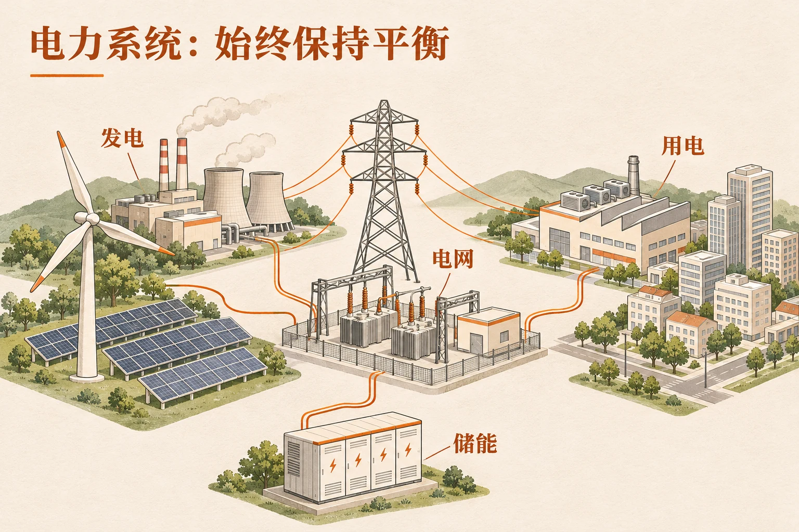
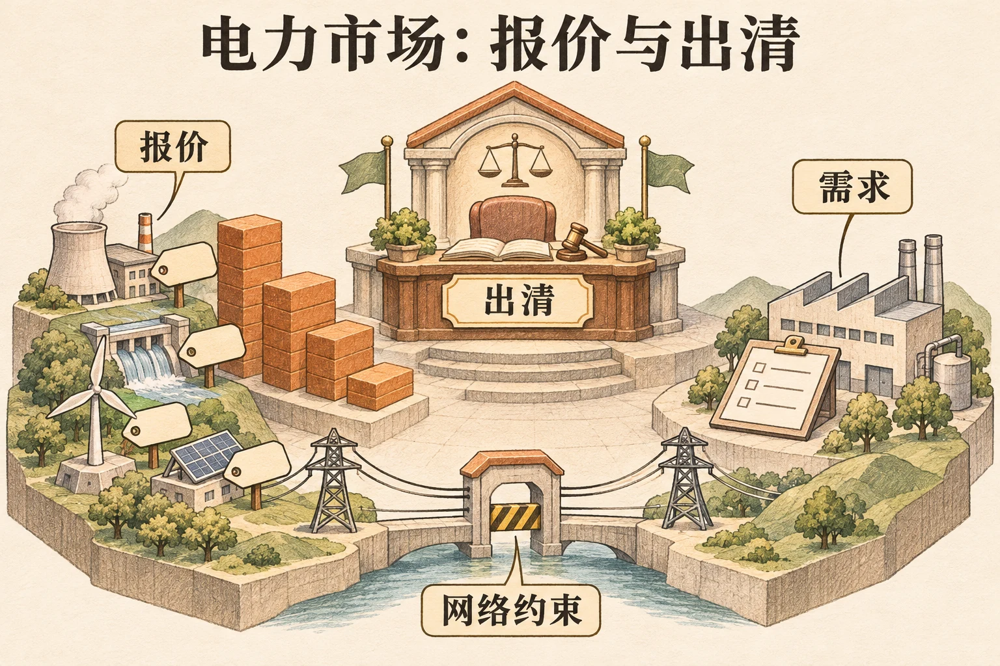

# Power Trading Atlas · 从数学与神经网络理解电力交易

从数学与神经网络出发，循序渐进理解电力系统、市场出清、负荷与电价预测、采购、结算、储能和工业应用。规则核对日期为2026-11-15，各份文件的版本状态见原始资料；算例不等于安徽实际账单。本文由课程规范数据导出，包含全部正文、数字例子、自检反馈与原始资料。交互实验请在网页中运行。阅读时间为学习估计，不是完成要求。

配图是概念插图；精确公式、数值、单位与模型边界以正文和计算实验为准。图片位于本文件上一级的 images 目录；单独下载 Markdown 不会同时下载图片，请保留站点目录结构。

## 课程目录

### 1. 用数学描述问题

从单位、向量和概率开始，理解误差、梯度与学习。

- 01 从功率、电量到一张电费账单
- 02 把负荷信息装进向量和矩阵
- 03 概率、期望与不能忽略的尾部
- 04 导数、梯度与一次可以手算的学习

### 2. 神经网络怎样学习

从一个神经元走到时序预测，观察参数如何由数据更新。

- 05 先做一个能被超越的线性基线
- 06 从一个神经元到非线性负荷模型
- 07 反向传播：把误差信号送回参数
- 08 时间窗、序列网络与预测区间

### 3. 读懂电力市场

认识电力平衡、市场产品、边际出清与网络约束。

- 09 电力平衡、参与者与交易对象
- 10 中长期、现货、辅助服务与绿电绿证
- 11 从报价到边际出清
- 12 输电约束与分区、节点价格

### 4. 从数据到可信预测

预测负荷、风光与电价，用时间回测和不确定性检验结果。

- 13 预测负荷、风电与光伏
- 14 电价预测：尖峰、负价与市场状态
- 15 按时间回测，识别数据泄露
- 16 分位数、情景与不确定性

### 5. 把预测变成决策

比较覆盖、结算、储能与风险目标，观察决策改变费用。

- 17 售电采购：锁价比例与风险敞口
- 18 日前与实时：把一笔用电结算清楚
- 19 储能、需求响应与虚拟电厂
- 20 随机优化、CVaR与强化学习各做什么

### 6. 走进中国与工业场景

核对中国与安徽规则，把工业用户的一天决策完整复算。

- 21 中国规则地图与安徽入口
- 22 工业用户与售电公司的业务全流程
- 23 综合项目：一天的交易决策
- 24 验证、上线边界与进阶路径

---

# 01 从功率、电量到一张电费账单

先分清 MW 与 MWh，再把分时负荷变成可计算的成本。

## 学习目标

- 区分瞬时功率、平均功率、电量与价格的单位。
- 用时段长度把负荷曲线转换为电量和能量采购成本。
- 解释为什么平均电价需要按电量加权。

## 水流的快慢与水桶的总量

把用电想成往水桶里放水：功率描述“此刻流得多快”，电量描述“这段时间一共用了多少”。功率常用 kW、MW，电量常用 kWh、MWh；$1\,\mathrm{MW}=1000\,\mathrm{kW}$，$1\,\mathrm{MWh}=1000\,\mathrm{kWh}$。“1 度电”是 1 kWh，不是 1 kW。

若一个时段内的**平均功率**为 $P_t$ MW，时长为 $\Delta t$ 小时，那么 $E_t=P_t\Delta t$ MWh。8 MW 连续运行 15 分钟，电量是 $8\times0.25=2$ MWh。只看到某一个采样瞬间的 8 MW，还不能断定整个时段都维持这个功率；计量口径和采样方式需要核实。

### 从工厂的用电强度出发，把每个时段的电量与价格配成一对。

- 把负荷理解为用电的快慢，把电量理解为一段时间里的累计用量。
- 数学积木提示我们先给数字标上单位，再进行加权与求和。
- 插图帮助组织概念；实际面积、电量和成本请以下面的计算为准。

## 让单位替你检查公式

如果该时段的能量价格 $\pi_t$ 为元/MWh，能量采购成本就是 $C_t=E_t\pi_t$，单位相消后得到元。一整天的教学采购成本为：

$$C=\sum_t P_t\Delta t\,\pi_t.$$

例如 2 MWh、480 元/MWh，成本为 960 元；480 元/MWh 等于 0.48 元/kWh。把 MW 直接乘元/MWh，结果是元/小时，缺少时长就还不是账单金额。建立表格或模型时，把时段起止、平均功率、电量、价格、金额分别作为字段，可以及早发现 1000 倍或 4 倍的换算错误。

## 相同总电量，为什么账单不同

分时价格变化时，“什么时候用”与“用了多少”同样重要。把 1 MWh 从 700 元/MWh 的时段移到 300 元/MWh 的时段，能量成本减少 400 元。这个算式只说明价格差的作用，是否能移需要看生产、设备和合同约束，后面会逐步加入。

实际采购均价应写成 $\bar\pi=\sum_tE_t\pi_t/\sum_tE_t$。它是按电量加权的价格，不是把各时段价格直接平均。只有各时段电量相等时，两者才一致；零总电量时均价没有定义，也不应显示为零。

## 先建能量账，再补完整账单

本课程先把一个工厂当作电力购买方：负荷预测给出未来需要多少电量，价格预测描述可能的采购价格，决策再决定合同覆盖、日前申报或可调负荷。三个环节都依赖同一份时段索引。日期、时区、缺失值和时段长度不一致，会让看似正确的乘法配错行。

这里的 $C$ 仅为教学能量采购项。真实终端账单还可能包含输配电、系统运行费用、政府性基金及附加、需量或容量费用等，是否适用取决于当地规则与合同。15 分钟也是本课的算例设定，不表示所有市场都采用这一结算粒度。

## 四个时段，手算一小时的采购成本

四个连续 15 分钟时段的平均功率为 $[8,12,10,6]$ MW，价格为 $[300,500,700,400]$ 元/MWh。

| 时段 | 平均功率 MW | 电量 MWh | 价格 元/MWh | 成本 元 |
|---|---:|---:|---:|---:|
| 1 | 8 | 2 | 300 | 600 |
| 2 | 12 | 3 | 500 | 1500 |
| 3 | 10 | 2.5 | 700 | 1750 |
| 4 | 6 | 1.5 | 400 | 600 |

总电量是 9 MWh，总成本是 4450 元，电量加权均价为 $4450/9\approx494.44$ 元/MWh。直接平均价格得到 475 元/MWh，会低估这组用电曲线的实际采购均价。

## 常见误区

“一台 10 MW 的设备，每个时段就一定用了 10 MWh。”MW 是功率，必须结合实际平均运行功率与时段长度；额定功率也不等于实际运行功率。

## 适用边界

所有负荷、价格和金额都是教学假设。这里只计算能量采购项，未复刻任何地区完整电费、结算或税费规则，也未证明移峰方案满足生产约束。

## 平均功率 12 MW 持续 15 分钟，按 500 元/MWh 计价，能量成本是多少？

1. 6000 元
   × 这是把 15 分钟误当成 1 小时。先算 12×0.25=3 MWh。

2. 1500 元
   ✓ 电量为 3 MWh，成本为 3×500=1500 元。

3. 1.5 元
   × 这里的价格单位已经是元/MWh，不需要再除以 1000。

## 原始资料

- [Measuring electricity](https://www.eia.gov/energyexplained/electricity/measuring-electricity.php) — U.S. Energy Information Administration, Online
- [Mathematics for Machine Learning](https://mml-book.github.io/) — Marc Peter Deisenroth, A. Aldo Faisal, Cheng Soon Ong, 2020

---

# 02 把负荷信息装进向量和矩阵

温度、历史负荷和生产计划，怎样成为模型的一行输入？

## 学习目标

- 区分样本、特征、向量与矩阵的形状。
- 手算点积和一个线性负荷预测。
- 说明标准化与特征可获得时刻的作用。

## 先给每个轴起名字

用 $x=[T,L,d]$ 表示一个时段的气温、历史负荷和工作日标记，这是一个含 3 个特征的向量。收集 96 个时段，就得到 $X\in\mathbb{R}^{96\times3}$：每一行是样本，每一列具有固定含义。96 是这里的数据规模示例，不是模型必须使用的长度。

神经网络通常还会多出批次、时间等轴。比如 $B\times T\times d$ 分别代表批量样本数、窗口长度和特征数。看到“维度”时，要判断它指轴的数量还是某条轴的长度。把形状写在变量旁边，比只盯着公式里的乘号更容易定位错误。

### 把不同来源的信息组织成有固定含义的数字格子，数学才能连接预测与成本。

- 一个有序数字列表可以对应一个时段的多个特征。
- 成组的数字格子可以对应多个时段，而不只是装饰性表格。
- 图中的积木不规定数据维度；本课明确采用“样本为行、特征为列”。

## 点积是一种可学习的加权汇总

点积为 $x\cdot w=\sum_jx_jw_j$，含义是每项特征乘以自己的权重，再相加。加上偏置得到 $\hat P=x\cdot w+b$。帽子表示预测值，$b$ 是基准水平，$w$ 表示模型如何利用各项特征。

对于 $X\in\mathbb{R}^{n\times d}$ 和列向量 $w\in\mathbb{R}^{d\times1}$，预测 $Xw+b$ 的形状是 $n\times1$，偏置按行加到每个样本。矩阵乘法包含对内部维度的求和；逐元素乘法只将对应格子相乘，两者不能混用。权重描述模型关系，并不自动具有因果解释。

## 不同单位先变成可比较的尺度

温度可能是几十，功率可能是几百，月份是 1 到 12。数值大不代表更重要，但会影响优化时各方向的尺度。常见标准化为 $\tilde x_j=(x_j-\mu_j)/\sigma_j$。这里 $\mu_j$ 和 $\sigma_j$ 只能由训练时允许使用的数据估计，再原样应用于验证、测试与未来输入；常量列要单独处理，避免除以零。

标准化后的数值通常无量纲。若直接预测 MW，则权重和偏置也必须与这个输出口径一致。二元工作日标记可以保持 0/1；并非每一列都必须同样处理。电价若可能为零或负，不能未经检查就套用普通对数变换。

## 输入正确，还要在当时拿得到

假设今天上午预测明天的负荷。明天的日历信息已知，已经发布的天气预报可用，明天实际测得的温度却还不知道。把未来实测温度放进历史回测，会让模型得到部署时不存在的信息，即数据泄漏。使用天气预报时还应保留其发布时间，避免取到更晚修订的版本。

实践中可以给每个特征加三列说明：定义和单位、对应的目标时段、最早可获得时刻。模型训练前先对齐这三件事，往往比盲目加深网络更有价值。第 15 课会把这个检查扩展成完整回测流程。

## 从原始特征得到 11 MW 的教学预测

设温度为 25°C、历史负荷为 9 MW、工作日标记为 1。仅为演算，给定训练阶段统计量：温度均值 20°C、标准差 5°C；负荷均值 10 MW、标准差 2 MW。于是 $x=[(25-20)/5,(9-10)/2,1]=[1,-0.5,1]$。

取教学权重 $w=[2,4,1]$ MW、偏置 $b=10$ MW，则 $\hat P=1\times2+(-0.5)\times4+1\times1+10=11$ MW。若预测区间为 15 分钟，预测电量为 $11\times0.25=2.75$ MWh。这些权重是手设示例，不是已训练模型。

## 常见误区

“先把全部数据标准化，再切分训练和测试更公平。”这样会把未来分布信息泄漏给训练过程；预处理参数也要遵守时间边界。

## 适用边界

本课只用线性映射说明形状与特征可用性。配套神经元实验展示加权和及激活，不自动从真实负荷数据训练，也不能证明某个特征具有因果作用。

## X 是 96×3，w 是 3×1，Xw 的形状是什么？

1. 96×1
   ✓ 对 3 个特征求和，每个时段产生一个预测值。

2. 3×3
   × 匹配的内部维度参与求和，不成为输出的两个轴。

3. 96×3×1
   × 矩阵乘法沿共同的3维求和，不会拼接所有轴；结果仍为96×1。

## 原始资料

- [Mathematics for Machine Learning](https://mml-book.github.io/) — Marc Peter Deisenroth, A. Aldo Faisal, Cheng Soon Ong, 2020
- [Dive into Deep Learning](https://d2l.ai/) — Aston Zhang, Zachary C. Lipton, Mu Li, Alexander J. Smola, 2023
- [Forecasting: Principles and Practice, 3rd edition](https://otexts.com/fpp3/) — Rob J Hyndman, George Athanasopoulos, 2021 / Online

---

# 03 概率、期望与不能忽略的尾部

为什么平均成本较低的方案，仍可能带来一次很大的亏损？

## 学习目标

- 把不确定负荷与价格写成带概率的情景。
- 计算期望、方差和相关情景的采购成本。
- 区分平均结果、波动和尾部损失。

## 先定义随机量，再分配概率

设明天某时段的采购成本为随机变量 $C$。在一个离散教学模型中，可能出现三个成本 $C_s$，各自概率为 $p_s$，要求 $p_s\ge0$ 且 $\sum_sp_s=1$。概率表示我们对未来的建模判断，不是把几个历史样本随意等权就能得到的客观保证。

情景最好保留联合关系。例如高温同时推高用电需求与现货价格，这应写成一个“高负荷、高价格”的联合情景。若分别随机打乱负荷和价格，可能制造出现实中不合理的组合，进而低估采购风险。

### 同一个决策会遇到多种未来；概率给每种未来一个权重。

- 把不同情景看成温度、负荷、价格共同变化的可能未来。
- 每种可能性需要概率权重，不能根据插图中对象的数量估计真实概率。
- 平均值用于汇总，但不能替代对极端情景的单独检查。

## 期望是加权平均，不是最常发生的值

期望为 $\mathbb E[C]=\sum_sp_sC_s$。它适合比较同一口径下的长期平均表现，但明天不一定出现这个数，甚至它可能不是任何一个情景值。两个方案具有相同期望，也可能有完全不同的风险分布。

对于随机电量 $E$ 和随机电价 $\pi$，成本期望是 $\mathbb E[E\pi]$，通常不能替换成 $\mathbb E[E]\mathbb E[\pi]$。二者差值就是协方差：$\mathbb E[E\pi]=\mathbb E[E]\mathbb E[\pi]+\operatorname{Cov}(E,\pi)$。需求越高价格也越高时，忽略这种关联容易低估成本。

## 方差量波动，尾部指标量坏结果

方差 $\operatorname{Var}(C)=\sum_sp_s(C_s-\mu)^2$ 描述相对均值 $\mu$ 的平方偏离；标准差是方差的平方根，与成本同为“元”。方差会同时惩罚高于和低于均值的偏离，所以它并不只描述亏损。

在采购问题里，高成本尾部往往更值得关注。分位数给出分布的位置，CVaR 则聚焦某个高置信水平以外的平均损失。离散分布存在概率质量跨越阈值的问题，不能总是机械地“挑超过分位数的样本平均”。第 16、20 课会给出明确的计算口径。

## 把不确定性传到决策里

一个完整流程是：定义可用信息，建立负荷与价格联合情景，对每个候选决策计算各情景的成本，再比较平均值、尾部与约束是否满足。先用同一组情景比较方案，才能知道差别来自决策而不是随机抽样变了。

风险偏好不是让模型自动猜出的事实。例如企业可能要求保留现金缓冲，或者不接受某类生产中断；这些约束需要从业务确定。教学时可以先用三个情景手算，实际研究还要检查情景覆盖、概率校准与极端事件是否遗漏。

## 一个均值不等于任何情景的例子

假设低、常态、高成本分别为 3000、5000、12000 元，概率分别为 0.5、0.4、0.1。期望为 $0.5\times3000+0.4\times5000+0.1\times12000=4700$ 元。

方差为 $0.5(3000-4700)^2+0.4(5000-4700)^2+0.1(12000-4700)^2=6{,}810{,}000$ 元²，标准差约 2610 元。10% 的高成本情景仍然需要单独审视。

另设两个等概率的联合情景 $(E,\pi)=(8,300)$ 与 $(12,700)$，单位分别是 MWh 和元/MWh。真实期望成本为 $0.5\times8\times300+0.5\times12\times700=5400$ 元；均值相乘只有 $10\times500=5000$ 元，相差 400 元。

## 常见误区

“把期望成本降下来，就一定降低了所有风险。”期望改善可以与尾部恶化同时发生，应同时检查损失分布和业务约束。

## 适用边界

情景与概率均为假设，不是对市场波动的估计。方差、分位数和 CVaR 也不能覆盖流动性、规则变更、信用与模型失效等全部风险。

## 高负荷与高价格经常同时出现时，用“平均电量×平均价格”估计成本可能怎样？

1. 必定精确，因为期望可以随意拆开相乘
   × 乘积的期望一般不能拆开，必须考虑电量与价格的相关性。

2. 可能低估，因为遗漏了正协方差
   ✓ 在这个条件下 E[Eπ]=E[E]E[π]+Cov(E,π)，协方差为正。

3. 一定高估，因为用了两个平均值
   × 平均值的数量不决定偏差方向，相关性才是这里的关键。

## 原始资料

- [Mathematics for Machine Learning](https://mml-book.github.io/) — Marc Peter Deisenroth, A. Aldo Faisal, Cheng Soon Ong, 2020
- [Forecasting: Principles and Practice, 3rd edition](https://otexts.com/fpp3/) — Rob J Hyndman, George Athanasopoulos, 2021 / Online

---

# 04 导数、梯度与一次可以手算的学习

把“预测偏了多少”变成参数应该怎样调整。

## 学习目标

- 用局部斜率解释导数、偏导数和梯度。
- 按明确定义的损失函数计算一次参数更新。
- 区分预测模型训练与带约束的交易优化。

## 导数回答“轻轻改一下会怎样”

把预测误差压缩成一个数叫作损失。先看一维例子：$L(w)=\tfrac12(w-3)^2$。当 $w$ 小于 3，稍微增大它会降低损失；大于 3 时则相反。导数 $L'(w)=w-3$ 把这种局部趋势变成有符号的数。

多参数时，对其中一个参数求导、暂时固定其他参数，得到偏导数。把所有偏导按参数顺序排列就是梯度 $\nabla_\theta L$。它说明附近怎样改变参数会影响损失，不是一个已经求出的最优参数列表。损失的定义和缩放改变，梯度大小也会改变。

### 把误差看成高低起伏的地形，梯度告诉你当前位置的变化趋势。

- 较低的位置类比较小的训练损失，不代表交易收益一定更高。
- 一次移动只利用局部斜率，步长仍需由学习率决定。
- 示意地形不包含真实市场约束；精确更新由公式和实验计算。

## 负梯度给方向，学习率给步长

梯度下降使用 $\theta_{k+1}=\theta_k-\eta\nabla_\theta L(\theta_k)$，其中 $\eta>0$ 是学习率。减去负梯度会增大参数；“下降”的对象是目标损失，而不是每一个权重都变小。

对 $L(w)=\tfrac12(w-3)^2$，误差满足 $w_{k+1}-3=(1-\eta)(w_k-3)$。因此本例在 $0<\eta<2$ 时收敛；$\eta=2$ 会在低点两侧等幅摆动，$\eta>2$ 通常发散。这一范围由本例曲率决定，不能直接作为真实网络的学习率建议。

## 从一个负荷预测得到梯度

令预测为 $\hat y=wx+b$，训练目标为 $y$，损失 $L=\tfrac12(\hat y-y)^2$。链式法则把两段变化接起来：$\partial L/\partial w=(\hat y-y)x$，$\partial L/\partial b=\hat y-y$。输入值越大，同样的输出误差会对权重产生更大的梯度，这也解释了特征缩放的作用。

本课求导的 $x,y,w,b$ 均按教学尺度处理；真实实现常对输入和目标分别标准化，再将预测反变换回 MW。一个批量的训练损失是多个样本损失的平均，梯度也要采用相同的归一化口径。第 7 课会把这条链延伸到隐藏层。

## 学预测参数，与选交易动作是两回事

训练负荷模型时，变量是权重，目标是减少预测误差。做采购决策时，变量可能是合同电量、报价或储能充放电，目标可能是采购成本与风险，且必须满足能量平衡、容量和生产约束。预测误差更小并不自动保证交易结果更好，因为两者的目标、约束和错误代价不同。

连续且可导的问题可以使用梯度方法；含整数开停机、分段报价、离散交易档位的模型可能需要其他优化方法。不要把“沿梯度走”误当成解决所有电力交易问题的通用按钮。先明确定义变量、单位、目标和约束，再选择算法。

## 同时更新斜率和偏置

用无量纲教学数据 $x=2,y=5$，初始 $w=1,b=0$。预测 $\hat y=2$，误差为 $-3$，损失 $L=\tfrac12(-3)^2=4.5$。两个梯度分别是 $\partial L/\partial w=-3\times2=-6$、$\partial L/\partial b=-3$。

取学习率 $\eta=0.1$，使用**更新前的同一组梯度**得到 $w'=1.6,b'=0.3$。重新前向计算 $\hat y'=1.6\times2+0.3=3.5$，新损失 $\tfrac12(3.5-5)^2=1.125$。这只说明一个样本上的一次更新，并未证明对未来负荷有泛化能力。

## 常见误区

“损失下降就意味着交易一定赚钱。”训练损失度量预测误差；交易收益还取决于决策规则、价格实现、约束和费用，两者需要分别评估。

## 适用边界

推导使用光滑、确定性的简化损失，配套实验用于看清更新方向；它不是市场优化求解器，也不提供非凸网络全局收敛保证。

## 当前参数为 1，梯度为 −6，学习率为 0.1，下一步参数是多少？

1. 0.4
   × 更新是减去梯度，减去负数会增大参数。

2. 1.6
   ✓ 1−0.1×(−6)=1.6，方向由梯度符号决定。

3. 6
   × 梯度是局部变化率，不能直接当作新的参数值。

## 原始资料

- [Mathematics for Machine Learning](https://mml-book.github.io/) — Marc Peter Deisenroth, A. Aldo Faisal, Cheng Soon Ong, 2020
- [Deep Learning](https://www.deeplearningbook.org/) — Ian Goodfellow, Yoshua Bengio, Aaron Courville, 2016
- [Dive into Deep Learning](https://d2l.ai/) — Aston Zhang, Zachary C. Lipton, Mu Li, Alexander J. Smola, 2023

---

# 05 先做一个能被超越的线性基线

从“昨天同一时刻”到回归，让复杂模型有一个公平的比较对象。

## 学习目标

- 区分预测目标、输入特征与可训练参数。
- 解释最小二乘如何从数据确定一条预测关系。
- 用按时间留出的结果比较简单基线与复杂模型。

## 为什么先预测“和昨天差不多”

复杂模型应该先回答一个朴素问题：它是否比简单办法更有用？负荷的季节性基线可以取上一个同类时段，例如昨天或上周同一时刻的负荷。普通持续性基线取最后一个可见观测值。它们不需要深层网络，却能揭示数据里有多强的重复规律。

基线必须遵守预测时点。预测明天全天时，“明天前一时刻的实际负荷”还不可用，不能偷偷作为输入。工厂临时停产、节假日和极端天气会让简单重复失效；这些失败也提供了新特征和更复杂模型应该解决的问题。

### 先把已知信息送进一个简单预测器，再用实际观测检查误差。

- 天气、日历与历史用电都可以提供预测线索，但应在预测时已经可获得。
- 模型部分先用线性加权来理解，不需要立即跳到深层网络。
- 预测与实际的比较产生学习信号；图中不展示真实模型的精度结果。

## 让数据选择权重，而不是手调到好看

线性模型为 $\hat y_i=x_i\cdot w+b$。给定 $n$ 个训练样本，可以最小化半均方误差：

$$L(w,b)=\frac{1}{2n}\sum_{i=1}^n(\hat y_i-y_i)^2.$$

平方让正负误差不会相互抵消，并让大误差承担更大的惩罚。$1/2$ 只是方便求导的约定，必须与梯度和学习率口径一致。优化得到的是“在这些特征、数据和损失下的拟合关系”，不是某个永远成立的物理定律。解析方法或梯度方法都可以求解合适的线性回归问题。

## 线性模型也能表达经过设计的关系

“线性”通常指对待估参数线性，不表示原始温度只能直线影响负荷。可以事先构造制冷度数、温度平方、小时指示或生产计划等特征，再做线性回归。例如 $\max(T-26,0)$ 可描述超过某阈值后的额外制冷需求；26°C 在这里是教学设定，不是通用工程阈值。

特征越多越要关注共线性与过拟合。岭回归在损失里加入 $\lambda\lVert w\rVert_2^2$，用系数大小约束拟合自由度；通常不惩罚截距。缩放方式、特征组合与 $\lambda$ 都只能利用训练和验证数据选择。正则化帮助控制模型，但不能修复未来信息泄漏。

## 看误差在什么时候发生

定义残差 $e_t=y_t-\hat y_t$，正值表示低估。除了汇总 MAE 或 RMSE，还要按小时、工作日、温度区间、预测步长检查误差。一个模型可能白天很好、晚高峰系统性低估；平均误差接近零也可能只是正负相消。

比较模型时应使用相同的预测起点、数据可用范围和评估时段。先报告预测质量，再把预测交给同一套决策逻辑检查业务后果。若只给复杂模型额外天气信息，却让基线缺少这些信息，性能差异就不能全部归功于网络结构。

## 三条教学数据确定一个线性关系

设标准化温度特征 $x=(T-20)/5$，三个教学样本为 $(x,y)=(0,8),(1,10),(2,12)$，$y$ 单位为 MW。关系 $\hat y=2x+8$ 恰好拟合这三个样本；训练半均方误差为零。

预测温度 27.5°C 时，$x=1.5$，得到 $\hat y=11$ MW。若后来观测为 11.5 MW，绝对误差为 0.5 MW。假设同期季节性基线为 10.5 MW，它的绝对误差为 1 MW。这里只比较了一个合成样本，不能据此宣称线性模型普遍优于季节性基线，也不能从零训练误差推出零未来误差。

## 常见误区

“训练误差为零，说明预测问题已经解决。”零误差可能只来自非常简单的样本或过拟合，未来评估仍必须独立进行。

## 适用边界

直线与温度阈值均为教学构造，不是经过校准的工厂负荷规律。配套梯度实验用于理解拟合过程，不进行真实多特征回归或模型优劣排名。

## 怎样判断新网络比线性基线更有效？

1. 比较同一时间留出集、同一信息范围下的表现
   ✓ 保持任务和信息范围一致，差异才更能反映模型本身，并应检查误差的业务后果。

2. 只看谁的训练误差更低
   × 更强的拟合能力也可能只是记住训练样本。

3. 谁参数更多，谁一定更好
   × 模型容量不是未来预测效果的保证。

## 原始资料

- [Mathematics for Machine Learning](https://mml-book.github.io/) — Marc Peter Deisenroth, A. Aldo Faisal, Cheng Soon Ong, 2020
- [Dive into Deep Learning](https://d2l.ai/) — Aston Zhang, Zachary C. Lipton, Mu Li, Alexander J. Smola, 2023
- [Forecasting: Principles and Practice, 3rd edition](https://otexts.com/fpp3/) — Rob J Hyndman, George Athanasopoulos, 2021 / Online

---

# 06 从一个神经元到非线性负荷模型

加权、偏置、激活，再把简单计算组合成一张网络。

## 学习目标

- 分清输入、参数、中间特征与最终输出。
- 手算一个 ReLU 神经元及其负荷输出。
- 根据预测任务选择输出含义，而不是把任何数都叫概率。

## 一个神经元的四个角色

人工神经元先计算 $z=\sum_jw_jx_j+b$，再输出 $h=\phi(z)$。$x_j$ 是当前样本输入，$w_j$ 与 $b$ 是训练得到的参数，$\phi$ 是激活函数，$h$ 是中间特征。输入每次变化，参数通常在推理阶段保持固定；训练阶段才按损失更新参数。

把温度和生产强度送进一个神经元，可以形成“高温且高生产强度”的组合特征。这个说法只是帮助理解：普通隐藏节点未必具有可命名、稳定的业务含义。网络学到的统计关系，也不等于我们已经掌握了调节工况的因果机制。

### 网络把可用特征逐层变换，最终给出一个与任务单位一致的预测。

- 输入侧的不同信息可以对应天气、生产计划与历史负荷。
- 中间节点类比可学习特征，节点数量不是本课网络的精确规模。
- 输出侧的负荷或价格只是预测，实际值仍要等待观测与评估。

## 为何需要激活函数

若两层都只是线性变换加偏置，它们仍可合并：$(xW_1+b_1)W_2+b_2=x(W_1W_2)+b_1W_2+b_2$。增加层数本身没有摆脱仿射关系。插入非线性之后，网络才能组合出更复杂的分段或曲面关系。

ReLU 定义为 $\phi(z)=\max(0,z)$：正输入直接通过，负输入输出零。sigmoid 则把输入压缩到 0 与 1 之间。ReLU 不会让权重自动为正，也不会保证每个单元都一直有效；某些单元若长期落在负区间，梯度可能为零。

## 把许多神经元合成矩阵

采用行向量约定，一个含 $d$ 个输入、$h$ 个隐藏单元、单个输出的网络可以写为 $H=\operatorname{ReLU}(XW_1+b_1)$，$\hat y=HW_2+b_2$。若 $X$ 为 $n\times d$，则 $W_1$ 为 $d\times h$，$H$ 为 $n\times h$，$W_2$ 为 $h\times1$。

输入层没有把数据变成生物神经元；它只是规定数字如何进入计算。隐藏层学到中间表示，输出层把这些表示映射到目标。增加容量可能帮助拟合复杂关系，也增加数据、正则化与验证要求，不能替代对时序和预测时点的正确处理。

## 输出层必须服从目标的含义

预测负荷时，可以使用线性输出再检查物理可行性，或根据建模设计采用合适的非负变换。预测现货价格时，某些市场和时段允许负价格，不能为了“看起来合理”而一律用 ReLU 截掉负数。目标做过标准化时，先反变换才能恢复 MW 或元/MWh。

只有在合适的二分类目标、训练与评估下，sigmoid 输出才可解释为某事件的预测概率；0.8 的隐藏激活不是“80% 把握”。输出概率还需检查校准。多个分位数或多个未来时段也可以各占一个输出位置，它们的维度和业务含义要在训练前写清楚。

## 一层隐藏特征，得到 8.6 MW

输入两个无量纲特征 $x=[0.5,1]$，取 $w=[1.2,0.8]$，偏置 $b=-0.5$。加权和为 $z=0.5\times1.2+1\times0.8-0.5=0.9$，ReLU 隐藏值 $h=0.9$。

设输出层为 $\hat P=5+4h$ MW，得到 $\hat P=8.6$ MW。若第一个特征改为 $-1$，则 $z=-0.9$，$h=0$，预测变为 5 MW。这里的 5 是手设的输出基准，不是最低用电量的物理证明。

## 常见误区

“用 sigmoid 得到 0.8，就说明负荷预测有 80% 正确率。”激活数值的范围不决定其统计含义；必须看目标、损失、校准与评估。

## 适用边界

实验使用滑块调整的小型计算单元，不训练深层网络；隐藏特征解释是帮助理解的类比，未验证实际工业用电规律或交易收益。

## 为了预测可能出现负值的现货价格，输出层必须如何考虑？

1. 任何预测都必须用 ReLU 截断到非负
   × 这会排除目标中允许的负价格，造成模型表达错误。

2. 根据市场允许的目标范围设计输出，而不是任意截断
   ✓ 输出变换应与目标口径一致；是否允许负价要核对具体规则。

3. 所有输出都改成 0 到 1 的概率
   × 价格回归与事件概率预测是不同任务。

## 原始资料

- [Deep Learning](https://www.deeplearningbook.org/) — Ian Goodfellow, Yoshua Bengio, Aaron Courville, 2016
- [Dive into Deep Learning](https://d2l.ai/) — Aston Zhang, Zachary C. Lipton, Mu Li, Alexander J. Smola, 2023

---

# 07 反向传播：把误差信号送回参数

前向得到预测，反向得到梯度，优化器才执行更新。

## 学习目标

- 按计算图跟踪一次前向和反向传播。
- 用链式法则手算两层网络的参数梯度。
- 区分训练改进、验证选择与最终测试。

## 先保存每一步算了什么

考虑一个两层标量网络：$z_1=w_1x+b_1$，$h=\operatorname{ReLU}(z_1)$，$\hat y=w_2h+b_2$，$L=\tfrac12(\hat y-y)^2$。按顺序计算这些变量就是前向传播。计算图记录哪些结果依赖哪些输入，因此也给反向求导提供路径。

反向传播会用到前向中间值。例如 $\partial\hat y/\partial w_2=h$，而 ReLU 的局部导数取决于 $z_1$ 是正还是负。训练所需内存因此不只包含权重，还包括用于求导的中间状态。推理若不需要梯度，可以省去一部分训练状态。

### 预测与实际之间的差异形成损失，训练沿计算依赖把梯度传回各层。

- 先顺着输入到输出理解前向计算，再把实际观测用于计算损失。
- 学习反馈表示调整参数所需的导数，不是把真实答案倒着塞回网络。
- 图中的反馈路径仅表达直觉，具体梯度和更新由本课算例展开。

## 把每一段局部影响乘起来

第一层权重影响隐藏特征，隐藏特征影响预测，预测影响损失。链式法则把这条路径连接成：

$$\frac{\partial L}{\partial w_1}=\frac{\partial L}{\partial\hat y}\frac{\partial\hat y}{\partial h}\frac{\partial h}{\partial z_1}\frac{\partial z_1}{\partial w_1}.$$

当 $z_1>0$，四项分别是 $(\hat y-y)$、$w_2$、1 和 $x$。若一项变量通过多条路径影响损失，需要把各路径贡献相加。反向传播复用公共中间梯度，提高计算效率；它不是为每个参数重新跑一遍完全独立的数值试探。

## 一次训练迭代的职责分工

一个基础迭代按顺序完成：读取训练样本 → 前向预测 → 计算损失 → 清理或管理旧梯度 → 反向求导 → 优化器更新。反向传播只计算梯度，SGD、Adam 等优化器才决定怎样改参数。若有意累积多个小批量的梯度，应清楚何时清零、何时更新，以及损失怎样归一化。

大梯度可能来自异常数据、尺度不当或训练不稳定。检查输入与目标对齐，比首先尝试更复杂优化器更重要。自动微分能正确求出**所写计算图**的导数，但无法替你发现“把次日价格错当成当前特征”这样的任务定义错误。

## 训练学参数，验证选方案，测试看未来

训练集参与梯度计算；验证集用于选择模型、学习率、正则化和检查点；测试集在方案冻结后评估。验证集虽不直接更新权重，反复据此做选择仍可能过度适应它。时间序列需要保留时间顺序，并防止滚动窗口的目标跨过划分边界。

例如训练损失在第 10、20、30 轮为 0.50、0.30、0.20，而同一验证集损失为 0.55、0.40、0.48。若预先约定按最低验证损失选择，应取第 20 轮。早停是选择规则，不是“模型已经理解市场”的证明；最终还应检查未见时段与极端工况。

## 同时更新四个参数，并重新计算损失

使用无量纲教学值 $x=2,y=4,w_1=0.5,b_1=0,w_2=3,b_2=0$。前向：$z_1=1,h=1,\hat y=3,L=0.5$。

反向：输出误差为 $-1$，因此 $\partial L/\partial w_2=-1$、$\partial L/\partial b_2=-1$；第一层 $\partial L/\partial w_1=(-1)\times3\times1\times2=-6$、$\partial L/\partial b_1=-3$。

学习率 0.01 时，使用同一旧参数点的梯度同时更新：$w_1'=0.56,b_1'=0.03,w_2'=3.01,b_2'=0.01$。新隐藏值 $h'=0.56\times2+0.03=1.15$，新预测 $3.01\times1.15+0.01=3.4715$，新损失约 0.139656。不能先更新第二层，再拿新权重计算这一步第一层的旧梯度。

## 常见误区

“调用反向传播后参数就已经变了。”反向传播计算导数，参数更新是另一个操作；梯度累积时尤其需要区分。

## 适用边界

例子省略批量矩阵计算、正则化、优化器内部状态和 ReLU 零点约定。配套实验用于理解梯度步骤，不模拟真实训练集与验证集的泛化曲线。

## 训练损失一直下降，但验证损失先降后升，按预设验证规则应怎样选模型？

1. 选择训练损失最低的最后一轮
   × 训练拟合更好不保证未见数据表现更好。

2. 反复查看测试集，直到找到最好的一轮
   × 这会把测试集变成选择模型的开发数据。

3. 按验证损失选检查点，再在独立测试集评估
   ✓ 验证承担选择职责，独立测试保留最终检验作用。

## 原始资料

- [Deep Learning](https://www.deeplearningbook.org/) — Ian Goodfellow, Yoshua Bengio, Aaron Courville, 2016
- [Dive into Deep Learning](https://d2l.ai/) — Aston Zhang, Zachary C. Lipton, Mu Li, Alexander J. Smola, 2023
- [Forecasting: Principles and Practice, 3rd edition](https://otexts.com/fpp3/) — Rob J Hyndman, George Athanasopoulos, 2021 / Online

---

# 08 时间窗、序列网络与预测区间

把过去组织成输入，把尚未发生的未来组织成目标。

## 学习目标

- 明确预测起点、历史窗口与预测步长。
- 说明 MLP、卷积、循环网络与注意力处理序列的不同方式。
- 区分点预测、分位数区间和联合情景。

## 每个样本都有一个“现在”

在预测起点 $t$，模型看到长度为 $L$ 的历史窗口 $x_{t-L+1:t}$，预测未来 $H$ 个时段 $y_{t+1:t+H}$。如果每时段有 $d$ 个特征，一批输入可以记为 $B\times L\times d$，输出为 $B\times H$。输入轴与输出轴含义不同，不能因为都表示时间就直接对齐相乘。

未来日历通常提前已知；未来天气只能使用在 $t$ 之前发布的预报版本；未来实际负荷仍是目标。训练样本可以来自很多过去起点，但每个样本都要恢复其当时可用的信息。任何填补、平滑或归一化都必须考虑这一时间边界。

### 历史测量和已知未来条件一起进入模型，输出是尚未观测的未来。

- 把历史记录和预测起点分清：起点之后的真实结果不能混进输入。
- 天气预报与日历是可能的未来条件，但两者的可用性和误差不同。
- 预测带表达不确定性的概念；具体覆盖率必须通过独立数据检验。

## 不同网络怎样利用历史

MLP 可以把固定窗口展平成一串特征，结构简单但输入长度通常固定。时间卷积使用局部共享滤波器提取模式；因果卷积在每个位置只访问该位置及之前的信息。RNN 按时间更新隐藏状态，LSTM/GRU 用门控调节信息保留；注意力根据当前任务对多个历史位置进行加权组合。

这些结构各有计算和建模取舍，没有一个名称能保证在所有负荷数据上最好。已完整观测的历史窗口内部使用双向编码不必然泄漏；真正的判断是：有没有读到**预测起点之后尚不可得的信息**。模型能接受不同窗口长度，也不意味着无需长度管理、掩码或足够的训练覆盖。

## 直接预测与递归预测会遇到不同错误

递归方式先预测一步，再把预测值作为下一步的输入继续向前。它复用一个预测器，但训练时使用真实历史、推理时使用自己的预测，分布可能变化，误差也可能累积。直接多步方式一次输出 $H$ 个目标，或为每个步长建模型，避免把前一步预测强行回填，但需要学习不同步长的规律。

评估时要逐步长报告误差，而不是只给一个混在一起的均值。近一小时预测准确，不说明明天全天也准确。滚动重预测能纳入新信息，但回测也必须在相应时点才释放这些观测，不能提前使用。

## 一个数不够时，给出分布信息

点预测给出一个中心值，例如条件均值或中位数。分位数预测可以给出 $q_{0.1},q_{0.5},q_{0.9}$；在相应条件分布下，10%与90%分位数构成名义80%区间；连续分布且分位数准确时对应80%的概率质量，离散分布的覆盖可能更高。这是模型声称的覆盖，必须检查实际样本覆盖率、区间宽度和不同工况的表现。

逐时分位数带不是一条联合概率情景路径。“每个时段分别有 80% 覆盖”不等于“整天全部时段同时有 80% 覆盖”。储能、累计电量和组合风险需要跨时段相关性，通常还要构造联合情景。第 13—16 课会把这些概念连接到负荷、电价和回测。

## 四步输入、两步输出，检查功率与电量

设在起点 $t$ 已看到四个 15 分钟平均负荷 $[8,9,10,11]$ MW。模型预测未来两步为 $[12,10]$ MW，因此未来半小时预测电量为 $(12+10)\times0.25=5.5$ MWh。

后来实际值为 $[13,9]$ MW，两个绝对误差均为 1 MW，所以 MAE 为 1 MW；实际总电量同样是 5.5 MWh。**总电量准确并不代表每个时段准确**：若两步价格不同，时段误差仍会影响采购成本。

若第一步给出 10%—90% 分位数为 $[10,14]$ MW，它只描述第一步边际预测区间。不能据此给整条两步路径贴上“80% 一定命中”的标签。

## 常见误区

“把每小时的 10% 与 90% 分位数连起来，就得到有 80% 概率覆盖整天的路径。”边际覆盖与联合覆盖不同，需要检查跨时段相关性。

## 适用边界

本课比较网络思路与数据组织方式，配套预测实验为本地教学模型，没有训练或基准测试 LSTM、Transformer 等大型网络，也没有为真实市场提供概率担保。

## 今天上午预测明天的负荷，下面哪个输入会泄漏未来信息？

1. 已经公布的明天节假日安排
   × 它在预测时已知，可以使用，但仍需保持正确日期对齐。

2. 今天上午已发布的明天天气预报
   × 当时已发布的预报可用；要保留版本，不能换成后来更新的预报。

3. 明天结束后统计得到的实际平均气温
   ✓ 预测时还不可得，用它回测会夸大可部署效果。

## 原始资料

- [Deep Learning](https://www.deeplearningbook.org/) — Ian Goodfellow, Yoshua Bengio, Aaron Courville, 2016
- [Dive into Deep Learning](https://d2l.ai/) — Aston Zhang, Zachary C. Lipton, Mu Li, Alexander J. Smola, 2023
- [Forecasting: Principles and Practice, 3rd edition](https://otexts.com/fpp3/) — Rob J Hyndman, George Athanasopoulos, 2021 / Online

---

# 09 电力平衡、参与者与交易对象

先跟着一度电认识系统，再跟着一笔合同认识市场。

## 学习目标

- 区分功率、电量、容量和灵活性。
- 说清发电、用电、交易、调度与电网各自的作用。
- 把每个时段的供需平衡写成带单位的等式。

## 从功率走到电量，再走到费用

“工厂用了 10 MW 电”还不是完整的电量描述：MW 是速度，需要补上持续时间。若一个时段内平均功率为 $P$、长度为 $\Delta t$ 小时，电量就是 $E=P\Delta t$ MWh。负荷曲线下各小块面积相加，才是一整天的用电量；不同长度时段不能直接把功率数值相加当成电量。

容量描述设备可以提供的功率或储存的能量。一个标为“10 MW / 20 MWh”的电池同时给出了功率与能量两个上限。灵活性则关注能多快改变、能持续多久，以及付出什么代价。采购电能量、购买备用能力与安排电池充放电，解决的是不同问题。

### 发电侧、电网、用户与储能共享一个物理系统，交易关系建立在这个系统之上。

- 先找发电与用电设施，思考每个时刻谁在提供或消耗功率。
- 储能的作用随充电和放电切换：充电增加需求，放电提供电力。
- 图中连线表达关系；真实潮流和合同关系需要分别建模，不能按图追踪某一笔合同的电子。

## 交易计划最终要落到物理平衡

从一个区域的简化边界看，每个时段都要满足：

$$P_{\mathrm{generation}}+P_{\mathrm{import}}+P_{\mathrm{discharge}}=P_{\mathrm{load}}+P_{\mathrm{export}}+P_{\mathrm{charge}}+P_{\mathrm{loss}}.$$

这不是说交易员需要每秒亲自平衡系统。市场形成计划与价格，调度根据运行条件组织执行，并安排备用等调节资源。天气、故障和用户行为会使实际结果偏离预测，因此日前计划不是对未来物理状态的保证。

本课先把损耗设为零，学会核对供需。以后加入网络和储能时，应把相应项加回模型。不能为了让等式成立，悄悄删除未满足的需求；缺额必须单独显示。

## 五种角色，不是五个互不相关的系统

发电企业提供电能量及其具备条件的服务；电力用户提出用电需求；售电公司汇集客户需求、采购并管理合同和价格风险。虚拟电厂、聚合商或储能等新型主体，是否能提供某项产品，要看资源能力和当地准入规则。

电力交易机构组织交易并提供相关服务，电力调度机构组织系统运行；电网企业提供输配电等服务并依规开展计量和电费收付。角色可能在业务流程中密切配合，但“撮合一笔交易”和“决定实时安全运行方式”不是同一项工作。

市场允许谁参与、谁报价、谁只申报数量，须查适用规则。不要把国外市场的组织名称和权限直接套到中国，也不要把一个省的申报模式扩展成全国固定模式。

## 区分电力流、合同流与资金流

工厂与某风电场签订购电合同，意味着形成约定的商业权利义务；它通常不意味着电网为两者开辟一条专用电子通道。电力流取决于电网结构和运行状态，合同记载时段、数量、价格及责任，结算依据实际计量和市场规则形成资金流。

读一份交易数据时，先问“这一列属于哪条流”：MW 可能是功率计划，MWh 可能是交割电量，元/MWh 是单价，元才是费用。相同的 100 出现在不同列，含义完全不同。后续预测模型的标签、优化模型的变量与结算公式，都要沿用这套单位和边界。

## 15 分钟内，发电、储能和用户如何对上账

教学区域发电 90 MW、进口 20 MW，工厂负荷 100 MW、电池充电 10 MW，忽略损耗：$90+20=100+10$。15 分钟为 0.25 h，所以工厂用电 25 MWh、电池从电网吸收 2.5 MWh。若只计算工厂的电能量费用，单价为 400 元/MWh，则为 $25\times400=10000$ 元；电池充电电量不能再混入工厂这笔费用。

## 常见误区

“签了某电厂的合同，就能沿电线识别买来的那批电。”合同、物理潮流和费用记录是相互关联但不同的对象。

## 适用边界

平衡式是区域、时段平均的教学表达；未模拟频率、电压、无功、网损或事故过程，也不替代调度安全校核。

## 一个负荷连续 15 分钟保持 80 MW，其电量是多少？

1. 80 MWh
   × 80 MWh 对应持续一小时；这里时段只有 0.25 h。

2. 20 MWh
   ✓ 电量 = 80 MW × 0.25 h = 20 MWh。

3. 320 MWh
   × 应乘持续时间，而不是除以 0.25 h。

## 原始资料

- [Measuring electricity](https://www.eia.gov/energyexplained/electricity/measuring-electricity.php) — U.S. Energy Information Administration, Online
- [《电力市场运行基本规则》— 2024 年第 20 号令](https://zfxxgk.ndrc.gov.cn/wap/iteminfo.jsp?id=20379) — 国家发展和改革委员会, 2024
- [《电力市场计量结算基本规则》— 发改能源规〔2025〕976 号](https://zfxxgk.ndrc.gov.cn/web/iteminfo.jsp?id=20533) — 国家发展和改革委员会、国家能源局, 2025

---

# 10 中长期、现货、辅助服务与绿电绿证

同一个电力系统，为什么需要多种交易安排？

## 学习目标

- 按时间尺度和交易对象区分市场。
- 说明中长期合同与现货结算如何共同管理价格暴露。
- 区分电能量、调节服务和绿证环境属性。

## 先安排长期敞口，再处理临近交付的变化

中长期交易为未来交割安排数量、价格、时段曲线和责任，可以覆盖数年、年度、月度和月内。它让买卖双方更早管理不确定性，但“年度合同”不等于全年每小时都用同样功率，更不等于预测和偏差管理从此消失。

现货围绕更接近交付的时间组织。日前使用当时掌握的信息安排下一天，日内和实时可以进一步反映条件变化。具体有哪些环节、是否有财务结算以及如何与中长期衔接，取决于适用市场规则。可以先把它理解为逐步修正信息的过程，再学习当地的执行细节。

### 相同的电源、电网与用户，可以围绕不同时间尺度和不同产品建立交易关系。

- 先看物理资源，再问它能提供电能量、备用能力还是调节服务。
- 储能与可调负荷的价值来自可执行的调节能力，不能只看名称。
- 新能源的电能量与绿色属性分开解释；图中颜色不代表经过核证的环境声明。

## 合同不是给每个时段贴一个固定电价

假设用电量固定为 $Q$，其中 $q_c$ 按合同价 $K$ 购入，其余按现货价 $p$ 购入，简化费用为 $C=q_cK+(Q-q_c)p$。这个式子用于认识“覆盖量”和“未覆盖量”：合同覆盖越大，剩余现货价格暴露通常越小，但合同也可能比之后的现货贵。

若实际用电量不确定，合同过量或不足都需要依规处理；还要看覆盖的是哪个时段、哪个结算参考点。总量对上但小时曲线不对，仍会有风险。第 17、18 课把这种直觉展开为采购情景和日前/实时结算，不能把本节的一行公式当作全国统一账单。

## 辅助服务购买的是系统需要的调节

电能量交易回答“在这个时段提供或消费多少电”。辅助服务还关心“出现变化时，谁能及时响应”：调频关注相应的频率调节能力，备用为可能发生的供需变化预留能力。不同品种的资格、响应要求、计价和考核并不相同。

同一块电池不能把全部功率同时承诺给互不兼容的任务。联合安排需要考虑机会成本、能量状态和履约约束。中国 2025 年辅助服务基本规则还要求，现货连续运行地区由现货价格发挥相应调峰作用，不再运行调峰及类似功能市场；不能把历史上的各类补偿无限叠加为当前收益。

## 绿电与绿证：分清电能量和环境属性

绿电交易涉及符合条件的可再生能源电能量及相应绿色属性，绿证则是该属性的凭证。中国绿证的基本单位是 1 个对应 1000 kWh，也就是 1 MWh。绿证可以帮助核验可再生能源消费，但不是“每张抵扣一吨碳”的通用碳信用。

读合同要分别识别电能量价格、绿证数量和价格、交割与核销安排。已声明的同一环境属性不能反复当作不同主体的新贡献。依据 2025 年绿证管理实施细则，独立储能放电不核发绿证；从 2026 年起，声明绿色消费的核销还须遵守生产年份与消费年份匹配等要求。课程的数量换算不替代具体项目的核发资格审查。

## 100 MWh 的覆盖量，不等于 100 MWh 的完整账单

假设某交割块需求 100 MWh，60 MWh 合同价 380 元/MWh，40 MWh 现货价 500 元/MWh。简化电能量成本为 $60\times380+40\times500=42800$ 元，平均 428 元/MWh。若其中 30 MWh 符合相应绿电及绿证条件，数量上对应 30 个绿证；若另行约定绿证单价 5 元/个，则该部分价格为 150 元。后一个假设不意味着所有合同都把绿证额外收费，也不包含输配电等项目。

## 常见误区

“中长期买了电，现货、辅助服务和绿证都是重复收费。”它们描述不同时间安排或不同产品，是否及如何结算要读规则和合同。

## 适用边界

本课展示产品分类和简化覆盖关系，不推荐合同配置；现货 2023 试行规则仅作机制参考，版本状态及安徽入口见第 21 课。

## 在满足相关核发条件的前提下，25 MWh 可再生能源电量对应多少个中国绿证？

1. 25 个
   ✓ 每个对应 1 MWh；数量换算仍需与项目资格及实际核发区分。

2. 25,000 个
   × 25,000 是换算后的 kWh 数量，不是绿证数量。

3. 25 吨碳信用
   × 绿证证明电量环境属性，不是固定吨数的碳信用。

## 原始资料

- [《电力中长期市场基本规则》— 发改能源规〔2025〕1656 号](https://www.ndrc.gov.cn/xxgk/zcfb/ghxwj/202512/t20251226_1402666.html) — 国家发展和改革委员会、国家能源局, 2025
- [《电力辅助服务市场基本规则》— 发改能源规〔2025〕411 号](https://www.ndrc.gov.cn/xxgk/zcfb/ghxwj/202504/t20250429_1397483.html) — 国家发展和改革委员会、国家能源局, 2025
- [《可再生能源绿色电力证书管理实施细则（试行）》— 国能发资质规〔2025〕107 号](https://henb.nea.gov.cn/xxgk/zcfg/202602/t20260203_295284.html) — 国家能源局；河南能源监管办公室官方全文转载, 2025
- [《关于深化新能源上网电价市场化改革 促进新能源高质量发展的通知》— 发改价格〔2025〕136 号](https://zfxxgk.ndrc.gov.cn/web/iteminfo.jsp?id=20482) — 国家发展和改革委员会、国家能源局, 2025

---

# 11 从报价到边际出清

亲手把供给排成阶梯，观察需求如何改变调用量和价格。

## 学习目标

- 从报价与容量形成供给阶梯。
- 计算简化出清量、边际价格和电能量收入。
- 解释供给不足、阶梯边界与真实市场约束。

## 一条报价，至少要有量、价和时段

先考虑一个小时、一个区域、固定需求、没有网络限制的模型。每台机组提交可用容量 $\bar g_i$（MW）和报价 $c_i$（元/MWh）。“报价低”表示愿意以较低价格提供该块电能量，并不自动说明其全部会计成本低；启停、固定成本、履约义务等未必出现在这一条价格中。

将报价从低到高排序，横轴累计 MW，纵轴元/MWh，得到供给阶梯。每一阶的宽度对应可供功率，高度对应报价。需求是需要覆盖的功率位置，不是额外的一台发电机。实验中修改容量会改变阶梯宽度，修改报价会改变高度和排序。

### 报价阶梯帮助理解边际供给；真正的坐标、调用量与价格由下面实验精确计算。

- 从低价供给到高价供给依次观察，思考累计容量能否覆盖需求。
- 最末被调用资源只需要补足剩余需求，不一定全容量运行。
- 区域间连接提示下一课的限制：网络阻塞会让单一供给阶梯不再足够。

## 出清先找满足需求的可行组合

在本模型中，最小化报价对应的供给支出可以写为：

$$\min_{g_i}\sum_i c_i g_i\Delta t\quad\text{使}\quad\sum_i g_i=D,\quad0\le g_i\le\bar g_i.$$

因为需求固定、价格线性且没有跨时段约束，按报价从低到高调用就能找到解。剩余需求小于下一台容量时，只调用所需部分。如果需求超过所有可用容量之和，原问题没有可行解。此时应显示未供电缺额；若引入失负荷成本，必须把它作为额外假设解释，而不是把它伪装成某台机组报价。

负报价在教学模型中仍可以排序；它并不会让供给无限增长，因为容量与需求约束仍然存在。真实市场是否允许负报价和允许范围，需查当地规则。

## 边际价格问的是“再多一点需求要付多少”

当边际机组还有可用容量时，稍微增加需求会继续调用它，于是最优目标对需求的增量反映它的报价。本实验用最后一块正调用供给的报价作为展示价格。这是明示的教学约定：恰好卡在阶梯拐点、需求为零或供给不足时，需要另外说明边界，不能机械地套用“最后一台”。

在统一边际支付假设下，入选机组的电能量收入为 $R_i=\lambda g_i\Delta t$。这个收入不等于利润。还要扣实际变动成本，并可能计入启停、固定成本及其他结算项目。优化目标中的报价加权总额，也不等于所有机组按统一价格获得的收入总额。

## 把实验学到的直觉带到真实市场

真实机组可能有最小稳定出力、启动时间、爬坡限制和最小开停机时间；电网有线路约束，系统还要留备用。这些条件会让“低价先用”的简单排序不足以生成完整可执行计划。它仍然是理解稀缺性和边际价值的起点。

打开出清实验，先只改变需求，再固定需求改变低价容量。每次先预测哪一块会被调用，再检查数值。把供给压低到不足时，检查界面是否报告缺额。最后记录：这次变化究竟改变了物理调用、统一支付价格，还是两者都改变？

## 三段报价满足 85 MW 需求

一小时内，A 报价 100 元/MWh、容量 40 MW；B 为 300 元/MWh、50 MW；C 为 600 元/MWh、30 MW。需求 85 MW 时，调用为 A=40、B=45、C=0 MW，展示边际价 300 元/MWh。按报价计算的目标值为 $40\times100+45\times300=17500$ 元，统一价格下总电能量支付为 $85\times300=25500$ 元。两者相差 8000 元，不能直接称为全系统净利润。需求增至 95 MW 时，需要 C 提供 5 MW，展示价格升到 600 元/MWh。

## 常见误区

“边际价格等于平均成本，而且低价机组只能拿自己的报价。”平均值、边际价值和支付规则是不同概念，必须先说明采用的规则。

## 适用边界

单时段、单区域、固定需求、线性报价与统一边际支付的教学模型；没有网络、启停、爬坡、备用或市场力分析，不是任何地区的完整出清引擎。

## 算例需求为 85 MW 时，B 应提供多少功率？

1. 50 MW
   × A 提供 40 MW 后只剩 45 MW 需求，B 无需满发。

2. 45 MW
   ✓ 按顺序先用 A 的 40 MW，再由 B 补足 85−40=45 MW。

3. 0 MW
   × 只靠 A 的 40 MW 无法满足 85 MW 需求。

## 原始资料

- [《电力市场运行基本规则》— 2024 年第 20 号令](https://zfxxgk.ndrc.gov.cn/wap/iteminfo.jsp?id=20379) — 国家发展和改革委员会, 2024
- [《电力中长期市场基本规则》— 发改能源规〔2025〕1656 号](https://www.ndrc.gov.cn/xxgk/zcfb/ghxwj/202512/t20251226_1402666.html) — 国家发展和改革委员会、国家能源局, 2025
- [《电力现货市场基本规则（试行）》— 发改能源规〔2023〕1217 号](https://zfxxgk.ndrc.gov.cn/web/iteminfo.jsp?id=20272) — 国家发展和改革委员会、国家能源局, 2023
- [Locational Marginal Pricing](https://learn.pjm.com/three-priorities/buying-and-selling-energy/lmp.aspx) — PJM Learning Center, Online

---

# 12 输电约束与分区、节点价格

为什么两地都在用电，增加一兆瓦的代价却不同？

## 学习目标

- 用两区域平衡解释线路容量约束。
- 计算受限传输下的调用量和局部边际成本。
- 区分运输模型、DC 最优潮流与完整交流电网。

## 从一条平衡式拆成两条

设区域 A、B 的负荷为 $D_A,D_B$，发电为 $g_A,g_B$，从 A 流向 B 的传输量为 $f$。无损的两区域模型满足 $g_A-D_A=f$、$g_B+f=D_B$，并限制 $-F\le f\le F$。把两式相加仍是全系统供需平衡，但各自的约束保留了“电送不过去”的可能。

如果 A 的供给便宜但通道满了，B 新增需求就可能需要当地更贵的资源。此时全系统还有低价容量，也不意味着每个位置都能无限获得低价电。网络约束使地点成为价格的一部分。

### 两个区域之间的连接能传多少电，会改变各自需要调用的资源与边际价值。

- 先分别查看两侧供给和需求，不能只比较全系统总量。
- 把连接理解为受容量约束的通道；图示宽度不是实际线路额定容量。
- 价格差来自带约束的边际变化；精确数值请看下方可调参数实验。

## 局部加一点需求，观察最优费用变化

用 $C^*(D_A,D_B)$ 表示满足两地需求的最小报价支出。区域 A 的边际价值可通过有限差分理解：

$$\lambda_A\approx\frac{C^*(D_A+\epsilon,D_B)-C^*(D_A,D_B)}{\epsilon\Delta t}.$$

分母中的 $\Delta t$ 将新增 MW 转为 MWh，因此结果是元/MWh。B 同理。当线路没有卡住且其他约束允许时，两地新增需求可能由同一低价资源满足；线路卡住后，响应资源不同，边际值便可能分开。

有限差分跨越阶梯拐点时会得到区间平均变化，而非某一侧的瞬时导数；供给不足时也不能制造一个看似正常的价格。实验的分区边际值帮助理解概念，不等于完整节点电价计算。

## 运输模型不是 DC 最优潮流

本实验只约束两个区域间的净传输和容量，属于运输模型。它没有线路电抗、相角或网状电网的潮流分配。DC 最优潮流在相应线性近似下还会把线路有功潮流与节点相角差、电抗联系起来，并满足网络方程；通常忽略电阻损耗和无功、电压幅值等因素。

完整交流模型进一步涉及有功、无功、电压及非线性网络关系。现实节点边际价格还可能包含能量、阻塞与边际损耗等成分，采用的网络与定价方法由市场决定。两节点示例能说明约束的价值，但不能宣称已经复现省级电网的 SCUC/SCED 或交流安全校核。

## 价格地点不同，会留下基差风险

如果合同按参考点结算，而工厂按另一个节点或统一结算点结算，即使数量完全匹配，位置价格差仍可能改变结果。这类不能被原合同完全覆盖的差异，是理解基差风险的一个入口；具体还可能涉及时间和产品差异。

在实验中逐步增加通道容量，记录两地调用、总费用和边际值的变化。先判断“再增加一点容量是否有用”，再计算节省。线路扩容的系统运行价值不是项目净收益：投资成本、检修、可靠性和跨期条件还没有进入这个实验。

## 便宜的电送不过去时

一小时示例：A 的容量 150 MW、报价 200 元/MWh、负荷 40 MW；B 的容量 100 MW、报价 600 元/MWh、负荷 80 MW；A→B 通道最多 50 MW。最优调用为 A=90 MW、B=30 MW，总报价支出 $90\times200+30\times600=36000$ 元。此时 A 新增 1 MW 需求花 200 元，B 新增 1 MW 花 600 元。通道从 50 增到 51 MW 时，A=91、B=29 MW，费用变为 35600 元，节省 400 元。若可无损输送足够电力，A 提供全部 120 MW 时费用为 24000 元。

## 常见误区

“只要全国发电总量够，哪里用电都应该一个价格。”位置、可输送能力及其他约束会改变局部新增需求的代价。

## 适用边界

实验为无损两区域运输模型，不含相角、电抗、环流、无功、事故约束和边际网损；不把它称作 DCOPF 或真实节点电价系统。

## 在算例通道已满的状态下，B 增加 1 MW 负荷，最便宜的可行响应是什么？

1. A 多发 1 MW 并越过通道上限
   × 这违反了容量约束，不是可行方案。

2. B 本地多发 1 MW
   ✓ B 尚有容量；本例一小时新增支出为 600 元。

3. 只提高价格，不增加供给
   × 固定需求模型仍需满足物理平衡，价格变化不能代替电量。

## 原始资料

- [Locational Marginal Pricing](https://learn.pjm.com/three-priorities/buying-and-selling-energy/lmp.aspx) — PJM Learning Center, Online
- [《电力现货市场基本规则（试行）》— 发改能源规〔2023〕1217 号](https://zfxxgk.ndrc.gov.cn/web/iteminfo.jsp?id=20272) — 国家发展和改革委员会、国家能源局, 2023
- [《电力市场运行基本规则》— 2024 年第 20 号令](https://zfxxgk.ndrc.gov.cn/wap/iteminfo.jsp?id=20379) — 国家发展和改革委员会, 2024

---

# 13 预测负荷、风电与光伏

先定义何时预测什么，再选择数据与模型。

## 学习目标

- 写清预测对象、时间粒度和发布时刻。
- 区分负荷、可再生能源出力与净负荷。
- 从季节性基线逐步建立可验证的预测模型。

## 先把任务写成一句完整的话

“预测明天用多少电”还不够具体。一个可实施的任务是：每天 10:00，用此前可获得的数据，预测次日每个 15 分钟区间的平均功率，单位 MW。预测对象是一个工厂、一组零售用户，还是全省系统，会改变特征、数据量和误差含义。

把预测发布时刻记为 $t$，目标记为 $y_{t+h}$，预测是 $\hat y_{t+h|t}$。竖线右侧的 $t$ 提醒你：模型只能使用在 $t$ 时已知的信息。要同时记录目标区间、时区、预测跨度、计量更新时间和缺失值规则。预测曲线转电量时，逐段乘以 $\Delta t$；96 个区间不等于 96 小时。

### 历史与外部信息，为未来提供线索

- 历史记录代表发布时刻以前已知的测量值。
- 天气与生产信息要区分预报、计划和事后实际值。
- 未来的多条带状路径表示可能情景，不是已经观测到的曲线。

## 三个对象，三种因果线索

用电负荷受工作日、气温、班次、设备检修和生产计划影响；风电受风速、风向、空气密度、机组状态和限电影响；光伏受辐照、云量、温度、太阳位置及逆变器状态影响。同一个神经网络可以接收不同特征，但特征不能靠名字代替物理含义。

若把系统总需求 $D_t$ 扣除风电 $W_t$ 与光伏 $S_t$，得到教学中的净负荷 $N_t=D_t-W_t-S_t$。它近似描述其余资源需要补足的部分，但还没有加入跨区交换、损耗、其他电源和储能动作。不要把某售电公司的客户负荷直接等同于全系统净负荷。

## 从可用的季节性基线开始

先建立信息确实可用的季节性朴素预测。对于每天10:00发布次日完整曲线的任务，可以用“上周同刻”：$\hat y_t=y_{t-672}$，这里明确使用15分钟采样，一周有672个区间。“昨日同刻”只有在该实际值已发布时才能使用：今天10:00还不知道今天23:00的负荷，不能拿它预测明天23:00。也可选发布时已完整观测的最近可用日曲线。基线便宜、可解释，还能暴露时间对齐问题。再加入日历和天气的线性模型，最后比较树模型、MLP、LSTM 或其他序列网络。是否值得增加复杂度，由独立测试期决定。

清洗停机、缺测和异常值时保留原因标记。真实停产可能是重要事件，不应一律平滑掉。标准化参数只用训练集拟合。每一次模型比较必须使用相同的预测发布时刻、测试窗口和可用特征，否则提高的分数可能只来自更容易的信息条件。

## 让预测输出服务于采购

一条点预测曲线回答最可能或平均会发生什么；采购决策还需要知道上下偏差的可能性。可同时输出中位数、较高分位数和对应的预测区间，并按高温、检修、停产等事件检查误差。多个用户聚合时，误差可能抵消，也可能因共同天气或节假日一起放大。

本章实验用确定性的合成日曲线展示这些关系，不训练真实工业模型。你可以修改温度、模型敏感度或偏置，观察基线和特征模型如何变化。把某一时段预测得到的 MW 转为 MWh，再带到第 18 课的结算模型，才能看到预测误差与电价误差共同作用后的业务结果。

## 把一个负荷预测变成结算电量

设教学线性模型为 $\hat D=80+1.5(T-20)+10I$ MW，其中 $T$ 是发布时可用的次日温度预报，$I=1$ 表示计划生产。若 $T=28$，则 $\hat D=80+12+10=102$ MW。在一个 15 分钟区间，对应 $102\times0.25=25.5$ MWh。

另一个独立的系统例子：需求 120 MW、风电 25 MW、光伏 15 MW，则净负荷为 $120-25-15=80$ MW，区间电量为 20 MWh。两个例子的统计边界不同，不能把工厂的 25.5 MWh 与系统的 20 MWh 相减。

## 常见误区

未来时段的特征并不都不可用：日历和已经公布的生产计划通常可用；未来实际气温则不可用，要换成当时发布的天气预报。区分的是信息发布时间。

## 适用边界

本章和实验使用教学合成数据，未接入安徽负荷、气象或交易接口；简化净负荷不含损耗和完整电网调度。模型优劣必须在实际目标与时间窗口上重新验证。

## 每天10:00预测明天负荷，哪个输入最符合可用信息原则？

1. 明天最终观测到的最高气温
   × 该值要等明天之后才知道，提前使用会产生数据泄露。

2. 今天09:00发布的明天天气预报
   ✓ 它在10:00发布预测时已经可用，应保留预报的原始版本与时间戳。

3. 在全部历史和测试数据上计算的标准化均值
   × 测试期信息参与了预处理，应只在当时的训练集上拟合。

## 原始资料

- [Forecasting: Principles and Practice, 3rd edition](https://otexts.com/fpp3/) — Rob J Hyndman, George Athanasopoulos, 2021 / Online
- [Dive into Deep Learning](https://d2l.ai/) — Aston Zhang, Zachary C. Lipton, Mu Li, Alexander J. Smola, 2023
- [Common pitfalls and recommended practices — Data leakage](https://scikit-learn.org/stable/common_pitfalls.html) — scikit-learn contributors, Online

---

# 14 电价预测：尖峰、负价与市场状态

价格由供需和约束共同形成，不只是负荷曲线换一个单位。

## 学习目标

- 解释电价为何可能出现突变。
- 选择与市场和发布时刻一致的价格目标。
- 在负价和尖峰下合理比较预测指标。

## 为什么负荷平滑，电价却会跳变？

在第 11 课的教学市场中，供给由不同报价的阶梯组成。需求仍落在同一阶梯时，增加一点需求可能不改变价格；一旦跨过下一台资源的进入门槛，边际报价就会改变。输电约束、机组不可用、备用需求和预测误差还会改变哪些资源真正可用。

因此，不能把电价建模为“负荷越大价格必然按固定比例增加”。负荷相同，风光出力、燃料条件或可用输电容量不同，也可能有不同电价。建立价格模型时，先写出形成价格的机制和你能观测到的代理变量，再选择统计模型或神经网络。

### 同样的需求变化，可能对应不同的价格未来

- 历史记录只说明过去的供需和规则状态。
- 天气与生产会影响负荷，也会改变新能源出力。
- 多条未来路径提示尖峰、低价和普通状态需要分别考虑。

## 先选准你要预测的那一种价格

日前价格、实时价格、节点价格、分区价格、统一结算点价格和零售合同价格不是同一个标签。一个模型即使准确预测系统平均价格，也未必能覆盖某个结算节点的价差风险。数据表必须说明币种、元/MWh 或元/kWh、时间粒度、价格所在地点以及是否已经被修订。

基线可以从发布时已可获得的历史同刻价格开始，例如上周同刻，再加入已知日历、滞后价格、负荷与风光预测、可获得的检修或网络信息。若实时报价前已经公布了日前价，它可能是可用特征；但不能倒过来用事后实时价预测更早的日前价格。模型的输入集合由业务时序决定。

## 用合适的尺子衡量尖峰与负价

MAE 让每个误差按绝对大小贡献；RMSE 更强调大误差，适合揭示少数尖峰是否被严重漏判。二者都不能独自证明交易价值：应按高价时段、普通时段、负价时段以及不同季节分组评估，并报告价格分位数或区间的质量。

当真实价格接近零或为负时，直接用 $|y-\hat y|/|y|$ 作为百分比误差会出现除零或极大权重。不要因某个指标常见就忽略它的分母。可报告原单位的 MAE/RMSE、分位数损失，以及用同一结算模型计算的采购成本；每个指标都要说明它衡量的问题。

## 制度和市场状态会改变数据分布

历史上学到的价格关系可能随新能源渗透、燃料条件、申报机制或市场边界变化。训练集不是一份永远有效的“市场规律”。用滚动回测检查近期表现，给重要规则变化和异常运行事件打标签，并记录模型在哪个时间范围、哪套规则下被验证。

负价在允许相应价格边界的市场中可能出现，但不是所有地区、所有产品都允许负报价或负成交价。本教程实验允许负数是为了展示数学机制，不声明安徽当前价格上下限。具体申报上下限、市场干预和结算口径必须查阅适用的正式规则。

## 增加2 MW，为什么边际价格会改变？

采用单区域、无网络约束的教学报价表：40 MW 报 100 元/MWh，60 MW 报 300 元/MWh，30 MW 报 900 元/MWh。需求为 99 MW 时，调用 40+59 MW，边际报价为 300 元/MWh；需求为 101 MW 时，调用 40+60+1 MW，边际报价为 900 元/MWh。

这不是价格预测模型，而是形成机制的算例。需求只增加 2 MW，价格却改变 600 元/MWh。若数据中很少出现这种门槛，平均拟合很好也可能遗漏尖峰；需要单独检查尾部表现。

## 常见误区

预测价格与预测利润不是同一件事。利润还依赖成交电量、结算地点、合同、实际用量、风险约束和各类费用；单独展示价格准确率不足以评价交易策略。

## 适用边界

本章解释一般价格机制和评估方法，不提供市场价格预测服务。报价数字、负价范围和曲线均为教学设置，不代表安徽或其他市场的实际价格边界。

## 某时段真实电价为0，最需要避免什么？

1. 不加处理地用该价格作MAPE分母
   ✓ 分母为零会使百分比误差无定义；应选用原单位误差等合适指标。

2. 记录该时段的绝对误差
   × 绝对误差仍有定义；真正的问题是百分比指标的分母。

3. 检查价格所在的结算地点
   × 地点是必要的标签信息，检查它不会引入除零问题。

## 原始资料

- [Forecasting: Principles and Practice, 3rd edition](https://otexts.com/fpp3/) — Rob J Hyndman, George Athanasopoulos, 2021 / Online
- [Locational Marginal Pricing](https://learn.pjm.com/three-priorities/buying-and-selling-energy/lmp.aspx) — PJM Learning Center, Online
- [《电力现货市场基本规则（试行）》— 发改能源规〔2023〕1217 号](https://zfxxgk.ndrc.gov.cn/web/iteminfo.jsp?id=20272) — 国家发展和改革委员会、国家能源局, 2023

---

# 15 按时间回测，识别数据泄露

模拟“当时能做出的预测”，而不是事后解释全部数据。

## 学习目标

- 建立训练、验证、测试的时间边界。
- 识别预处理、天气、窗口和调参中的泄露。
- 用相同发布时刻比较误差与业务成本。

## 为什么随机打散常常不合适？

普通随机切分会让训练样本来自测试样本的未来。对具有趋势、季节性和规则变化的电力时间序列，这与真实部署不一致。先把较早数据用于训练，中间一段用于验证和选择超参数，最后保留从未参与选择的测试期。测试期不能每调一次参数就拿来“再看看”。

训练窗口可以不断扩展，也可以仅保留最近固定长度；二者分别偏向利用更多历史和适应近期变化。选择本身也应通过历史验证。特别注意：一个训练样本的输入虽然在过去，它的预测目标可能跨入测试区间，仍需根据标签实际可用时间排除或设置间隔。

### 每次预测，都站在当时的信息边界上

- 历史记录能够进入模型；未来目标暂时不可见。
- 分界线要随回测发布时刻向前移动。
- 预测完成后才能揭示真实结果，并把它用于下一次允许的更新。

## 泄露通常藏在看似无害的数据准备里

常见泄露包括：先用全量数据求均值方差再切分；用中心滚动平均作为滞后特征；用最终修订的天气或计量数据代替当时版本；把事后可见的出清结果加入申报前特征；在全部数据上挑选最相关的变量。代码没有读取“未来目标列”，并不等于没有未来信息。

给每个数据字段保存观测时间、发布时间和修订版本。回测取数使用“截至当时”的连接规则。缺失值填补、归一化和特征筛选都在每个训练窗口内拟合，再应用于验证窗口。数据管道与预测模型应该作为一个整体进入回测。

## 一次滚动回测具体做什么？

在第一个发布时刻冻结所有可用信息，拟合或加载当时版本的模型，预测未来指定区间，并保存预测结果。等目标真实值按业务规则可用后，计算误差。再移动发布时刻，按原定更新频率重复。不能为了提高某一窗口的表现，临时增加现实中不会发生的重训次数。

本章实验逐点揭示合成序列，比较只用过去数据的预测与提前使用包括未来目标在内的全部序列拟合的泄露反例。反例能够得到异常漂亮的分数，恰好说明分数需要通过信息边界来解释。实验演示泄露原理，不声称所有泄露都会使误差变成零。

## 把误差、成本与可重复性一起保存

对功率序列，$\mathrm{MAE}=n^{-1}\sum|y_i-\hat y_i|$ 的单位仍是 MW；$\mathrm{RMSE}=\sqrt{n^{-1}\sum(y_i-\hat y_i)^2}$ 也为 MW。若采用 WAPE，要写明分母为测试期实际量绝对值之和，分母为零时不定义。比较价格模型时，不要把不同地点、分辨率或币种混在同一平均值中。

业务评估还应在相同合同、价格、可交易集合和约束下计算成本，并单列约束违例。保存数据快照、模型参数、版本、随机种子、测试窗口和指标口径。实验可重复只是必要条件；是否代表真实部署，还取决于信息、费用、市场规则与操作约束是否被正确模拟。

## 同一组预测，三种误差口径

四个等长区间的真实功率为 $[100,110,90,120]$ MW，预测为 $[105,100,95,110]$ MW。绝对误差为 $[5,10,5,10]$ MW。

$$\mathrm{MAE}=30/4=7.5\ \mathrm{MW},\qquad \mathrm{RMSE}=\sqrt{250/4}\approx7.91\ \mathrm{MW}.$$

按本例定义，$\mathrm{WAPE}=30/(100+110+90+120)\approx7.14\%$。这三个数来自同一组观测，衡量角度不同。它们没有包含电价，因此不能直接推出采购成本差多少。

## 常见误区

按时间分割CSV只解决一部分问题。若标准化、特征选择或天气数据版本已经使用未来信息，文件顺序正确也会泄露。必须审查整条数据处理链。

## 适用边界

实验使用小型确定性合成序列，泄露对照故意用含未来目标的全序列拟合。它不是工业模型性能排行；真实评估还要考虑发布延迟、跨期标签、数据修订、季节迁移和规则变化。

## 哪种流程仍然存在泄露？

1. 每个训练窗口内单独拟合标准化器
   × 这是正确做法，前提是训练窗口中的标签与特征也已经可用。

2. 先按时间切分，再用全部数据的均值标准化
   ✓ 预处理看到了测试期信息；切分顺序没有挽救全量拟合。

3. 只在验证期选择超参数，最终测试一次
   × 这保留了独立测试集，仍应保证所有前处理也在训练范围内。

## 原始资料

- [Forecasting: Principles and Practice, 3rd edition](https://otexts.com/fpp3/) — Rob J Hyndman, George Athanasopoulos, 2021 / Online
- [Common pitfalls and recommended practices — Data leakage](https://scikit-learn.org/stable/common_pitfalls.html) — scikit-learn contributors, Online
- [TimeSeriesSplit](https://scikit-learn.org/stable/modules/generated/sklearn.model_selection.TimeSeriesSplit.html) — scikit-learn contributors, Online

---

# 16 分位数、情景与不确定性

从一个“最可能”的数，走向能够支撑风险决策的分布。

## 学习目标

- 区分均值、中位数、分位数和区间。
- 计算pinball loss并解释不对称惩罚。
- 保留情景内的时序和变量相关关系。

## 均值不是“最保险的预测”

均值最小化期望平方误差，中位数最小化期望绝对误差；不同损失对应不同“最好”的点预测。分位数 $q_\tau$ 可定义为满足 $F(q)\ge\tau$ 的最小值，$\tau$ 越高，越偏向分布的较大一侧。80%分位数表达分布位置，不表示模型有80%的确定性，更不保证每一天都达到相同覆盖率。

离散分布会有跳跃，所以“恰好80%的值在以下”未必成立。读区间时也要区别边际覆盖和联合覆盖：每天96个时段各有80%覆盖，并不等于整条96点曲线有80%概率全部落在区间中。

### 未来是一组带概率的可能性

- 历史数据为分布估计提供证据，但不能保证未来复制过去。
- 同一个发布时刻可以给出多个分位数或完整情景。
- 一条情景应同时描述相关时段和变量，避免拼成物理上不协调的未来。

## 为什么分位数损失是不对称的？

令误差 $u=y-q$。分位数损失为 $\rho_\tau(u)=\max(\tau u,(\tau-1)u)$。实际值高于预测时，损失是 $\tau(y-q)$；实际值低于预测时，损失是 $(1-\tau)(q-y)$。当 $\tau=0.8$ 时，相同幅度的低估惩罚是高估的四倍。

这种不对称能把模型推向相应的条件分位数，而不是仅仅提高所有预测。若要把分位数用于采购，还需要由少买和多买的业务代价推导目标水平，不能想当然地认为“越高越安全”。交互实验允许改变 $\tau$ 和候选预测，直接查看损失如何变化。

## 覆盖率与区间宽度一起看

一个极宽区间很容易覆盖真实值，却可能几乎不能帮助决策。一个很窄的区间如果经常漏掉真实值，也会给人错误信心。评估时同时报告区间覆盖率、平均宽度、分位数损失，并按高温、节假日、尖峰等条件检查校准；只看全测试期平均覆盖可能掩盖某类工况失效。

例如目标80%区间在100个留出时段中覆盖81次，只能描述该样本的经验覆盖，不能证明未来必然覆盖80%。时间相关还会减少有效独立样本数。模型更新和市场制度改变后，要持续检查概率输出，而不是把一次校准结果永久沿用。

## 从单点分布到整条情景

储能和中长期采购不能只看某一个时段的随机数。把各时段的分位数独立拼接，可能得到上下跳变不合理的负荷，或同时出现高光伏和不合理天气组合。一个场景应是一组共同发生的量：负荷轨迹、风光轨迹、电价轨迹以及权重 $p_s$，且权重非负、总和为1。

实际方法可从历史残差块、联合统计模型或校准后的生成模型建立场景；本教程先使用少量显式情景，便于手算和检查。下一阶段会计算每个决策在每个情景下的成本，再对期望与尾部进行比较。场景代表假设空间，并不覆盖所有极端事件。

## 亲手计算80%分位数与pinball loss

教学价格样本为 $[100,200,300,500,900]$ 元/MWh，等权重。均值为400，中位数为300。采用经验CDF的下分位定义，$q_{0.8}=500$。

当 $\tau=0.8$、候选 $q=500$ 时，五个样本的损失为 $[80,60,40,0,320]$，平均为100 元/MWh。对于 $y=900$ 的低估，损失为 $0.8(900-500)=320$；对于 $y=100$ 的高估，为 $0.2(500-100)=80$。

离散样本中最优点可能不唯一：本例从500到900之间的预测均有相同平均损失。本课报告500是分位数选择约定，不声称它是唯一优化解。

## 常见误区

预测区间不是对未来的保证，分位数也不是主观的“信心百分比”。必须说明条件信息、目标变量、经验覆盖和验证区间；交易风险还与变量相关性有关。

## 适用边界

实验用少量等权离散样本解释分位数损失，不拟合真实概率预测器，也不提供安徽价格分布。真实情景需要校准、相关结构和极端事件检查。

## 在τ=0.8时，低估10与高估10的损失分别是多少？

1. 8和2
   ✓ 低估损失为0.8×10=8，高估损失为(1−0.8)×10=2。

2. 2和8
   × 这把高低估惩罚颠倒了；高分位数损失对低估更敏感。

3. 都是10
   × 那是绝对误差；pinball loss按目标分位数给两侧不同权重。

## 原始资料

- [Regression Quantiles](https://people.eecs.berkeley.edu/~jordan/sail/readings/koenker-bassett.pdf) — Roger Koenker, Gilbert Bassett, Jr., 1978
- [Forecasting: Principles and Practice, 3rd edition](https://otexts.com/fpp3/) — Rob J Hyndman, George Athanasopoulos, 2021 / Online
- [Optimization of Conditional Value-at-Risk](https://sites.math.washington.edu/~rtr/papers/rtr179-CVaR1.pdf) — R. Tyrrell Rockafellar, Stanislav Uryasev, 2000

---

# 17 售电采购：锁价比例与风险敞口

把负荷与价格预测转成采购组合，先看清谁承担剩余风险。

## 学习目标

- 用同一份能量账区分固定价覆盖与剩余现货采购。
- 解释锁价比例怎样改变价格敞口和机会成本。
- 识别电量、时段形状与结算参考价不匹配的风险。

## 从实际用电需求建立头寸表

先把一个交付时段或一个已统一口径的交付区间内的实际需求记为 $D$ MWh。提前约定固定价格 $K$ 元/MWh，覆盖 $Q$ MWh，剩余部分按现货价格 $p$ 计价。在同一交付地点、时间和参考价格下，教学能量成本是：

$$C=QK+(D-Q)p.$$

这个式子把总需求拆成两部分。$Q$ 是在价格和需求完全揭晓前决定的头寸；$D$ 是后来实现的用量。如果实际需求低于 $Q$，残余量会为负，式子相当于允许按同一价格结清多余头寸；真实市场是否允许、怎样结清，必须另查合同和规则。

### 先约定覆盖多少电量，再把实际需求与已有头寸对账。

- 合同记录与实际计量承担不同职责，不能把同一份电量算成两次采购。
- 固定价覆盖减少部分价格暴露，但实际用量和时段分布仍可能变化。
- 图中的账本是概念提示，具体金额按本课的统一结算假设计入。

## 锁价减少暴露，也放弃部分低价机会

在 $D,Q,K$ 固定时，成本对现货价格的敏感度为 $\partial C/\partial p=D-Q$。覆盖越多，未覆盖电量越少，现货涨价的影响通常越小；若现货下跌，固定价部分也不能自动享受更低价格。因此锁价是一种风险分配，不是每个未来情景都会赚钱的预测技巧。

若只让 $p$ 随机，$\operatorname{Var}(C)=(D-Q)^2\operatorname{Var}(p)$。实际需求也随机时，这个简式就不够了，要保留需求与价格的联合情景。选择覆盖率应同时比较预期成本、坏情景、现金需求与合同边界，不应把某个教学滑块位置当作企业通用最优值。

## 固定价电量与差价合约的两种记账方式

同一个教学成本还可写成 $C=Dp+Q(K-p)$：全部实际电量先按现货计价，再由合同差价调整覆盖部分。它与 $QK+(D-Q)p$ 代数等价，但不是两笔公式叠加。若先记 $QK$，又额外加上全量 $Dp$，会把覆盖电量重复计费。

等价需要参考价格、交付时段与数量口径一致。若合同参考的是另一节点、月均价或另一组时段，差价项应使用实际合同定义的参考价，剩余基差风险不会被“锁价”二字消除。中长期交易也不总等同于一种金融差价合约；本课用两种账法解释模型，不替代具体合同的法律和结算安排。

## 从采购成本走到售电业务结果

售电公司的教学毛利可以写成“零售收入减采购成本”，但收入也要按零售合同确定：固定价、市场联动或其他条款会把不同风险分给售电方与用户。实际业务还要扣除相关费用、信用成本和违约损失。预测误差只是其中一个来源，不能把采购省下的钱直接全部叫净利润。

工业客户的月总电量预测准确，也可能晚高峰不足、低谷过剩。管理组合时至少分时记录需求预测、已签合同曲线、未覆盖量和可调能力，再用同一组情景评估。已经占用的信用额度、客户集中度和可用资金，也会限制看似便宜的采购方案。

## 覆盖 60 MWh，比较三种现货价格

独立教学算例：实际需求 $D=100$ MWh，固定价电量 $Q=60$ MWh，合同价 $K=400$ 元/MWh。先付固定价部分 $60\times400=24{,}000$ 元，剩余 40 MWh 按现货计价。

| 现货价 元/MWh | 60% 覆盖成本 元 | 全部现货成本 元 |
|---|---:|---:|
| 200 | 32,000 | 20,000 |
| 400 | 40,000 | 40,000 |
| 800 | 56,000 | 80,000 |

800 元/MWh 时，$C=24{,}000+40\times800=56{,}000$ 元；用差价写法也是 $100\times800+60(400-800)=56{,}000$ 元。200 元/MWh 时，覆盖方案反而比全部现货贵 12,000 元。比较的是同一能量采购项，不包含其他费用。

## 常见误区

“固定价合同付款之外，还应把全部用电再按现货付一次。”应选择一种一致账法：固定部分加剩余现货，或者全量现货加合同差价；两者不能重复叠加。

## 适用边界

算例假定同一参考价与交付口径，不是安徽真实售电结算方案。未计输配电、基金附加、系统运行费、信用安排和税费；实际中长期与零售合同需按适用规则逐项映射。

## D=100 MWh、Q=60 MWh、K=400、p=800 元/MWh，哪种计算没有重复计费？

1. 60×400＋100×800
   × 覆盖的 60 MWh 又按现货算了一遍，重复计费。

2. 60×400＋40×800＝56,000 元
   ✓ 固定价部分与未覆盖部分加起来恰好是实际需求 100 MWh。

3. 100×400＝40,000 元
   × 只有 60 MWh 被固定价覆盖，剩余 40 MWh 不能自行使用合同价。

## 原始资料

- [《电力中长期市场基本规则》— 发改能源规〔2025〕1656 号](https://www.ndrc.gov.cn/xxgk/zcfb/ghxwj/202512/t20251226_1402666.html) — 国家发展和改革委员会、国家能源局, 2025
- [《电力市场运行基本规则》— 2024 年第 20 号令](https://zfxxgk.ndrc.gov.cn/wap/iteminfo.jsp?id=20379) — 国家发展和改革委员会, 2024
- [Optimization of Conditional Value-at-Risk](https://sites.math.washington.edu/~rtr/papers/rtr179-CVaR1.pdf) — R. Tyrrell Rockafellar, Stanislav Uryasev, 2000

---

# 18 日前与实时：把一笔用电结算清楚

先把 MW 变成 MWh，再区分已成交电量、实际电量和偏差。

## 学习目标

- 手算一个统一假设下的日前加实时偏差结算。
- 区分偏差金额、价格差影响与规则中的额外考核费用。
- 为结算复盘保留时段、计量与价格版本。

## 交易发生在不同时间，交付仍是同一个时段

日前阶段根据当时信息形成计划和成交头寸；运行日实际负荷、发电和电网状态实现，实时机制处理差异。不要把日前电量理解成另外一次物理用电：两阶段针对的是同一交付时段的计划与实际。

本课从购电方视角定义正号为支出，所有 $Q$ 都是 MWh。先假定同一地点与时段、统一的日前价格 $p_{\mathrm{DA}}$ 和实时价格 $p_{\mathrm{RT}}$，忽略其他费用。这个约定让金额可以核对，不能直接代表任何省份每种市场主体的完整结算流程。

### 日前账记录提前成交的电量，实时账只调整实际与日前的差额。

- 两份账对应同一个交付时段，不是把全量用电购买两次。
- 计量值揭晓后才能确定偏差正负，不能在预测时假装已经知道。
- 图解只展示对账逻辑，结算粒度与费用项目需按具体市场规则确定。

## 日前电量加上实时偏差

在上述教学假设下：

$$C=Q_{\mathrm{DA}}p_{\mathrm{DA}}+(Q_{\mathrm{actual}}-Q_{\mathrm{DA}})p_{\mathrm{RT}}.$$

若实际用量高于日前头寸，差额为正，补购部分按实时价计；低于日前头寸时，差额为负，在这个对称模型中形成抵扣。它也可写成 $C=Q_{\mathrm{actual}}p_{\mathrm{RT}}+Q_{\mathrm{DA}}(p_{\mathrm{DA}}-p_{\mathrm{RT}})$，两种写法金额一致。

发电方收入可以在同样对称假设下写成类似结构，但真实市场可能有主体差异、补偿和考核。若另有中长期合同，必须先确定合同参考价和结算方式，再加入正确的调整项，不能叠加重复的全量购电成本。

## 偏差金额不等于额外罚款

把“全部实际电量都按日前价计算”作为比较基准，教学差额是：

$$C-Q_{\mathrm{actual}}p_{\mathrm{DA}}=(Q_{\mathrm{actual}}-Q_{\mathrm{DA}})(p_{\mathrm{RT}}-p_{\mathrm{DA}}).$$

它同时依赖偏差方向和价差方向。低估需求遇上实时高价会增加成本；同样的低估遇上更低实时价，在本模型中反而降低相对成本。因此偏差结算不是天然等于某个固定百分比罚款。若适用规则另设偏差考核、不平衡费用或补偿，应该作为独立项目记录并引用该规则。

## 让每一笔金额都能追溯回输入

一张可复盘的明细表至少包含：交付日期和时段、时长、日前成交平均功率或电量、最终计量电量、价格节点和价格版本、偏差量、各金额分项。MW 字段必须先乘小时数，MWh 字段则不能再次乘时长。不同粒度的数据要按照规则对齐，不能把月均价与 15 分钟电量随意相乘。

截至本课程核对日期 2026-11-15，所列 2023 年现货试行规则只作历史制度资料，其标示有效期已于 2026-10-15 届满；2026 年征求意见材料不等于已经生效的规则。实际应用应核对所在地区现行细则、合同与计量结算要求，第 21 课提供版本核查路线。

## 100 MW 日前、110 MW 实际，为什么支出 12,000 元？

独立教学算例：时长 15 分钟，即 0.25 小时。日前成交平均功率 100 MW，实际平均用电 110 MW，日前价 400 元/MWh，实时价 800 元/MWh。

1. 日前电量：$100\times0.25=25$ MWh。
2. 实际电量：$110\times0.25=27.5$ MWh；偏差为 2.5 MWh。
3. 日前金额：$25\times400=10{,}000$ 元。
4. 实时偏差金额：$2.5\times800=2000$ 元。
5. 合计 $C=12{,}000$ 元。

如果全部实际电量按日前价计，基准是 $27.5\times400=11{,}000$ 元。价差带来的额外成本为 $2.5(800-400)=1000$ 元，而不是把整个 2000 元实时金额都称为“罚款”。

下方结算实验的数量输入使用 MWh：请先完成 MW×时长的转换，再输入日前 25 MWh、实际 27.5 MWh，不要直接填入 100 和 110。

## 常见误区

“日前成交量按日前价付钱后，实际总量还要全部按实时价再付一次。”实时项在本模型中只结算偏差；若采用全量实时账法，必须同时加入日前价差调整。

## 适用边界

这是购电支出为正的双结算教学恒等式，不是安徽实际账单生成器。未包含节点差异、中长期参考价差、偏差考核、补偿、分摊和税费；15 分钟只是示例粒度。

## 上述算例中，相对“全部实际电量按日前价计”的额外成本是多少？

1. 2000 元，因为这就是实时偏差金额
   × 2000 元还包含偏差电量按日前价也应支付的 1000 元，不能全部当成价差影响。

2. 1000 元，等于 2.5×(800−400)
   ✓ 偏差电量乘日前与实时价差，恰好等于12,000−11,000。

3. 8000 元，因为 10 MW×800
   × 这既遗漏 0.25 小时，也没有使用需要比较的价格差。

## 原始资料

- [《电力现货市场基本规则（试行）》— 发改能源规〔2023〕1217 号](https://zfxxgk.ndrc.gov.cn/web/iteminfo.jsp?id=20272) — 国家发展和改革委员会、国家能源局, 2023
- [《电力现货市场基本规则（公开征求意见稿）》征求意见公告](https://yyglxxbsgw.ndrc.gov.cn/htmls/article/article.html?articleId=2c97d16c-9ff00a63-01a1-524711ba-002f) — 国家发展和改革委员会, 2026
- [《电力市场计量结算基本规则》— 发改能源规〔2025〕976 号](https://zfxxgk.ndrc.gov.cn/web/iteminfo.jsp?id=20533) — 国家发展和改革委员会、国家能源局, 2025
- [《电力中长期市场基本规则》— 发改能源规〔2025〕1656 号](https://www.ndrc.gov.cn/xxgk/zcfb/ghxwj/202512/t20251226_1402666.html) — 国家发展和改革委员会、国家能源局, 2025

---

# 19 储能、需求响应与虚拟电厂

灵活性能够改变用电时刻，但每一次调节都有能量和设备边界。

## 学习目标

- 用网侧功率、充放电效率和时长更新储能电量。
- 计算一个完整循环的净能量毛收益并计入衰减。
- 区分移峰、削减与聚合，检查服务承诺是否重复占用能力。

## 先把储能电量状态写对

令 $E_t$ 为电池内部可用电量 MWh，$P_t^c,P_t^d\ge0$ 分别为网侧充电与放电功率 MW，$\eta_c,\eta_d$ 为充、放电效率，时长 $\Delta t$ 用小时。状态更新为：

$$E_{t+1}=E_t+\eta_cP_t^c\Delta t-\frac{P_t^d\Delta t}{\eta_d}.$$

充电时只有部分网侧能量存入电池；放电向外送出 1 MWh，需要消耗更多内部能量。不能在两边都乘同一个效率。还需约束电量上下限、功率上限，并在本教学模型中要求充放电互斥，避免同一时段同时充放制造不合理账面收益。

### 把电池、可调负荷与分布式资源组织起来，仍需逐项守住物理约束。

- 电池可以跨时段搬运能量，但转换损耗会使卖出的电量少于买入电量。
- 工厂用电可以有部分可调空间，生产约束决定哪些时段允许调节。
- 聚合只是统一协调与参与接口，不会消除线路、容量或设备限制。

## 价差足够大，才可能覆盖效率和衰减

如果从网侧充入 1 MWh，完整循环能返回 $\eta_c\eta_d$ MWh。忽略其他费用时，收益是“卖电收入减买电成本”，再扣除与采用口径一致的衰减成本。买价 200、卖价 210 元/MWh 并不自动有利可图，损耗就可能超过价差。

比较策略必须统一初始电量与末端电量条件。若一个策略把原来库存全部卖掉，另一个策略保留库存，直接比较现金流会奖励前者消耗原有资产。可以要求期末回到相同电量，或显式计入期末库存价值；库存不能被当作免费获得的能源。

## 移峰与削减承担不同生产代价

移峰把任务从一个时段移到另一个时段，常需要在允许窗口内保持总产量或总能量；削减则可能减少产量、降低舒适度或消耗工艺缓冲。两者不能都假设“电少用了，但业务完全不受影响”。某些负荷还有最小连续运行时间、爬坡、温度或库存约束，调节后可能出现反弹负荷。

需求响应的可核验贡献还依赖基线、计量与执行规则。基线是对未响应情况下用电的估计，不是用户随意填高的数字。把价格响应、指令响应与实际履约分开记录，才能区分模型建议、已承诺能力和真正交付的服务。

## 虚拟电厂聚合能力，也聚合责任

虚拟电厂把分布式电源、储能或可调负荷组织成可协调的资源组合。聚合层要知道每个资源的位置、可用功率、持续时长、能量状态和通信条件，并把总体承诺分解成设备可执行的计划。资源数量增加，不代表所有能力可以简单无条件相加。

同一份能力不能重复承诺。例如电池已把全部可放电功率用于能量市场，就不能又把同样功率完整承诺为需要额外响应的备用，除非规则和物理余量确实允许。辅助服务、能量交易与需求响应的联合收益应经过共同约束和结算规则检验。

## 1 MWh 充电，完整循环能赚多少能量毛收益？

独立教学循环从空电池开始、回到空电池结束，假定容量和功率允许操作。网侧买入 1 MWh，买价 200 元/MWh；$\eta_c=\eta_d=0.95$，卖价 600 元/MWh。

存入电量为 0.95 MWh，网侧可售 $0.95\times0.95=0.9025$ MWh，往返效率为 90.25%。卖电收入 $0.9025\times600=541.5$ 元，扣除买电成本 200 元，能量毛收益为 341.5 元。

若采用每放出 1 MWh 收取 30 元衰减成本的教学近似，衰减费用为 $0.9025\times30=27.075$ 元，扣除后为 **314.425 元**。这不是项目净利润：未计投资、固定运维、税费与其他收费，也没有把初始库存当成免费电量。

## 常见误区

“买入 1 MWh，之后一定可以卖出 1 MWh。”充放电转换损耗降低可返回电量；还要考虑容量、功率、终端库存与衰减。

## 适用边界

使用常数效率与线性衰减费用的教学储能模型，不表示实际电池寿命或项目盈利。需求响应与虚拟电厂参与资格、计量、基线和收入取决于所在地区规则；未模拟完整配电网及工艺动态。

## 网侧充入 1 MWh，充放电效率均为 95%，完整循环最多返回多少网侧电量？

1. 1 MWh
   × 这忽略了充电和放电的两次转换损耗；应把1 MWh乘以两侧效率的乘积。

2. 0.95 MWh
   × 0.95 MWh 是充电后内部电量，放电仍有一次效率损失。

3. 0.9025 MWh
   ✓ 1×0.95×0.95=0.9025 MWh，对应90.25%的往返效率。

## 原始资料

- [System Advisor Model — Battery Storage: Front of Meter](https://samrepo.nlr.gov/help/battery_storage_fom.html) — System Advisor Model development team, Online
- [《电力市场运行基本规则》— 2024 年第 20 号令](https://zfxxgk.ndrc.gov.cn/wap/iteminfo.jsp?id=20379) — 国家发展和改革委员会, 2024
- [《电力辅助服务市场基本规则》— 发改能源规〔2025〕411 号](https://www.ndrc.gov.cn/xxgk/zcfb/ghxwj/202504/t20250429_1397483.html) — 国家发展和改革委员会、国家能源局, 2025
- [《电力市场计量结算基本规则》— 发改能源规〔2025〕976 号](https://zfxxgk.ndrc.gov.cn/web/iteminfo.jsp?id=20533) — 国家发展和改革委员会、国家能源局, 2025

---

# 20 随机优化、CVaR与强化学习各做什么

先定义信息、目标和约束，再判断需要求解器还是学习策略。

## 学习目标

- 把场景概率、决策时点和可行约束组织成随机优化问题。
- 按概率质量正确计算离散损失分布的上尾 CVaR。
- 说明 RL 的状态、动作、奖励和可信评估要求。

## 同一个事前决策面对多种未来

令 $x$ 表示先决定的合同电量或计划，情景 $s$ 有概率 $p_s$、后续成本 $C_s(x)$。风险中性模型最小化 $\sum_sp_sC_s(x)$，并要求 $x$ 位于可行集合：电量、功率、现金和合同条件都能形成约束。若允许观测新信息后再调整，可以加入后续决策，但它只能依赖当时已经揭晓的信息。

这里的关键是**非预见性**：在相同信息下不能因为后来发生的情景不同，就给同一个过去时点安排不同动作。若每个情景都提前选最便宜的完美动作，算出的是理想化全知结果，不能当成可部署策略的收益。相同场景集与一致的库存边界也是公平比较的前提。

### 预测提供未来情景，决策选择可行动作，执行结果再回到评估。

- 信息进入模型时必须保留发布时间，不能提前知道后来实现的情景。
- 决策层同时处理成本、风险与物理边界，算法只是完成这一步的工具。
- 反馈用于检验模型与策略，不表示未经验证的策略可以直接在线试错。

## CVaR看损失上尾，并保留恰好足量的概率

先固定符号：$L$ 表示损失或采购成本，数值越大越差。采用下分位数定义 $\operatorname{VaR}_\alpha=\inf\{z:P(L\le z)\ge\alpha\}$。CVaR 对应最坏 $1-\alpha$ 概率质量的平均损失；离散分布中，阈值处的一个情景可能只需取其中一部分概率质量。

一个适用于离散情景的计算形式是：

$$\operatorname{CVaR}_\alpha(L)=\min_z\left[z+\frac{1}{1-\alpha}\sum_sp_s\max(L_s-z,0)\right].$$

因此不能总用“所有 $L\ge\operatorname{VaR}$ 的样本平均”代替。概率不同的情景要加权；置信水平越高，样本尾部越稀少，估计也更依赖极端情景覆盖。

## 风险偏好不是额外发生的一笔账单

例如可以最小化 $(1-\lambda)\mathbb E[C]+\lambda\operatorname{CVaR}_\alpha(C)$，其中 $0\le\lambda\le1$。这是一种在平均与坏情景之间取舍的**评价目标**，并不表示企业实际付款时还要再加一笔 CVaR 费用。也可以最小化预期成本，并对 CVaR 设置上限，具体选择应对应业务风险要求。

目标之外仍需要硬约束。若成本与约束为线性，场景 CVaR 常能用辅助变量组织成线性规划；含充放电互斥或开停机时可能需要整数变量。应先建立可解释的规则、线性/混合整数优化或滚动优化基线，再判断更复杂算法带来了什么增益。

## 强化学习适合研究连续决策，但环境必须可信

把问题写成 MDP 时，状态可包括当前电量、未完成生产任务、已持有合同、可用市场信息与已发布预测；动作可为可执行的充放电或采购调整；奖励可以是负的净成本，并正确计入衰减与期末库存。状态转移同时包含物理更新和不确定外部过程。若价格视为外生，必须明确价格接受者假设。

RL 通过交互数据学习状态到动作的策略，但不能省去模型核验。先检查仿真器、历史回放和离线评估，再与统一条件下的优化基线比较；训练数据范围外的策略效果尤其不确定。容量、功率、生产等硬限制应由可行动作集或独立约束执行机制落实，不能只靠一个有限惩罚项期待永不违规。现场电力交易与设备运行不适合直接用未验证策略试错。

## 离散尾部的概率切分：VaR 不等于 CVaR

独立教学损失分布：$L=[10,20,100]$ 千元，对应概率 $[0.80,0.15,0.05]$。期望为 $0.80\times10+0.15\times20+0.05\times100=16$ 千元。

采用下分位定义，$P(L\le20)=0.95$，因此 $\operatorname{VaR}_{0.95}=20$ 千元。最坏 5% 的概率质量全部落在损失 100 千元的情景，所以 $\operatorname{CVaR}_{0.95}=100$ 千元。

改用 90% 置信水平，需要最坏 10% 的概率质量：取全部 5% 的 100 千元情景，再从 20 千元情景的 15% 概率中取 5%。因此 $\operatorname{CVaR}_{0.90}=(0.05\times100+0.05\times20)/0.10=60$ 千元。把所有不低于 VaR 的情景按其条件概率平均会得到 40 千元，遗漏了“只取恰好 10% 上尾”的要求。

## 常见误区

“训练一个 RL 智能体，就不需要写结算公式和设备约束。”错误环境会让策略学会利用仿真漏洞；结算、状态转移和可行动作边界仍须先定义正确。

## 适用边界

CVaR例子是有限情景下的精确教学计算，不代表市场风险估计。采购实验用于比较情景成本与敞口，没有训练或部署 RL；概率失准、市场冲击、信用风险和未建模工况仍需独立研究。

## 损失[10,20,100]千元、概率[0.80,0.15,0.05]，95% CVaR是多少？

1. 16 千元
   × 16 是全部分布的期望，不是最坏5%尾部的平均。

2. 20 千元
   × 20 是采用下分位定义得到的95% VaR，不是尾部平均。

3. 100 千元
   ✓ 最坏5%概率恰好全部落在损失100千元的情景。

## 原始资料

- [Optimization of Conditional Value-at-Risk](https://sites.math.washington.edu/~rtr/papers/rtr179-CVaR1.pdf) — R. Tyrrell Rockafellar, Stanislav Uryasev, 2000
- [Conditional Value-at-Risk for General Loss Distributions](https://sites.math.washington.edu/~rtr/papers/rtr187-CVaR2.pdf) — R. Tyrrell Rockafellar, Stanislav Uryasev, 2002
- [Reinforcement Learning: An Introduction, 2nd edition](https://mitpress.mit.edu/9780262039246/reinforcement-learning/) — Richard S. Sutton, Andrew G. Barto, 2018
- [《电力市场运行基本规则》— 2024 年第 20 号令](https://zfxxgk.ndrc.gov.cn/wap/iteminfo.jsp?id=20379) — 国家发展和改革委员会, 2024
- [Forecasting: Principles and Practice, 3rd edition](https://otexts.com/fpp3/) — Rob J Hyndman, George Athanasopoulos, 2021 / Online

---

# 21 中国规则地图与安徽入口

学会查对版本、适用地区和生效日期，避免把旧规则变成新结论。

## 学习目标

- 区分全国基础规则、地方细则和具体合同。
- 辨认已生效、历史参考及征求意见材料。
- 用官方入口核对安徽业务需要的规则版本。

## 一张地图，连接四类文件

阅读规则先定位层次：全国基础规则解释市场框架；全国某类交易规则细化中长期、辅助服务等产品；省级或区域实施细则说明当地组织方式；年度方案、交易公告与具体合同再落实执行安排。它们需要结合阅读，不能只凭一份介绍文章推导实际费用。

本课程把规则来源与教学公式分开：前者告诉你某个结论在哪里适用，后者帮助你理解变量之间的关系。一个正确的双结算算式，仍可能不是某类主体在某省的完整账单。查阅时保留文件全名、文号、发布与生效日期、适用主体和替代关系。

### 从信息进入决策到结算复盘，规则版本和适用范围贯穿每一环。

- 在数据进入模型之前，先记录适用市场、主体和规则日期。
- 预测进入决策时，需要叠加当地准入、申报和执行条件。
- 复盘不只比较数字，也要检查该日采用的规则与合同版本。

## 截至 2026-11-15，哪些版本特别容易混淆

《电力市场运行基本规则》（2024 年第 20 号令）构成课程的市场框架来源。中长期部分采用发改能源规〔2025〕1656 号：该规则自 2026-03-01 施行，并明确替代 2020 年中长期基本规则及 2024 年绿色电力交易专章。绿电不是因为旧专章被替代就消失，而是要在新规则体系下阅读。

现货部分尤其需要版本标签：2023 年试行规则正文载明有效期截至 2026-10-15；2026-10-19 官方公布新版征求意见，意见截止日为 2026-11-18。本次核对不能把前者无条件称为现行，也不能把后者当作已经生效。课程保留 2023 文件用于解释机制，同时要求实际业务查验后续正式文件及地方有效细则；未确认的延期或替代关系不自行补写。

## 安徽案例：先核对运行状态，再寻找适用细则

华东能源监管局 2026-09-09 公告确认安徽现货市场转入正式运行。公告介绍了煤电、用户、储能等参与安排，因此不能再把安徽整体描述为尚未进入正式运行。它是状态与制度背景来源，不是可直接编程的完整结算规范。

安徽中长期部分可从 2026-03-20 制发的《安徽电力中长期市场实施细则》进入，再核对适用年度方案、交易和结算细则。公告称“1+5”规则体系，不等于这门课已经逐条复现全部文件。本课程没有核定安徽当前完整现货结算参数，因此不把实验中的价差、时段、限价或偏差处理标为安徽实盘设置。

## 用一个具体问题训练规则阅读

例如：“这家工厂明天多用 2 MWh，如何结算？”先识别它是直接参与批发还是通过售电公司零售购电，再查合同所覆盖的时段、偏差条款和参考价格，然后核对当地现货及结算规则。最后确认计量点、计量周期、实际电量与结算科目。缺任一关键字段时，应把它标为待确认输入。

规则资料库同时保存适用起止日期与获取日期：今天下载的文件可能早已被替代，旧文件也可能仍适用于历史账单复算。页面参考资料附有版本状态和核对日期，目的是让读者能继续追到原文，而不是把一次检索日期当作永久有效保证。

## 同样多用 2 MWh，先问哪一条规则

在明确采用本课教学双结算、实时价为 700 元/MWh 且其他量固定时，多用 2 MWh 的新增实时项是 $2\times700=1400$ 元。这个结果只回答已定义模型的问题。若用户由零售套餐结算，还必须核对套餐的计价与偏差条款；若问完整电费，还需计入适用的其他科目。拿到“安徽、2 MWh、700 元/MWh”三个字段，仍不足以自动确认其实际账单。

## 常见误区

“官方来源就永远有效，最新发布日期就是最新生效规则。”还需核对生效、失效、替代、适用主体与文件性质。

## 适用边界

规则核对日期为 2026-11-15；本课提供可追溯学习入口，不提供已穷尽的安徽现行法规清单，也不替代具体交易与结算依据。

## 2026-11-15 查到新版现货规则征求意见稿，应该怎样使用？

1. 立即替换业务系统全部有效规则
   × 征求意见不等于已经生效，需要确认最终正式文本与实施时间。

2. 注明征求意见状态，用于跟踪变化并继续核对有效依据
   ✓ 文件性质与适用状态都保留下来，才能避免把提案当成义务。

3. 因为是草案就断言现货交易已经停止
   × 规则修订动态不能直接推导地方市场的运行状态。

## 原始资料

- [《电力市场运行基本规则》— 2024 年第 20 号令](https://zfxxgk.ndrc.gov.cn/wap/iteminfo.jsp?id=20379) — 国家发展和改革委员会, 2024
- [《电力中长期市场基本规则》— 发改能源规〔2025〕1656 号](https://www.ndrc.gov.cn/xxgk/zcfb/ghxwj/202512/t20251226_1402666.html) — 国家发展和改革委员会、国家能源局, 2025
- [《电力现货市场基本规则（试行）》— 发改能源规〔2023〕1217 号](https://zfxxgk.ndrc.gov.cn/web/iteminfo.jsp?id=20272) — 国家发展和改革委员会、国家能源局, 2023
- [《电力现货市场基本规则（公开征求意见稿）》征求意见公告](https://yyglxxbsgw.ndrc.gov.cn/htmls/article/article.html?articleId=2c97d16c-9ff00a63-01a1-524711ba-002f) — 国家发展和改革委员会, 2026
- [《安徽电力中长期市场实施细则》](https://hdj.nea.gov.cn/dtyw/tzgg/202603/P020260331593555268345.pdf) — 国家能源局华东监管局、安徽省发展和改革委员会、安徽省能源局, 2026
- [《安徽电力现货市场转入正式运行》](https://hdj.nea.gov.cn/dtyw/jgdt/202609/t20260909_308441.html) — 国家能源局华东监管局, 2026
- [《电力市场计量结算基本规则》— 发改能源规〔2025〕976 号](https://zfxxgk.ndrc.gov.cn/web/iteminfo.jsp?id=20533) — 国家发展和改革委员会、国家能源局, 2025

---

# 22 工业用户与售电公司的业务全流程

把预测、合同、生产约束和结算连成一条可检查的工作流。

## 学习目标

- 从客户计量和生产计划构造业务输入。
- 区分降低预测误差、降低采购成本和改善客户服务。
- 给工业柔性负荷建立可执行约束与复盘记录。

## 第一步：把客户变成一组可信输入

售电业务的输入不只是“这个月大约用多少电”。至少还要知道计量点与时间戳、历史分时用电、节假日安排、生产班次、检修与扩产计划，以及合同覆盖情况。账面电量与模型负荷曲线应在相同边界和单位下核对。

工业现场的异常停机、换料、设备维护会改变曲线。只根据天气预测工厂负荷，容易漏掉这些信息。把“预计发生、已确认发生、实际测量”分开保存，并记录获得时间，才能在事后还原交易员当时究竟知道什么。生产计划经客户授权进入模型，预测输出再经过业务可行性检查。

### 工厂、储能和分布式资源可以协调，但每一种资源都有自己的生产和设备边界。

- 工厂的可调部分只占总负荷的一部分，不是每条生产线都能随价格启停。
- 储能平移能量并承担效率损失；柔性负荷可能平移任务或改变产量。
- 协同方案先满足产量、质量和设备约束，再比较电能量成本。

## 第二步：把需求分布变成采购和风险选择

在预测之外，还要选择合同覆盖量、时段曲线、可接受的价格暴露和剩余调整方式。可以同时比较低价、基准、高价以及需求偏差情景。评价不是只看平均采购价，而是看满足同一客户需求时的总成本、尾部损失和资金占用。

售电公司与用户的利益也需要通过合同清楚连接：用户希望费用与服务可预期，售电公司需要覆盖采购及运营成本并管理履约风险。固定零售价会把部分批发价格波动留给售电公司；浮动套餐则可能把部分波动传递给用户。如何分担取决于合法有效的套餐与当地规则，本课程不指定应选择哪种商业合同。

## 第三步：给“挪一点负荷”补上生产约束

把磨机、冷库或充电任务移到低价时段，必须说明可移动的任务、开始和完成时间、最小连续运行时长、设备功率、库存与产量约束。若改变工艺导致质量风险、额外启停损耗或下游等待，电费节省可能不足以补偿业务代价。

先用保能量的平移模型建立直觉：把 $\Delta E$ 从价格 $p_h$ 的时段移到 $p_l$ 的时段，忽略其他变化时节省 $\Delta E(p_h-p_l)$。真实优化再加入启停、效率、库存和交付约束。工厂设定值优化与电力采购可以相互提供信息，但不能把电价模型的输出直接当作未经检查的工艺控制指令。

## 第四步：执行、核账、解释差异

交付后，先对齐计量与交易时段，再计算适用的电能量和其他结算项目。把差异归因于用电量、价格、合同覆盖、执行偏差与规则变化，而不是把所有损失统称为“模型预测不好”。一个模型可能预测更准，却因合同或执行安排不当没有改善成本。

保留预测版本、输入快照、建议方案、人工确认、实际执行和结算结果，才能复算一次决策。向客户解释时用“哪一个时段、多少电量、哪个单价、哪条合同”展开。这个记录链也让下一轮模型更新有明确目标，而不是仅追求更复杂的网络结构。

## 固定零售价下，批发风险由谁承担

教学交割块需求固定 100 MWh，零售价假设为 450 元/MWh，因此电能量收入 45000 元。若 60 MWh 以 380 元/MWh 覆盖、其余 40 MWh 现货价 500，采购成本 42800 元，未扣其他成本的差额为 2200 元。现货涨到 800 时，成本变为 $60\times380+40\times800=54800$ 元，差额变为 −9800 元。同样的售电量不保证同样利润；此例没有输配电、税费、信用损失或运营费用。

## 常见误区

“只要电价预测更准，就一定能给工厂省钱。”节省还依赖可调整资源、合同、时段覆盖、生产约束和实际执行。

## 适用边界

工业资源与合同均为虚构教学场景；没有连接工厂控制系统、售电平台或客户计量接口，也不提供真实申报与合同建议。

## 一个任务可无额外损失地把 5 MWh 从 700 元/MWh 移到 300 元/MWh，简化节省是多少？

1. 2,000 元
   ✓ 5×(700−300)=2000；前提是生产约束允许且无额外成本。

2. 3,500 元
   × 这是原时段费用，移动后仍要支付 5×300 元。

3. 5 MWh
   × 任务移动了电量，本例并未减少电量；问题询问的是费用差。

## 原始资料

- [《电力中长期市场基本规则》— 发改能源规〔2025〕1656 号](https://www.ndrc.gov.cn/xxgk/zcfb/ghxwj/202512/t20251226_1402666.html) — 国家发展和改革委员会、国家能源局, 2025
- [《电力市场计量结算基本规则》— 发改能源规〔2025〕976 号](https://zfxxgk.ndrc.gov.cn/web/iteminfo.jsp?id=20533) — 国家发展和改革委员会、国家能源局, 2025
- [Forecasting: Principles and Practice, 3rd edition](https://otexts.com/fpp3/) — Rob J Hyndman, George Athanasopoulos, 2021 / Online
- [《电力辅助服务市场基本规则》— 发改能源规〔2025〕411 号](https://www.ndrc.gov.cn/xxgk/zcfb/ghxwj/202504/t20250429_1397483.html) — 国家发展和改革委员会、国家能源局, 2025

---

# 23 综合项目：一天的交易决策

用同一组模拟数据，把预测、决策、执行与结算串起来。

## 学习目标

- 为一个教学购电方定义清晰的数据和规则边界。
- 计算分时日前安排、实时偏差和总电能量支出。
- 用预测与成本两套指标解释决策结果。

## 项目任务书：先把题目写完整

你负责一个虚构工业用户的一天电能量采购。为了能手算，把一天划为 4 个等长 6 小时时段，这不是任何省份真实结算时段的声明。使用日前全电量加实时偏差的教学费用，不计合同差价、输配电和其他收费；本轮也不加入储能，以便隔离预测与结算的关系。

输入包括在日前已知的负荷预测、决策时可用的价格信息和时段长度。实际负荷及实时价格只在交付后揭示。首先比较“日前按负荷预测安排”的基线，再考虑前面课程中的合同、分位数或情景方法；每次只改一个因素，才能知道结果为何变化。

### 同一个交付日贯穿数据、预测、行动和结算，形成能复算的学习闭环。

- 信息输入和实际结果分开：作出日前决定时，看不到之后的真实需求与实时价格。
- 行动是带约束的数量选择，预测只是它的一个输入。
- 复盘回到原始假设与算式，而不是只看最后一个收益数字。

## 四个时段，一张可复算的数据表

所有数据均为人工构造。功率是各时段平均值，电量统一乘以 6 h；价格单位为元/MWh。

| 时段 | 日前计划 MW | 实际负荷 MW | 日前价 | 实时价 |
|---|---:|---:|---:|---:|
| 00–06 | 10 | 10 | 200 | 180 |
| 06–12 | 11 | 12 | 350 | 400 |
| 12–18 | 12 | 14 | 500 | 700 |
| 18–24 | 9 | 8 | 250 | 200 |

日前量依次是 60、66、72、54 MWh，实际量为 60、72、84、48 MWh。总量分别为 252 与 264 MWh，但不要只用“总偏差 12 MWh”乘一个平均实时价：每个偏差发生的时段与价格都不同。

## 先分时清算，再汇总一天

使用第 18 课的约定，购电方支出为正：

$$C=\sum_t\left[Q_t^{DA}p_t^{DA}+(Q_t^{act}-Q_t^{DA})p_t^{RT}\right].$$

日前项为 12000、23100、36000、13500 元，共 84600 元；实时偏差项为 0、2400、8400、−1200 元，共 9600 元。总电能量支出 94200 元，按实际量计算的平均值为 $94200/264\approx356.82$ 元/MWh。最后时段的负数是模型里的费用冲减，不是“负用电”。

下面的结算实验直接以 MWh 输入，适合独立调整电量和价格，观察偏差项如何变化。完整四时段账单按上表逐段复算后相加；不要把实验的一段结果误称为整天，也不要把六小时总电量误作 MW。

## 把误差指标与业务结果放在一起解释

四个时段的功率绝对误差为 0、1、2、1 MW，因此 MAE 为 1 MW。这个数字对每个等长时段一视同仁，但成本对时段价差敏感：第三时段的低估处在实时比日前更贵的情景，因此更值得关注。

用“事后知道实际需求并以其作为日前量”的诊断参考，日前费用会是 91200 元，相比本方案少 3000 元。它只是事后分解工具，不是可实现的交易策略；真实决策时不知道实际需求，也不能保证以同一价格成交。扩展项目时再加入情景概率、合同覆盖、库存和储能终端状态，每次保留一套不变的比较基线。

## 第三时段的 12 MWh 偏差

12–18 时段的日前量为 $12\times6=72$ MWh，实际量为 $14\times6=84$ MWh。电能量支出为 $72\times500+(84-72)\times700=44400$ 元。若只把 84 MWh 乘日前价会得到 42000 元，漏掉的 2400 元正是 $12\times(700-500)$。若把 84 MWh 全按实时价计算则为 58800 元，又错误地丢掉了日前已经安排的头寸。

## 常见误区

“只要一天总量预测准，就不需要分时预测。”相同总量在不同时间发生，会产生不同的价格暴露和约束。

## 适用边界

四个六小时时段与所有价格均为教学数据；没有实际市场申报、真实训练结果或安徽结算复现。事后完美信息只作诊断，不作为可交易收益。

## 为什么最后时段的实时偏差项是 −1200 元？

1. 工厂实际发出了 6 MWh 电
   × 实际用电仍为 48 MWh；负号来自实际量少于日前安排。

2. 实际比日前少用 6 MWh，按 200 元/MWh 冲减
   ✓ (48−54)×200=−1200，是这个教学结算模型的偏差项。

3. 所有偏差都必须按罚款记录
   × 偏差结算与额外考核不是同一个概念；不能把所有差额都当作罚款。

## 原始资料

- [《电力现货市场基本规则（试行）》— 发改能源规〔2023〕1217 号](https://zfxxgk.ndrc.gov.cn/web/iteminfo.jsp?id=20272) — 国家发展和改革委员会、国家能源局, 2023
- [《电力市场计量结算基本规则》— 发改能源规〔2025〕976 号](https://zfxxgk.ndrc.gov.cn/web/iteminfo.jsp?id=20533) — 国家发展和改革委员会、国家能源局, 2025
- [Forecasting: Principles and Practice, 3rd edition](https://otexts.com/fpp3/) — Rob J Hyndman, George Athanasopoulos, 2021 / Online
- [TimeSeriesSplit](https://scikit-learn.org/stable/modules/generated/sklearn.model_selection.TimeSeriesSplit.html) — scikit-learn contributors, Online

---

# 24 验证、上线边界与进阶路径

把一个能解释的教学原型，变成可评估、可维护的研究起点。

## 学习目标

- 建立预测、决策和执行三层评价。
- 识别回测中的未来信息与模拟收益偏差。
- 规划从离线实验到影子运行的分阶段验证。

## 三层评价：预测对不对、决策值不值、行动做不做得到

预测层检查 MAE、RMSE、分位数损失和区间覆盖，按季节、时段与异常事件分组；不要只报一个全年均值。决策层在同一需求、规则与可用信息下比较采购成本、尾部损失和约束违例，明确费用口径。执行层检查建议是否及时到达、是否可执行，以及实际计量是否与计划匹配。

一项改进可能只作用于其中一层。区间更可靠不保证平均成本下降，但可能帮助控制尾部风险；模型更快也不保证报价合法或执行成功。报告要把假设、比较对象、样本区间和失败案例放在结果旁边，使结论可以复查。

### 闭环中的每一段都能独立失败，因此评估需要逐段定位。

- 先检查输入是否在决策时可获得，再看模型表现。
- 决策结果要与同约束、同信息下的基线比较。
- 执行与结算反馈用于诊断，不应悄悄进入历史训练特征。

## 回测最危险的错误：提前看到了答案

按日期切分只是第一步。特征还需要“在当时已经发布”的时间戳：未来实际天气、事后修订负荷和交付后的结算价，即使行号落在训练窗口，也不能被当作提前预测时可获得的输入。归一化、补缺和特征选择只能在相应训练段拟合。

反复查看测试集、选择表现最好的策略再称其为独立验证，也会带来乐观偏差。用训练期估计参数、验证期决定模型与策略、保留测试期作最终检查，并采用符合预测跨度的滚动回测。重叠预测标签是否需要间隔，应根据标签可用时间与任务定义判断，不能只记住某个固定 gap。

## 从离线到影子运行，逐步增加真实约束

第一阶段是可复现的离线实验：固定数据版本、单位、时间划分和规则，验证每个费用项与约束。第二阶段是影子运行：接收当时可用的输入并生成建议，但不自动提交实际交易，比较后来发生的结果。第三阶段才是在明确权限和人工审核条件下考虑受限业务使用，并保留撤回与回退途径。

持续监测输入缺失、时间错位、价格异常、模型漂移与规则变更。变化出现时，系统应该能退回已经定义的基线或人工处理，而不是在未知状态下继续输出貌似精确的收益。这里的进阶路线是工程研究建议，不能代替市场主体自身的业务准入与交易管理要求。

## 下一步学什么，由当前问题决定

如果误差主要来自时间结构，继续学习时间序列、概率预测和不同跨度的评估；如果预测不错但方案不可行，学习线性/混合整数优化、储能与生产建模；如果区域价格差解释不足，再学习潮流、DCOPF、机组组合与安全约束出清。

需要研究连续决策时，再考虑随机优化、模型预测控制或强化学习，并先建立可靠环境与基线。复杂算法不会自动修复错误规则和有泄露的数据。用一个小项目持续升级：从第 23 课的四时段算例开始，增加一个明确功能，解释新增假设，再展示它如何改变验证结果。

## MAE 更小，不一定少花钱

两个独立的一小时时段采用同一教学双结算。策略 A 的低估误差分别为 1、0 MW；策略 B 为 0、2 MW，因此 MAE 分别是 0.5、1 MW。若实时减日前价分别为 500、10 元/MWh，相对“按实际需求安排日前量”的事后诊断参考，A 的价差成本为 $1\times500=500$ 元，B 为 $2\times10=20$ 元。A 的 MAE 更小却更贵。这个刻意构造的例子只说明两种目标不等价，不能据此证明 B 在未来总是更好。

## 常见误区

“回测收益高就能直接自动交易。”先检查信息是否可获得、基线是否公平、规则是否适用、约束是否完整和执行是否可行。

## 适用边界

本网站是本地教学系统：模型、价格、市场和工业案例用于学习；页面实验不构成真实市场接入、收益承诺或已验证生产策略。

## 预测明天负荷时，把“明天实际温度”放进历史回测特征，会怎样？

1. 只要按日期切分就没有问题
   × 时间切分不能让当时尚未获得的信息变成可用信息。

2. 模型层数越多，越能消除这个问题
   × 这是信息边界错误，不是网络容量不足。

3. 形成未来信息泄露，应使用当时可获得的天气预报
   ✓ 正确输入取决于发布时点；还要保留当时的预报版本。

## 原始资料

- [Common pitfalls and recommended practices — Data leakage](https://scikit-learn.org/stable/common_pitfalls.html) — scikit-learn contributors, Online
- [TimeSeriesSplit](https://scikit-learn.org/stable/modules/generated/sklearn.model_selection.TimeSeriesSplit.html) — scikit-learn contributors, Online
- [Forecasting: Principles and Practice, 3rd edition](https://otexts.com/fpp3/) — Rob J Hyndman, George Athanasopoulos, 2021 / Online
- [Optimization of Conditional Value-at-Risk](https://sites.math.washington.edu/~rtr/papers/rtr179-CVaR1.pdf) — R. Tyrrell Rockafellar, Stanislav Uryasev, 2000
- [《电力市场运行基本规则》— 2024 年第 20 号令](https://zfxxgk.ndrc.gov.cn/wap/iteminfo.jsp?id=20379) — 国家发展和改革委员会, 2024

---

# 概念与符号

## 功率

能量供给或消耗的速率，本课程用 MW；需乘持续小时数才能得到 MWh。

对应第 01 课。

## 电量

一段时间内累计的电能，本课程用 MWh；1 MWh=1000 kWh。

对应第 01 课。

## 向量

按确定顺序排列的一组数，可以表示特征或分时电量；顺序和单位属于含义的一部分。

对应第 02 课。

## 期望

按概率加权的平均值；不是每一次都会发生的结果。

对应第 03 课。

## 方差

相对均值的平方偏离的期望，用来描述分散程度；有原变量单位的平方。

对应第 03 课。

## 损失函数

把预测与目标之间的差异变成优化数值；训练损失不自动等于交易损失。

对应第 04 课。

## 梯度

目标对各参数的局部偏导组成的向量，用来描述更新方向和敏感度。

对应第 04 课。

## 可行域

同时满足所有约束的决策集合；目标更好但违约的点不属于可行解。

对应第 20 课。

## 神经元

对输入作加权组合、加偏置，再经激活函数得到输出的计算单元。

对应第 06 课。

## 激活函数

引入非线性的变换，使多层网络能够表达比单一线性映射更复杂的关系。

对应第 06 课。

## 反向传播

沿计算图反向应用链式法则求梯度；参数更新由优化器执行。

对应第 07 课。

## 过拟合

对训练样本细节拟合过度，未能在符合业务场景的新数据上保持表现。

对应第 07 课。

## 预测跨度

预测发布时点到目标时点的距离；不同跨度往往有不同信息和误差。

对应第 08 课。

## 电力平衡

在定义的系统边界和时刻，供给与消耗及相关损耗保持一致的约束。

对应第 09 课。

## 售电公司

按适用规则为用户提供售电及相关服务，并管理采购、合同和相应市场风险的主体。

对应第 09 课。

## 中长期合约

约定未来交割的数量、时段、价格与责任；不能只用一个月总量代替其完整曲线。

对应第 10 课。

## 日前市场

在交付日前组织的交易安排；是否财务结算以及如何衔接实时由适用规则决定。

对应第 10 课。

## 辅助服务

支持系统稳定与调节的服务，如符合相应规则的调频和备用，区别于单纯电能量。

对应第 10 课。

## 绿证

中国可再生能源电量环境属性凭证，每个对应 1 MWh；核发和核销还需满足适用条件。

对应第 10 课。

## 供给报价排序

将供给按报价排列以理解调用次序；仅在相应简化条件下直接给出完整出清。

对应第 11 课。

## 边际价格

在给定约束下增加少量需求的最优费用变化率；不等于平均费用。

对应第 11 课。

## 输电阻塞

网络约束限制原本更经济的电力传输，从而可能改变调用与位置价格。

对应第 12 课。

## 节点边际价格

在相应网络和定价模型下，某位置新增单位需求的边际价值；可能含能量、阻塞与损耗成分。

对应第 12 课。

## 基线

用于公平比较的明确简单方法，如当时已知的上周同刻预测；信息和约束必须与候选方法一致。

对应第 13 课。

## 净负荷

按指定口径从负荷扣除选定非调度发电后的剩余需求；应说明扣除了哪些资源。

对应第 14 课。

## 数据泄露

建模或评估使用了作出预测时不应获得的信息，导致表现过于乐观。

对应第 15 课。

## 滚动回测

按时间推进决策起点，在每个起点只使用当时可得信息预测后续。

对应第 15 课。

## 分位数

描述分布累积概率位置的数值，可用于不对称风险下的决策；不是单次结果保证。

对应第 16 课。

## 分位数损失

对低估和高估施加不同权重，用于学习指定条件分位数的损失。

对应第 16 课。

## 套期与覆盖

用相关合同或决策改变风险敞口；通常减少某类波动，不保证每个情景都更便宜。

对应第 17 课。

## 基差风险

被覆盖对象与合同在地点、时间或产品等方面不一致而残留的风险。

对应第 17 课。

## 偏差电量

按明确基准计算的实际量与计划或合约量之差；偏差结算不自动等于罚款。

对应第 18 课。

## 荷电状态

储能当前可用能量相对定义容量的状态；应与 MWh 能量及效率约定保持一致。

对应第 19 课。

## 虚拟电厂

聚合分散资源以提供符合规则的电力和调节能力的组织方式，不是凭空增加实体发电。

对应第 19 课。

## 条件风险价值

衡量损失分布尾部的风险指标；离散分布在阈值处的概率质量需正确处理。

对应第 20 课。

## 影子运行

用当时可得输入产生建议但不自动提交真实交易，待结果发生后比较并诊断。

对应第 24 课。

# 完整原始资料目录

- [Mathematics for Machine Learning](https://mml-book.github.io/) — Marc Peter Deisenroth, A. Aldo Faisal, Cheng Soon Ong, 2020. 线性代数、向量微积分、概率与连续优化的基础教材；课程算例为独立编写。
- [Deep Learning](https://www.deeplearningbook.org/) — Ian Goodfellow, Yoshua Bengio, Aaron Courville, 2016. 前馈网络、正则化、优化与序列模型；支持概念学习，不作为电力市场规则。
- [Dive into Deep Learning](https://d2l.ai/) — Aston Zhang, Zachary C. Lipton, Mu Li, Alexander J. Smola, 2023. 张量、线性回归、多层感知机、反向传播与时序建模；与交互神经元和训练实验相衔接。
- [Forecasting: Principles and Practice, 3rd edition](https://otexts.com/fpp3/) — Rob J Hyndman, George Athanasopoulos, 2021 / Online. 时间序列图形、基线、预测误差、滚动评估与预测区间；合成电力案例不代表教材中的真实数据。
- [Regression Quantiles](https://people.eecs.berkeley.edu/~jordan/sail/readings/koenker-bassett.pdf) — Roger Koenker, Gilbert Bassett, Jr., 1978. 分位数回归的原始论文；分位数损失刻画非对称误差，分位点不等于某一天必定发生的数值。
- [Optimization of Conditional Value-at-Risk](https://sites.math.washington.edu/~rtr/papers/rtr179-CVaR1.pdf) — R. Tyrrell Rockafellar, Stanislav Uryasev, 2000. 通过阈值与超额损失表示 CVaR 的优化方法；离散情景的尾部概率需正确加权。
- [Conditional Value-at-Risk for General Loss Distributions](https://sites.math.washington.edu/~rtr/papers/rtr187-CVaR2.pdf) — R. Tyrrell Rockafellar, Stanislav Uryasev, 2002. 把 CVaR 推广到包含离散概率质量的一般损失分布；支持对阈值场景进行部分概率加权。链接为作者保存的 2001 年稿。
- [System Advisor Model — Battery Storage: Front of Meter](https://samrepo.nlr.gov/help/battery_storage_fom.html) — System Advisor Model development team, Online. 储能功率、能量容量、转换效率与损耗的工程定义；本课程使用简化库存模型，不复现 SAM 电化学与寿命模型。
- [Reinforcement Learning: An Introduction, 2nd edition](https://mitpress.mit.edu/9780262039246/reinforcement-learning/) — Richard S. Sutton, Andrew G. Barto, 2018. 状态、动作、奖励、策略和价值函数的基础；用于解释序贯决策，不证明某个电力交易策略的实际效果。
- [Locational Marginal Pricing](https://learn.pjm.com/three-priorities/buying-and-selling-energy/lmp.aspx) — PJM Learning Center, Online. 市场运营方对地点边际价格的说明；用于解释能量、阻塞与损耗，不把 PJM 规则套成中国规则。
- [Measuring electricity](https://www.eia.gov/energyexplained/electricity/measuring-electricity.php) — U.S. Energy Information Administration, Online. 功率与电量单位、kW 与 kWh 的区别；本课程统一用 MW、MWh 和明确时段。
- [Common pitfalls and recommended practices — Data leakage](https://scikit-learn.org/stable/common_pitfalls.html) — scikit-learn contributors, Online. 先划分数据再拟合预处理；不能使用预测时无法获得的信息。
- [TimeSeriesSplit](https://scikit-learn.org/stable/modules/generated/sklearn.model_selection.TimeSeriesSplit.html) — scikit-learn contributors, Online. 按时间顺序构建训练和测试；具体窗口、间隔与标签可用时点应按任务定义。
- [《电力市场运行基本规则》— 2024 年第 20 号令](https://zfxxgk.ndrc.gov.cn/wap/iteminfo.jsp?id=20379) — 国家发展和改革委员会, 2024. 2024-04-25 制发，2024-07-01 施行；支撑市场成员、交易类型与运营框架的介绍。
- [《电力中长期市场基本规则》— 发改能源规〔2025〕1656 号](https://www.ndrc.gov.cn/xxgk/zcfb/ghxwj/202512/t20251226_1402666.html) — 国家发展和改革委员会、国家能源局, 2025. 2025-12-17 制发，自 2026-03-01 施行、有效期 5 年；替代 2020 年基本规则与 2024 年绿色电力交易专章。
- [《电力现货市场基本规则（试行）》— 发改能源规〔2023〕1217 号](https://zfxxgk.ndrc.gov.cn/web/iteminfo.jsp?id=20272) — 国家发展和改革委员会、国家能源局, 2023. 用于解释日前、实时、节点价格与差价合约等机制。正文载明有效期截至 2026-10-15；本次未确认延期，不将其无条件称为当前有效规则。
- [《电力现货市场基本规则（公开征求意见稿）》征求意见公告](https://yyglxxbsgw.ndrc.gov.cn/htmls/article/article.html?articleId=2c97d16c-9ff00a63-01a1-524711ba-002f) — 国家发展和改革委员会, 2026. 2026-10-19 公告，征求意见至 2026-11-18；用于追踪修订状态，不作为已经生效的交易义务。
- [《电力辅助服务市场基本规则》— 发改能源规〔2025〕411 号](https://www.ndrc.gov.cn/xxgk/zcfb/ghxwj/202504/t20250429_1397483.html) — 国家发展和改革委员会、国家能源局, 2025. 2025-04-03 制发；介绍辅助服务品种与市场衔接，尤其避免把现货连续运行地区的历史调峰补偿重复计入。
- [《可再生能源绿色电力证书管理实施细则（试行）》— 国能发资质规〔2025〕107 号](https://henb.nea.gov.cn/xxgk/zcfg/202602/t20260203_295284.html) — 国家能源局；河南能源监管办公室官方全文转载, 2025. 2025-11-28 制发；每个绿证对应 1000 kWh，明确核发、划转、核销与年份匹配等要求，独立储能放电不核发绿证。
- [《关于深化新能源上网电价市场化改革 促进新能源高质量发展的通知》— 发改价格〔2025〕136 号](https://zfxxgk.ndrc.gov.cn/web/iteminfo.jsp?id=20482) — 国家发展和改革委员会、国家能源局, 2025. 2025-01-27 制发；新能源参与市场、市场外价格结算机制及绿色属性协同，具体方案由各地落实。
- [《电力市场计量结算基本规则》— 发改能源规〔2025〕976 号](https://zfxxgk.ndrc.gov.cn/web/iteminfo.jsp?id=20533) — 国家发展和改革委员会、国家能源局, 2025. 2025-07-18 制发；区分计量、结算依据与电费收付，规范度量单位、清分和结算。
- [《安徽电力中长期市场实施细则》](https://hdj.nea.gov.cn/dtyw/tzgg/202603/P020260331593555268345.pdf) — 国家能源局华东监管局、安徽省发展和改革委员会、安徽省能源局, 2026. 2026-03-20 制发、2026-03-31 公开；作为安徽中长期规则入口。课程未逐条复现当地全部交易与现货结算细则。
- [《安徽电力现货市场转入正式运行》](https://hdj.nea.gov.cn/dtyw/jgdt/202609/t20260909_308441.html) — 国家能源局华东监管局, 2026. 2026-09-09 官方公告确认安徽现货转正式运行，并介绍主体参与和规则体系；运行状态公告不是完整结算规范。
